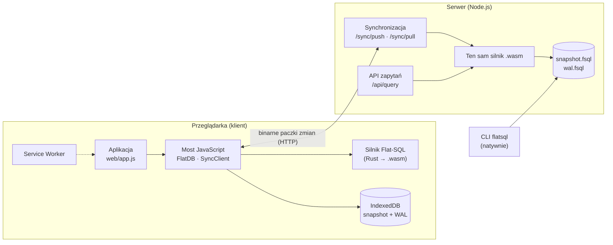
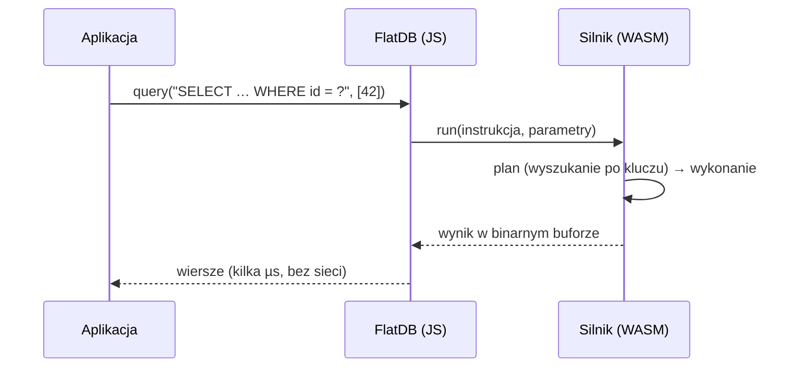
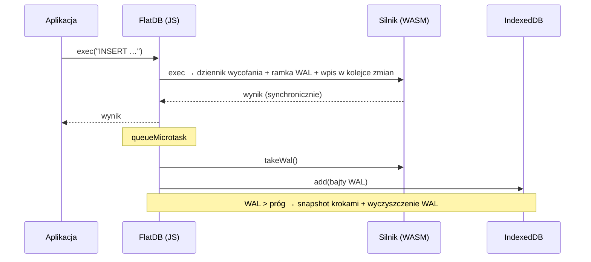
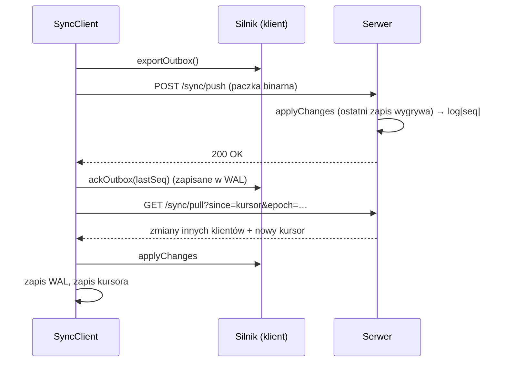

# Flat-SQL

Flat-SQL to silnik bazy danych SQL napisany w Rust i kompilowany do WebAssembly. Działa w przeglądarce, w Node.js i natywnie. Dane trzyma w pamięci urządzenia, zapisuje je przyrostowo (w IndexedDB albo w plikach) i synchronizuje w tle z serwerem. Aplikacja dostaje odpowiedź w mikrosekundach, bez czekania na sieć, i działa bez połączenia. Język to SQL ograniczony do jednej tabeli w zapytaniu: każda tabela ma klucz główny i nie ma złączeń.

Repozytorium zawiera silnik, most JavaScript, serwer synchronizacji, aplikację demonstracyjną, narzędzie pomiarowe z surowymi wynikami wszystkich pomiarów i opis badań.

## Od czego zacząć

1. Ten plik: cele, wyniki, architektura i uruchomienie.
2. [Rejestr decyzji](docs/adr/README.md): dlaczego silnik jest zbudowany tak, a nie inaczej. Decyzje 0001–0007 to założenia projektu.
3. [Wnioski z badań](docs/research/conclusions.md): co wyszło z pomiarów i co zostało słabe.
4. [Na później](docs/management/future.md): zadania, które rozwijają Flat-SQL w dojrzały produkt.
5. README modułu, nad którym pracujesz (tabela [Moduły](#moduły)).

## Cele produktu

1. Zapytania wykonywane lokalnie: odczyt i zapis kończą się w pamięci urządzenia, więc czas odpowiedzi nie zależy od sieci ([decyzja 0001](docs/adr/0001-zapytania-lokalne.md)).
2. Praca offline z synchronizacją w tle: zmiany czekają w kolejce na urządzeniu i trafiają na serwer, gdy wróci połączenie ([decyzja 0002](docs/adr/0002-local-first-z-serwerem.md)).
3. Dane domyślnie lokalne: nic nie opuszcza urządzenia, dopóki aplikacja nie włączy synchronizacji ([decyzja 0003](docs/adr/0003-dane-domyslnie-lokalne.md)).
4. Płaski model danych: jedno zapytanie dotyczy jednej tabeli, a plan jest prosty i widoczny w `EXPLAIN` ([decyzja 0004](docs/adr/0004-dialekt-bez-zlaczen.md)).
5. Jeden rdzeń wszędzie: ten sam kod, bez operacji wejścia/wyjścia i bez zależności, w przeglądarce, na serwerze i natywnie ([decyzja 0005](docs/adr/0005-rdzen-rust-bez-io.md)).

Flat-SQL ma być najlepszy w swojej kategorii: mała baza SQL na dane operacyjne aplikacji, działająca w przeglądarce bez konfiguracji. Nie konkuruje z silnikami analitycznymi ani z pełnym SQL baz serwerowych ([miejsce wśród innych baz](docs/research/engines-and-use-cases.md)).

## Najważniejsze wyniki

Benchmark 2, 28 października 2026: tabela 100 000 wierszy, Microsoft Edge 156 na laptopie z AMD Ryzen 5 4600H, mediana z 10 procesów. Prototyp i wersję po optymalizacjach zmierzono w tej samej sesji na przemian ([wyniki benchmarków](docs/research/benchmark-results.md)).

| Operacja | Prototyp | Po optymalizacjach | Krotność |
|---|---:|---:|---:|
| odczyt po kluczu | 8,78 µs | 3,28 µs | 2,7× |
| `COUNT(*)` po indeksie | 437 µs | 1,90 µs | 230× |
| pełny przegląd z warunkiem | 7,83 ms | 4,40 ms | 1,8× |
| `GROUP BY` (100 grup) | 15,6 ms | 9,38 ms | 1,7× |
| pobranie 10 000 wierszy | 11,4 ms | 1,55 ms | 7,3× |
| `UPDATE` 10% wierszy | 30,9 ms | 15,4 ms | 2,0× |
| odtworzenie bazy ze snapshotu | 115 ms | 46,4 ms | 2,5× |
| najdłuższa pauza checkpointu (IndexedDB) | 40,3 ms | 2,60 ms | 16× |
| trwałe zatwierdzenie jednego wiersza (IndexedDB) | 376 µs | 364 µs | bez zmian |

Na tle innych silników wersja po optymalizacjach jest szybsza od sql.js i oficjalnego SQLite WASM we wszystkich odczytach i ma najtańsze trwałe zatwierdzenie wśród silników zapisujących do IndexedDB. Wolniejsza jest w zapisach, w snapshocie i w odtwarzaniu bazy, bo SQLite kopiuje gotowe strony pliku. Pliki silnika mają po kompresji 287 KiB, najmniej wśród silników SQL w WebAssembly. Lokalny odczyt jest trzy do czterech rzędów wielkości szybszy niż przez serwer.

## Architektura



Silnik nie zapisuje niczego na dysk. Każda zatwierdzona transakcja zostaje zakodowana jako ramka dziennika zapisu (WAL) w buforze, a program, który osadza silnik, zapisuje te bajty do swojego magazynu. Dlatego ten sam rdzeń działa w przeglądarce, na serwerze i natywnie.

Zapytanie jest w całości lokalne i synchroniczne:



Zapis kończy się w pamięci, a WAL trafia do IndexedDB w najbliższym mikrozadaniu, jedną transakcją dla wszystkich zatwierdzeń z danej chwili:



Synchronizacja to powtarzalne rundy wysłania i pobrania zmian, które nie blokują aplikacji:



Przy starcie aplikacja wczytuje snapshot i odtwarza ramki WAL zapisane po nim; urwana końcówka WAL jest odrzucana. Kolejka zmian do wysłania odbudowuje się z WAL, więc przetrwa zamknięcie aplikacji offline.

## Moduły

| Moduł | Ścieżka | Odpowiedzialność |
|---|---|---|
| [Rdzeń silnika](crates/flatsql-core/README.md) | `crates/flatsql-core/` | planowanie i wykonanie zapytań, transakcje, WAL, synchronizacja; Rust bez zależności |
| ↳ [język Flat-SQL](crates/flatsql-core/src/sql/README.md) | `crates/flatsql-core/src/sql/` | lekser, parser i specyfikacja języka |
| ↳ [składowanie](crates/flatsql-core/src/storage/README.md) | `crates/flatsql-core/src/storage/` | snapshot, WAL, magazyny, formaty binarne |
| ↳ [testy rdzenia](crates/flatsql-core/tests/README.md) | `crates/flatsql-core/tests/` | testy trwałości, zbieżności i semantyki zapytań |
| [Wiązania WebAssembly](crates/flatsql-wasm/README.md) | `crates/flatsql-wasm/` | API silnika dla JavaScriptu, przekazywanie wyników |
| [CLI](crates/flatsql-cli/README.md) | `crates/flatsql-cli/` | powłoka `flatsql`, bazy w plikach, benchmark natywny |
| [Most JavaScript](bridge/README.md) | `bridge/` | `FlatDB`, `SyncClient`, magazyny IndexedDB, plikowy i w pamięci, typy TypeScript |
| [Serwer synchronizacji](server/README.md) | `server/` | synchronizacja, API zapytań, udostępnianie aplikacji demonstracyjnej |
| [Aplikacja demonstracyjna](web/README.md) | `web/` | konsola SQL, panel synchronizacji, praca offline |
| [Testy end-to-end](test/README.md) | `test/` | moduł, most i serwer razem, scenariusze offline |
| [Narzędzie pomiarowe](bench/README.md) | `bench/` | benchmarki i instrukcja odtworzenia badań |

`pkg/` powstaje przy budowaniu i zawiera moduł WebAssembly z kodem wiązań.

## Szybki start

Wymagania: [Rust](https://rustup.rs) (wersję i cel WebAssembly ustawia `rust-toolchain.toml`), [wasm-pack](https://rustwasm.github.io/wasm-pack/) i [Node.js](https://nodejs.org) 22 lub nowszy; w Windows także Build Tools for Visual Studio.

```bash
npm install
```

```bash
npm run build
```

```bash
npm start
```

`npm run build` kompiluje silnik do `pkg/`, a `npm start` uruchamia serwer z aplikacją demonstracyjną pod adresem <http://127.0.0.1:8080>. Testy:

```bash
cargo test --workspace
```

```bash
npm test
```

Użycie w kodzie aplikacji:

```js
import { FlatDB, SyncClient } from './bridge/index.js';

const db = await FlatDB.open({ name: 'my-app' }); // w przeglądarce domyślnie IndexedDB
db.exec('CREATE TABLE IF NOT EXISTS notes (id INT PRIMARY KEY, body TEXT)');
db.exec("INSERT INTO notes VALUES (1, 'pierwsza notatka')");
const rows = db.query('SELECT body FROM notes WHERE id = ?', [1]); // synchronicznie

await new SyncClient(db, { url: 'https://example.org' }).start(); // synchronizacja w tle
```

Opcje magazynu, trwałości i synchronizacji opisuje [most JavaScript](bridge/README.md), a język [specyfikacja Flat-SQL](crates/flatsql-core/src/sql/README.md).

## Odtworzenie badań

[bench/README.md](bench/README.md) opisuje krok po kroku trzy poziomy sprawdzenia wyników: odtworzenie wszystkich tabel i wykresów z zapisanych surowych wyników (kilka sekund, tylko Node.js), pomiar kontrolny (około minuty) i pełne powtórzenie Benchmarku 1 i 2 na dwóch wersjach silnika, `v1-prototyp` i `v2-optymalizacja`.

## Dokumentacja

| Pytanie | Dokument |
|---|---|
| Jak działa silnik i z czego się składa? | README modułów (tabela wyżej) |
| Dlaczego tak go zaprojektowano? | [rejestr decyzji](docs/adr/README.md) |
| Na jakiej literaturze się opiera? | [literatura a budowa Flat-SQL](docs/references/literature.md), [spis literatury](docs/references/README.md) |
| Jakie są inne bazy w przeglądarce i do czego służą? | [Flat-SQL wśród innych baz](docs/research/engines-and-use-cases.md) |
| Jak mierzono i jakie są wyniki? | [metodyka](docs/research/benchmark-scenario.md), [benchmarki](docs/research/benchmark-results.md), [optymalizacje](docs/research/optimization-results.md) |
| Co z tego wynika? | [wnioski z badań](docs/research/conclusions.md) |
| Czy silnik dotrzymuje gwarancji trwałości i zbieżności? | [testy](docs/testing/README.md) |
| Co zrobiono i co dalej? | [zrobione](docs/management/done.md), [na później](docs/management/future.md) |
| Jaki był pierwotny pomysł na produkt? | [prezentacja projektu](docs/presentation/v1.pdf) |

## Ograniczenia

- Cała baza jest w pamięci, więc musi się w niej zmieścić (moduł ma najwyżej 4 GiB).
- Konflikty rozstrzyga reguła „ostatni zapis wygrywa” dla całego wiersza. Współbieżne zmiany różnych kolumn jednego wiersza nie są scalane, a unikalność klucza głównego jest sprawdzana tylko lokalnie.
- Serwer synchronizacji to prototyp: jedna baza dla wszystkich klientów, log tylko w pamięci, brak uwierzytelniania. Nasłuchuje tylko na `127.0.0.1`.
- Zapisuje jedna karta przeglądarki; kolejne pracują na kopii w pamięci.
- Dane w przeglądarce nie są szyfrowane.
- Język nie ma `CASE`, podzapytań, złączeń ani indeksów wielokolumnowych. Złączenia są poza modelem z definicji.
- Otwarcie bazy 100 000 wierszy z IndexedDB trwa około 80 ms jednym blokiem.

## Słowniczek

| Pojęcie | Znaczenie |
|---|---|
| WebAssembly (WASM) | format kodu wykonywanego przez przeglądarkę i Node.js z szybkością bliską kodu natywnego; Flat-SQL kompiluje się do niego z Rust |
| Local-First | aplikacja trzyma dane na urządzeniu, działa bez sieci, a serwer służy do synchronizacji i kopii |
| IndexedDB | wbudowana w przeglądarkę baza klucz–wartość na dysku; Flat-SQL zapisuje w niej WAL i snapshot |
| OPFS | prywatny system plików strony w przeglądarce; szybki dostęp ma tylko z Web Workera |
| Web Worker | osobny wątek strony, który komunikuje się z wątkiem głównym wiadomościami |
| WAL | dziennik zapisu z wyprzedzeniem: zatwierdzone zmiany dopisywane na końcu pliku, z którego po awarii odtwarza się stan |
| snapshot, checkpoint | snapshot to pełny obraz bazy z danej chwili; checkpoint zapisuje snapshot i czyści WAL |
| zatwierdzanie grupowe | zapis wielu zatwierdzeń naraz jedną operacją na dysku (ang. *group commit*) |
| `fsync` | wymuszenie fizycznego zapisu danych z bufora systemu na dysk |
| kolejka zmian (outbox) | lokalne zmiany czekające na wysłanie do serwera |
| zegar hybrydowy (HLC) | czas fizyczny połączony z licznikiem; nigdy się nie cofa i daje znaczniki zmian |
| „ostatni zapis wygrywa” (LWW) | reguła rozstrzygania konfliktów: z dwóch zmian tego samego wiersza zostaje ta z późniejszym znacznikiem |
| znacznik usunięcia | zapamiętany znacznik usuniętego wiersza, który chroni przed jego przywróceniem przez spóźnioną zmianę (ang. *tombstone*) |
| CRDT | typ danych, którego repliki zawsze dochodzą do tego samego stanu bez koordynacji |
| replikacja częściowa | klient przechowuje tylko potrzebną mu część bazy |
| granica JavaScript–WebAssembly | koszt przekazywania parametrów i wyników między JavaScriptem a modułem WebAssembly |
| nagłówki izolacji (COOP i COEP) | nagłówki HTTP, które izolują stronę; wymagane między innymi przez wątki WebAssembly |

## Prawa autorskie

© 2026 Patryk Piotrowski. Wszelkie prawa zastrzeżone.

Repozytorium nie ma licencji. Kod i dokumentację można przeglądać. Kopiowanie, używanie i rozwijanie wymaga zgody autora, także przy kontynuacji projektu w innej pracy dyplomowej. O zgodę można poprosić w zgłoszeniu na GitHubie.
