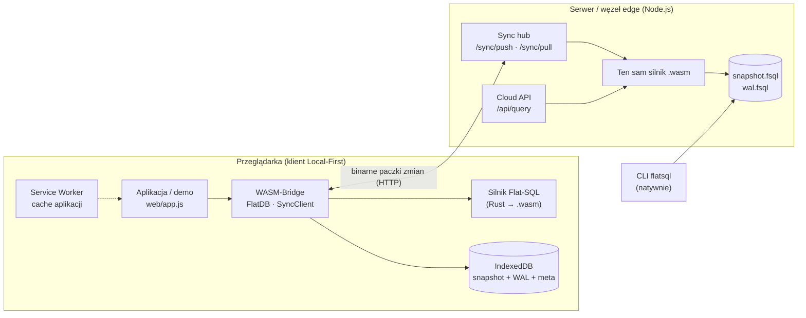
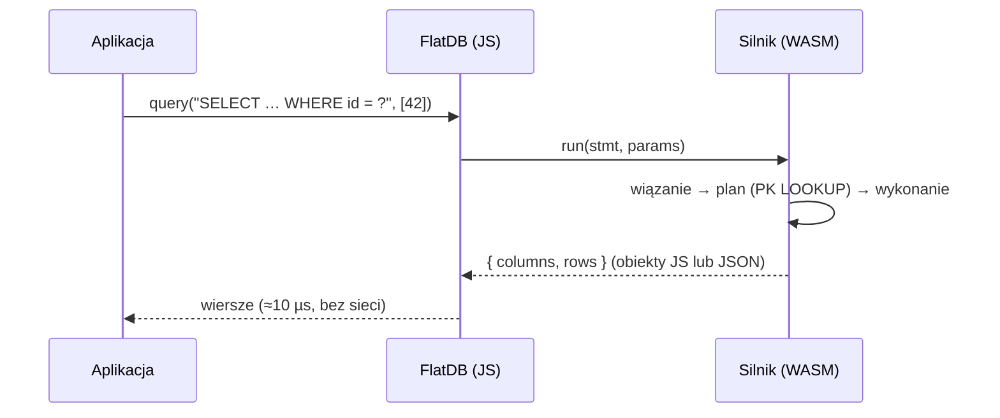
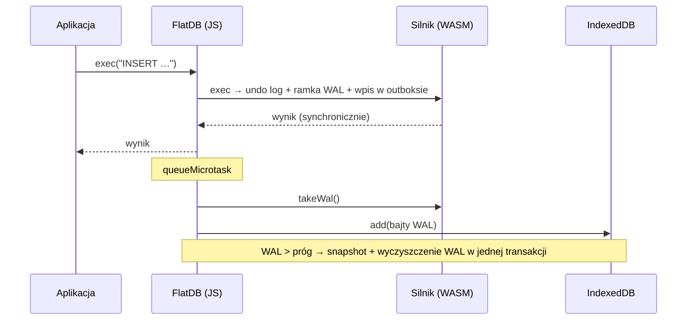
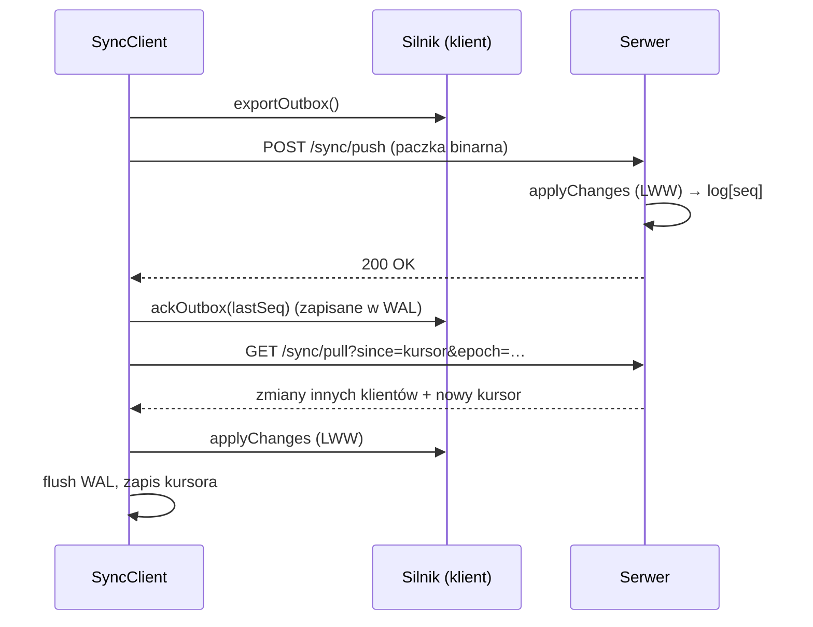

# Flat-SQL – silnik bazy danych SQL w Rust kompilowany do WebAssembly

Prototyp silnika bazy danych realizującego paradygmat **Edge Computing / Local-First**: zapytania SQL wykonują się bezpośrednio na urządzeniu użytkownika (w przeglądarce lub na węźle brzegowym) jako moduł WebAssembly, dane są trwale zapisywane lokalnie (IndexedDB, pliki), a stan jest asynchronicznie synchronizowany z serwerem, gdy sieć jest dostępna.

- **Latencja ~0 ms** – zapytanie po kluczu głównym trwa ok. 10 µs lokalnie, wobec 20–100 ms przy architekturze Cloud-First ([wyniki](docs/research/benchmark-results.md)).
- **Privacy by Design** – dane są przetwarzane w izolowanym środowisku przeglądarki; na serwer trafiają tylko zmiany, które aplikacja sama synchronizuje.
- **Local-First** – pełna funkcjonalność offline (Service Worker + IndexedDB), trwały outbox zmian, synchronizacja z rozwiązywaniem konfliktów (last-writer-wins na zegarze hybrydowym).
- **Flat-SQL** – autorski dialekt: składnia SQL, model danych NoSQL (płaskie tabele adresowane kluczem, bez JOIN-ów i relacji).

> Projekt inżynierski: „Projekt i implementacja silnika bazy danych SQL kompilowanego do WebAssembly z panelem administracyjnym w WinUI”. Ten etap obejmuje: analizę porównawczą silników baz danych WASM i scenariusz badawczy, implementację warstwy lokalnego składowania danych, benchmarki wydajnościowe oraz walidację architektury Local-First w warunkach offline. Panel WinUI jest kolejnym etapem (patrz [Dalsze prace](#ograniczenia-i-dalsze-prace)).

## Spis treści

- [Co jest zaimplementowane](#co-jest-zaimplementowane)
- [Szybki start](#szybki-start)
- [Korzystanie](#korzystanie)
- [Architektura](#architektura)
- [Przepływ danych](#przepływ-danych)
- [Struktura repozytorium](#struktura-repozytorium)
- [Wyniki badań w skrócie](#wyniki-badań-w-skrócie)
- [Ograniczenia i dalsze prace](#ograniczenia-i-dalsze-prace)
- [Dokumentacja](#dokumentacja)

## Co jest zaimplementowane

| Obszar | Zawartość |
|---|---|
| Rdzeń silnika (`crates/flatsql-core`) | lekser i parser Flat-SQL, typy `INT/FLOAT/TEXT/BOOL`, logika trójwartościowa SQL, funkcje skalarne i agregujące, planer zapytań (PK lookup, indeks, zakresy, full scan, `EXPLAIN`), transakcje z undo logiem, prepared statements – bez zależności zewnętrznych |
| Warstwa składowania | WAL (jedna ramka z CRC32 na transakcję), snapshoty (checkpoint), odtwarzanie po awarii odporne na urwane zapisy, backend plikowy i pamięciowy; w przeglądarce IndexedDB z group commitem |
| Synchronizacja | zegar hybrydowy (HLC), LWW per wiersz z tombstone'ami, outbox odtwarzany z WAL, binarne paczki zmian, serwer z logiem i kompaktowaniem |
| WASM-Bridge (`crates/flatsql-wasm`, `bridge/`) | wiązania `wasm-bindgen`, API JavaScript (`FlatDB`, `SyncClient`, magazyny IndexedDB/pamięć/pliki), typy TypeScript |
| Serwer (`server/`) | ten sam silnik WASM w Node.js (tryb edge): hub synchronizacji, API zapytań „cloud” z symulowaną latencją, hosting dema |
| Demo (`web/`) | konsola SQL w przeglądarce, panel synchronizacji i trybu offline, Service Worker, benchmark w przeglądarce |
| CLI (`crates/flatsql-cli`) | interaktywna powłoka `flatsql`, bazy plikowe, natywny benchmark |
| Badania (`bench/`, `docs/research/`) | porównanie Flat-SQL (WASM i natywnie), SQLite (sql.js) i czystego JS; Local-First vs Cloud-First; trwałość zapisów w przeglądarce |
| Testy | 82 testy w Rust (w tym odtwarzanie po ucięciu WAL w każdym bajcie i losowe sesje offline wielu replik) + 14 testów end-to-end w Node (scenariusze offline z prawdziwym serwerem) |

## Szybki start

### Wymagania

- [Rust](https://rustup.rs) (stable) z targetem WebAssembly: `rustup target add wasm32-unknown-unknown`
- [wasm-pack](https://rustwasm.github.io/wasm-pack/) (`cargo install wasm-pack`)
- [Node.js](https://nodejs.org) 22 lub nowszy

Na Windows potrzebne są też Build Tools for Visual Studio (linker MSVC).

### Budowanie i uruchomienie

```bash
npm install
```

```bash
npm run build
```

```bash
npm start
```

`npm run build` kompiluje silnik do `pkg/` (moduł `.wasm` + kod JS z `wasm-bindgen`). `npm start` uruchamia serwer pod adresem <http://127.0.0.1:8080>: aplikację demo, synchronizację i API zapytań. Dane serwera można zapisywać na dysku:

```bash
npm run start:persistent
```

### Testy

```bash
cargo test --workspace
```

```bash
npm test
```

### Benchmarki

```bash
npm run bench
```

```bash
npm run bench:full
```

`bench` porównuje silniki w Node.js (domyślnie 100 000 wierszy, opcje: `--rows N`, `--engines flatsql,json,sqljs,js`, `--no-network`, `--md plik.md`). `bench:full` dodatkowo buduje i uruchamia wersję natywną (narzut WebAssembly). Wersja przeglądarkowa jest dostępna w demo pod <http://127.0.0.1:8080/bench.html>. Metodyka: [docs/research/benchmark-scenario.md](docs/research/benchmark-scenario.md).

## Korzystanie

### Aplikacja demo

1. `npm run build && npm start`, otwórz <http://127.0.0.1:8080>.
2. Kliknij **Dane: ekwipunek gry** (2000 przedmiotów w jednej transakcji) i wybierz zapytanie z listy **Przykłady** – czas wykonania jest pokazywany w mikrosekundach.
3. Zaznacz **Symuluj brak sieci**, wykonaj kilka `INSERT`/`UPDATE` – zmiany czekają w outboksie; po odznaczeniu zostają wysłane.
4. Test prawdziwego offline: zatrzymaj serwer (`Ctrl+C`), odśwież stronę – aplikacja startuje z cache Service Workera, dane wczytuje z IndexedDB, zapisy działają. Po ponownym `npm start` oczekujące zmiany są automatycznie wysłane.
5. Otwórz stronę w drugiej przeglądarce lub oknie prywatnym, aby zobaczyć replikację między klientami.

### JavaScript (WASM-Bridge)

```js
import { FlatDB, IndexedDbStore, SyncClient } from './bridge/index.js';

const db = await FlatDB.open({ store: new IndexedDbStore('my-app') });

db.exec(`CREATE TABLE IF NOT EXISTS inventory (
  id INT PRIMARY KEY, player TEXT NOT NULL, item TEXT, qty INT)`);
db.exec("INSERT INTO inventory VALUES (1, 'ayla', 'sword', 1)");

const rows = db.query('SELECT item, qty FROM inventory WHERE player = ?', ['ayla']);
// [{ item: 'sword', qty: 1 }] – synchronicznie, bez sieci

await db.flush();                       // zmiany są trwałe w IndexedDB

const sync = new SyncClient(db, { url: 'https://example.org' });
await sync.start();                     // wysyła outbox / pobiera zmiany w tle
```

W Node.js zamiast `bridge/index.js` importuje się `bridge/node.js` (ładuje plik `.wasm` z dysku i udostępnia `FsStore`). Pełne API: [bridge/index.d.ts](bridge/index.d.ts).

### CLI

```bash
cargo run --release -p flatsql-cli -- moja-baza
```

```text
flatsql> CREATE TABLE notes (id INT PRIMARY KEY, body TEXT);
flatsql> INSERT INTO notes VALUES (1, 'zażółć gęślą jaźń');
flatsql> EXPLAIN SELECT * FROM notes WHERE id = 1;
flatsql> .stats
```

Katalog bazy zawiera `snapshot.fsql` i `wal.fsql` – ten sam format, który zapisuje serwer Node (`--data`), więc bazę serwera można otworzyć w CLI. Opcje: `-e SQL`, `-f plik.sql`, `--no-fsync`, `flatsql bench`.

### Rust

```rust
use flatsql_core::Database;

let mut db = Database::new(1);
db.execute("CREATE TABLE items (id INT PRIMARY KEY, name TEXT, qty INT)")?;
db.execute("INSERT INTO items VALUES (1, 'sword', 1), (2, 'potion', 5)")?;
let result = db.execute("SELECT name FROM items WHERE qty > 2")?;
let wal_bytes = db.take_wal();      // do zapisania przez hosta
```

## Architektura



Silnik nie wykonuje żadnych operacji wejścia/wyjścia. Każda zatwierdzona transakcja zostaje zakodowana jako ramka WAL w buforze, a host (JavaScript w przeglądarce, `Persistent` w Rust) zapisuje te bajty do swojego magazynu. Dzięki temu ten sam rdzeń działa w przeglądarce, w Node.js, na węźle brzegowym i natywnie (np. pod panelem WinUI).

| Warstwa | Odpowiedzialność |
|---|---|
| `sql` | tokenizacja, parser rekurencyjny zstępujący, AST |
| `expr` | wiązanie nazw kolumn, zwijanie stałych, ewaluacja (szybka ścieżka dla kolumn i literałów, osobny ewaluator predykatów) |
| `plan` | wybór ścieżki dostępu z koniunkcji `WHERE`, opis do `EXPLAIN` |
| `exec` | SELECT (strumieniowo, top-k, grupowanie), INSERT/UPDATE/DELETE, DDL |
| `db` | katalog tabel, transakcje (undo log, atomowość instrukcji), produkcja WAL, odtwarzanie, API synchronizacji |
| `table` | wiersze w `BTreeMap` po kluczu głównym, indeksy wtórne, tombstone'y |
| `storage` | kodek binarny, ramki WAL, snapshot, `Storage` (plik, pamięć), `Persistent` |
| `sync` | HLC, zmiany, paczki, outbox |

Szczegóły, formaty plików i decyzje projektowe: [docs/architecture.md](docs/architecture.md).

## Przepływ danych

**Zapytanie** – w całości lokalne i synchroniczne:



**Zapis i trwałość** – zapis kończy się w pamięci, WAL trafia do IndexedDB w najbliższym mikrozadaniu jedną transakcją IndexedDB dla wszystkich zatwierdzeń z danej chwili (group commit):



**Synchronizacja** – idempotentne rundy push/pull, bez blokowania aplikacji:



**Start aplikacji / odtwarzanie** – snapshot + odtworzenie ramek WAL o LSN większym niż w snapshocie; urwana końcówka WAL (zamknięta karta, awaria) jest odrzucana i od razu sprzątana checkpointem. Outbox (zmiany jeszcze niewysłane) jest odbudowywany z WAL, więc przetrwa zamknięcie aplikacji w trybie offline.

## Struktura repozytorium

```text
crates/
  flatsql-core/      rdzeń silnika (Rust, bez zależności)
  flatsql-wasm/      wiązania wasm-bindgen
  flatsql-cli/       powłoka flatsql i natywny benchmark
bridge/              WASM-Bridge: FlatDB, SyncClient, magazyny, typy TS
server/              serwer synchronizacji / edge / cloud API (Node.js)
web/                 aplikacja demo, Service Worker, benchmark w przeglądarce
bench/               scenariusz benchmarku, adaptery silników, runner Node
test/                testy end-to-end (node:test)
docs/                architektura, specyfikacja Flat-SQL, badania
pkg/                 (generowane) wynik npm run build
```

## Wyniki badań w skrócie

100 000 wierszy, AMD Ryzen 5 4600H, Windows 11, Node.js 22 (pełne tabele i przeglądarka: [docs/research/benchmark-results.md](docs/research/benchmark-results.md)).

| Pomiar | Flat-SQL (WASM) | SQLite (sql.js) | Flat-SQL natywnie |
|---|---:|---:|---:|
| PK lookup (prepared) | 9,7 µs | 20,3 µs | 2,3 µs |
| GROUP BY (100 grup) | 26,4 ms | 130,3 ms | 15,1 ms |
| ORDER BY … LIMIT 10 | 7,1 ms | 10,6 ms | 6,5 ms |
| Lookup po indeksie + COUNT | 573 µs | 100 µs | 442 µs |
| Insert (1 transakcja) | 180 tys. wierszy/s | 291 tys. wierszy/s | 447 tys. wierszy/s |
| Rozmiar modułu (gzip) | 206 KiB | 315 KiB | – |

| PK lookup | średnio |
|---|---:|
| lokalnie (WASM w procesie) | 0,011 ms |
| cloud API, localhost | 0,63 ms |
| cloud API, RTT 20 / 50 / 100 ms | 20,9 / 52,3 / 102,5 ms |

W przeglądarce trwałe zatwierdzenie pojedynczej transakcji (WAL → IndexedDB) trwa ok. 0,34 ms, wobec 8,7 ms przy podejściu sql.js (eksport całej bazy 50 tys. wierszy po każdej zmianie).

## Ograniczenia i dalsze prace

- **Panel WinUI 3** (C#) – kolejny etap: komunikacja z silnikiem przez FFI (biblioteka `cdylib` z interfejsem C) lub named pipes; rdzeń jest już niezależny od środowiska.
- Dane są w całości w pamięci (model przeglądarkowego „working set”); bardzo duże zbiory wymagałyby stronicowanego magazynu (np. OPFS w Web Workerze).
- Wiersze jako osobne alokacje w `BTreeMap` – wolniejsze od stronicowego formatu SQLite przy odtwarzaniu snapshotu i lookupach przez indeks; kierunki optymalizacji opisane w wynikach badań.
- Synchronizacja LWW per wiersz (bez scalania pól), zmiany schematu replikowane w uproszczony sposób, brak uwierzytelniania na serwerze (prototyp, nasłuch na `127.0.0.1`).
- Flat-SQL: brak `CASE`, podzapytań i indeksów złożonych/unikalnych – zgodnie z założeniem „płaskiego” modelu część z nich nie jest planowana.

## Dokumentacja

- [Architektura i formaty danych](docs/architecture.md)
- [Specyfikacja Flat-SQL](docs/flat-sql.md)
- [Analiza porównawcza silników baz danych WASM](docs/research/wasm-engines-comparison.md)
- [Scenariusz badawczy i metodyka benchmarków](docs/research/benchmark-scenario.md)
- [Wyniki benchmarków i walidacji offline](docs/research/benchmark-results.md)
- [Prezentacja projektu](docs/ProductPresentation.pdf)
