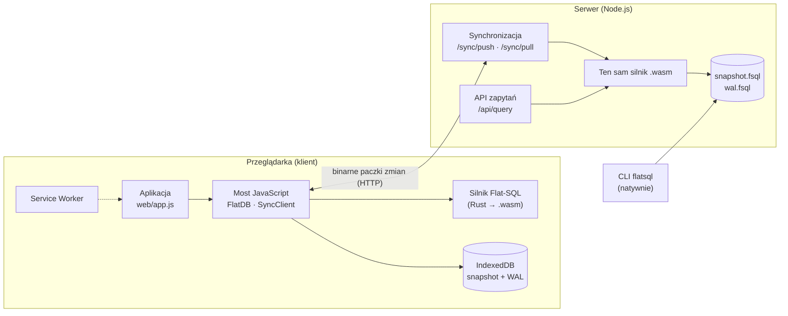
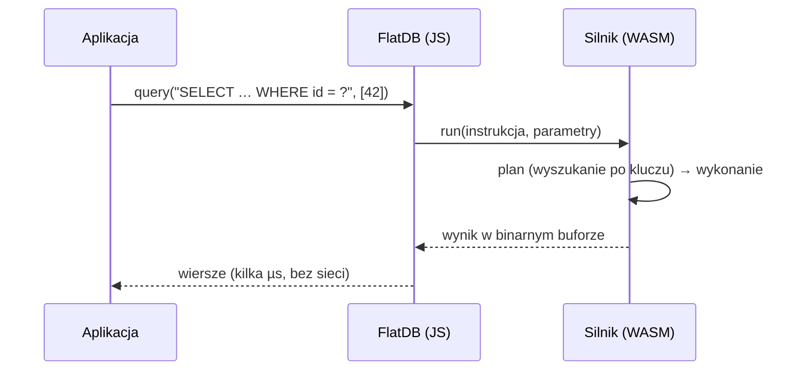
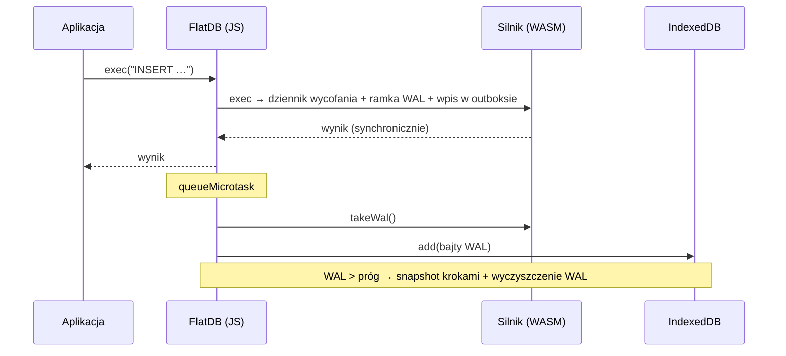
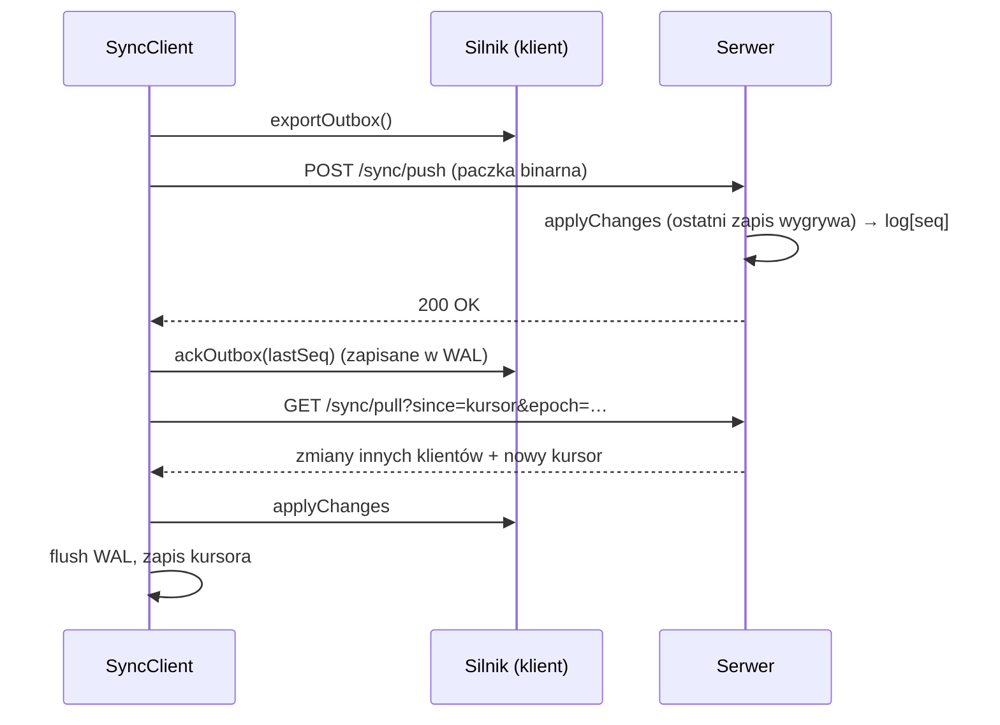

# Flat-SQL

Flat-SQL to silnik bazy danych SQL napisany w Rust i kompilowany do WebAssembly. Działa w przeglądarce, w Node.js i natywnie, a dane trzyma w pamięci urządzenia, zapisuje je przyrostowo (w IndexedDB albo w plikach) i synchronizuje w tle z serwerem. Aplikacja dostaje odpowiedź w mikrosekundach, bez czekania na sieć, i działa bez połączenia. Język to SQL ograniczony do jednej tabeli na zapytanie: każda tabela ma klucz główny i nie ma złączeń.

Repozytorium zawiera silnik, most JavaScript, serwer synchronizacji, aplikację demonstracyjną, narzędzie pomiarowe z surowymi wynikami wszystkich pomiarów i opis badań.

## Spis treści

- [Cele produktu](#cele-produktu)
- [Najważniejsze wyniki](#najważniejsze-wyniki)
- [Architektura](#architektura)
- [Moduły](#moduły)
- [Szybki start](#szybki-start)
- [Odtworzenie badań](#odtworzenie-badań)
- [Dokumentacja](#dokumentacja)
- [Ograniczenia](#ograniczenia)
- [Słowniczek](#słowniczek)

## Cele produktu

1. Zapytania wykonywane lokalnie: odczyt i zapis kończą się w pamięci urządzenia, więc czas odpowiedzi nie zależy od sieci ([ADR-0001](docs/adr/0001-zapytania-lokalne-bez-serwera.md)).
2. Praca offline z synchronizacją w tle: zmiany czekają w kolejce na urządzeniu i trafiają na serwer, gdy wróci połączenie; serwer koordynuje repliki ([ADR-0002](docs/adr/0002-local-first-z-serwerem-koordynujacym.md)).
3. Dane domyślnie lokalne: nic nie opuszcza urządzenia, dopóki aplikacja nie włączy synchronizacji ([ADR-0003](docs/adr/0003-privacy-by-design-dane-domyslnie-lokalne.md)).
4. Płaski model danych: tabela adresowana kluczem, jedno zapytanie dotyczy jednej tabeli, plan jest prosty i widoczny w `EXPLAIN` ([ADR-0004](docs/adr/0004-dialekt-flat-sql-bez-zlaczen.md)).
5. Jeden rdzeń wszędzie: ten sam kod bez operacji wejścia/wyjścia i bez zależności w przeglądarce, na serwerze i natywnie ([ADR-0005](docs/adr/0005-rdzen-rust-bez-io-i-zaleznosci.md)).

Silnik ma być najlepszy w swojej kategorii: mała baza SQL na dane operacyjne aplikacji, działająca w przeglądarce bez konfiguracji. Nie konkuruje z silnikami analitycznymi ani z pełnym SQL baz serwerowych ([zastosowania](docs/research/use-cases.md)).

## Najważniejsze wyniki

Benchmark 2, 28 października 2026: tabela 100 000 wierszy, Microsoft Edge 156 na laptopie z AMD Ryzen 5 4600H, mediana z 10 procesów, wynik jako obiekty JavaScript. Prototyp i wersję po optymalizacjach zmierzono w tej samej sesji na przemian ([benchmark-results.md](docs/research/benchmark-results.md)).

| Operacja | Prototyp | Po optymalizacjach | Krotność |
|---|---:|---:|---:|
| odczyt po kluczu | 8,78 µs | 3,28 µs | 2,7× |
| `COUNT(*)` po indeksie | 437 µs | 1,90 µs | 230× |
| pełny przegląd z filtrem | 7,83 ms | 4,40 ms | 1,8× |
| `GROUP BY` (100 grup) | 15,6 ms | 9,38 ms | 1,7× |
| pobranie 10 000 wierszy | 11,4 ms | 1,55 ms | 7,3× |
| `UPDATE` 10% wierszy | 30,9 ms | 15,4 ms | 2,0× |
| odtworzenie bazy ze snapshotu | 115 ms | 46,4 ms | 2,5× |
| najdłuższa pauza checkpointu (IndexedDB) | 40,3 ms | 2,60 ms | 16× |
| trwałe zatwierdzenie jednego wiersza (IndexedDB) | 376 µs | 364 µs | bez zmian |

Na tle silników z Benchmarku 1 wersja po optymalizacjach jest szybsza od sql.js i oficjalnego SQLite WASM we wszystkich odczytach (od 1,6 raza w pełnym przeglądzie do 33–36 razy w `COUNT(*)` po indeksie) i ma najtańsze trwałe zatwierdzenie w grupie trwałego zapisu. Wolniejsza jest we wstawianiu (1,28 raza wobec sql.js), w `UPDATE` (do 1,75 raza), w snapshocie (7–15 razy) i odtworzeniu bazy (29–39 razy), bo SQLite kopiuje strony pliku. Pliki silnika pobierane przy starcie strony mają po kompresji 287 KiB, najmniej wśród silników SQL w WebAssembly. Lokalny odczyt po kluczu z tekstem SQL trwa około 10–14 µs, a ten sam odczyt przez serwer z opóźnieniem sieci 20–100 ms trwa tyle co opóźnienie, czyli trzy do czterech rzędów wielkości dłużej. W WebAssembly operacje wykonywane w całości w silniku są tak szybkie jak natywnie; narzut leży tylko na granicy z JavaScriptem.

## Architektura



Silnik nie wykonuje operacji wejścia/wyjścia. Każda zatwierdzona transakcja zostaje zakodowana jako ramka dziennika zapisu z wyprzedzeniem (WAL) w buforze, a host (most JavaScript w przeglądarce i Node.js, `Persistent` w Rust) zapisuje te bajty do swojego magazynu. Dlatego ten sam rdzeń działa w przeglądarce, na serwerze i natywnie.

Zapytanie jest w całości lokalne i synchroniczne:



Zapis kończy się w pamięci, a WAL trafia do IndexedDB w najbliższym mikrozadaniu, jedną transakcją dla wszystkich zatwierdzeń z danej chwili:



Synchronizacja to idempotentne rundy wysłania i pobrania zmian, które nie blokują aplikacji:



Przy starcie aplikacja wczytuje snapshot i odtwarza ramki WAL o numerze większym niż w snapshocie; urwana końcówka WAL jest odrzucana. Kolejka zmian do wysłania (outbox) odbudowuje się z WAL, więc przetrwa zamknięcie aplikacji offline.

## Moduły

| Moduł | Ścieżka | Odpowiedzialność |
|---|---|---|
| [Rdzeń silnika](crates/flatsql-core/README.md) | `crates/flatsql-core/` | planowanie i wykonanie zapytań, transakcje, WAL, synchronizacja; Rust bez zależności |
| ↳ [język Flat-SQL](crates/flatsql-core/src/sql/README.md) | `crates/flatsql-core/src/sql/` | lekser, parser i specyfikacja języka |
| ↳ [składowanie](crates/flatsql-core/src/storage/README.md) | `crates/flatsql-core/src/storage/` | snapshot, WAL, magazyny, formaty binarne |
| ↳ [testy rdzenia](crates/flatsql-core/tests/README.md) | `crates/flatsql-core/tests/` | testy trwałości, zbieżności replik i semantyki zapytań |
| [Wiązania WebAssembly](crates/flatsql-wasm/README.md) | `crates/flatsql-wasm/` | API silnika dla JavaScriptu, przekazywanie wyników |
| [CLI](crates/flatsql-cli/README.md) | `crates/flatsql-cli/` | powłoka `flatsql`, bazy w plikach, benchmark natywny |
| [Most JavaScript](bridge/README.md) | `bridge/` | `FlatDB`, `SyncClient`, magazyny IndexedDB, plikowy i w pamięci, typy TypeScript |
| [Serwer synchronizacji](server/README.md) | `server/` | synchronizacja, API zapytań, serwowanie demo |
| [Aplikacja demonstracyjna](web/README.md) | `web/` | konsola SQL, panel synchronizacji, praca offline |
| [Testy end-to-end](test/README.md) | `test/` | moduł, most i serwer razem, scenariusze offline |
| [Narzędzie pomiarowe](bench/README.md) | `bench/` | benchmarki i instrukcja odtworzenia badań |
| [Dokumentacja](#dokumentacja) | `docs/` | badania, literatura, decyzje projektowe, kierunki rozwoju |

`pkg/` powstaje przy budowaniu i zawiera moduł WebAssembly z kodem wiązań.

## Szybki start

Wymagania: [Rust](https://rustup.rs) (wersję i cel WebAssembly ustawia `rust-toolchain.toml`), [wasm-pack](https://rustwasm.github.io/wasm-pack/) i [Node.js](https://nodejs.org) 22 lub nowszy; w Windows także Build Tools for Visual Studio. Wersje użyte w pomiarach: [bench/README.md](bench/README.md#wymagania).

```bash
npm install
```

```bash
npm run build
```

```bash
npm start
```

`npm run build` kompiluje silnik do `pkg/`, a `npm start` uruchamia serwer z aplikacją demonstracyjną pod adresem <http://127.0.0.1:8080> ([scenariusz demonstracji](web/README.md#scenariusz-demonstracji)). Testy:

```bash
cargo test --workspace
```

```bash
npm test
```

Użycie w kodzie aplikacji:

```js
import { FlatDB, SyncClient } from './bridge/index.js';

const db = await FlatDB.open({ name: 'my-app' }); // w przeglądarce domyślnie IndexedDB
db.exec('CREATE TABLE IF NOT EXISTS notes (id INT PRIMARY KEY, body TEXT)');
db.exec("INSERT INTO notes VALUES (1, 'pierwsza notatka')");
const rows = db.query('SELECT body FROM notes WHERE id = ?', [1]); // synchronicznie

await new SyncClient(db, { url: 'https://example.org' }).start(); // synchronizacja w tle
```

Opcje magazynu, trwałości i synchronizacji: [bridge/README.md](bridge/README.md); język: [sql/README.md](crates/flatsql-core/src/sql/README.md); CLI i Rust: [flatsql-cli](crates/flatsql-cli/README.md), [flatsql-core](crates/flatsql-core/README.md#interfejs).

## Odtworzenie badań

[bench/README.md](bench/README.md) opisuje krok po kroku trzy poziomy sprawdzenia wyników: odtworzenie wszystkich tabel i wykresów z zapisanych surowych wyników (kilka sekund, tylko Node.js), pomiar kontrolny (około minuty) i pełne powtórzenie Benchmarku 1 i 2 na dwóch wersjach silnika, `v1-prototyp` i `v2-optymalizacja`.

## Dokumentacja

| Pytanie | Dokument |
|---|---|
| Jak działa silnik i z czego się składa? | README modułów (tabela wyżej) |
| Dlaczego tak go zaprojektowano? | [rejestr decyzji projektowych (ADR)](docs/adr/README.md) |
| Jakie są inne silniki baz w WebAssembly i dlaczego te wybrano do porównania? | [analiza porównawcza](docs/research/wasm-engines-comparison.md) |
| Jak mierzono? | [scenariusz badawczy i metodyka](docs/research/benchmark-scenario.md) |
| Jakie są wyniki pomiarów? | [Benchmark 1 i 2](docs/research/benchmark-results.md), [pojedyncze optymalizacje](docs/research/optimization-results.md) |
| Czy silnik dotrzymuje gwarancji trwałości i zbieżności? | [metodyka testów](docs/research/tests-methodology.md), [wyniki testów](docs/research/tests-results.md) |
| Jak projekt wypada na tle literatury? | [Flat-SQL na tle literatury](docs/references/literature.md), [indeks literatury](docs/references/README.md) |
| Do czego się nadaje, a do czego nie? | [zastosowania](docs/research/use-cases.md) |
| Co dalej? | [kierunki rozwoju](docs/future/README.md) |
| Jaki był pierwotny pomysł na produkt? | [prezentacja projektu](docs/presentation/v1.pdf) |

Listy zadań: [docs/todo.md](docs/todo.md) (prace bieżące) i [docs/future/todo.md](docs/future/todo.md) (rozszerzenia).

## Ograniczenia

- Dane są w całości w pamięci, więc baza musi się w niej zmieścić (moduł `wasm32` ma najwyżej 4 GiB).
- Konflikty między replikami rozstrzyga reguła „ostatni zapis wygrywa” dla całego wiersza: współbieżne zmiany różnych kolumn jednego wiersza nie są scalane, a unikalność klucza głównego jest sprawdzana tylko lokalnie.
- Serwer synchronizacji to prototyp: jedna baza dla wszystkich klientów, log tylko w pamięci, brak uwierzytelniania; nasłuchuje na `127.0.0.1`.
- Zapisuje jedna karta przeglądarki; kolejne pracują na kopii w pamięci.
- Język nie ma `CASE`, podzapytań, złączeń ani indeksów złożonych; złączenia są poza modelem z definicji.

Kierunki rozwoju według komponentów: [docs/future/README.md](docs/future/README.md).

## Słowniczek

| Pojęcie | Znaczenie |
|---|---|
| WebAssembly (WASM) | format kodu wykonywanego przez przeglądarkę i Node.js z szybkością bliską kodu natywnego; Flat-SQL kompiluje się do niego z Rust |
| Local-First | aplikacja trzyma dane na urządzeniu, działa bez sieci, a serwer służy do synchronizacji i kopii |
| IndexedDB | wbudowana w przeglądarkę baza klucz–wartość na dysku; Flat-SQL zapisuje w niej WAL i snapshot |
| OPFS | prywatny system plików strony w przeglądarce; szybki dostęp ma tylko z Web Workera |
| Web Worker | osobny wątek strony, który komunikuje się z wątkiem głównym wiadomościami |
| WAL | dziennik zapisu z wyprzedzeniem: zatwierdzone zmiany dopisywane na końcu pliku, z którego po awarii odtwarza się stan |
| snapshot, checkpoint | pełny obraz bazy zapisany w danej chwili; checkpoint zapisuje snapshot i czyści WAL |
| zatwierdzanie grupowe | zapis wielu zatwierdzeń naraz jedną operacją na dysku (ang. *group commit*) |
| `fsync` | wymuszenie fizycznego zapisu danych z bufora systemu na dysk |
| outbox | kolejka lokalnych zmian czekających na wysłanie do serwera |
| HLC | hybrydowy zegar logiczny: czas fizyczny połączony z licznikiem, nigdy się nie cofa; daje znaczniki zmian |
| „ostatni zapis wygrywa” (LWW) | reguła rozstrzygania konfliktów: z dwóch zmian tego samego wiersza zostaje ta z późniejszym znacznikiem |
| znacznik usunięcia | zapamiętany znacznik usuniętego wiersza, który chroni przed jego przywróceniem przez spóźnioną zmianę (ang. *tombstone*) |
| CRDT | typ danych, którego repliki zawsze dochodzą do tego samego stanu bez koordynacji |
| replikacja częściowa | klient przechowuje tylko potrzebną mu część bazy |
| granica JavaScript–WebAssembly | koszt przekazywania parametrów i wyników między JavaScriptem a modułem WebAssembly |
| indeks pokrywający | indeks zawierający wszystkie dane potrzebne zapytaniu, więc nie trzeba czytać wierszy |
| COOP/COEP | nagłówki HTTP włączające izolację strony, wymagane m.in. przez wątki WebAssembly |
