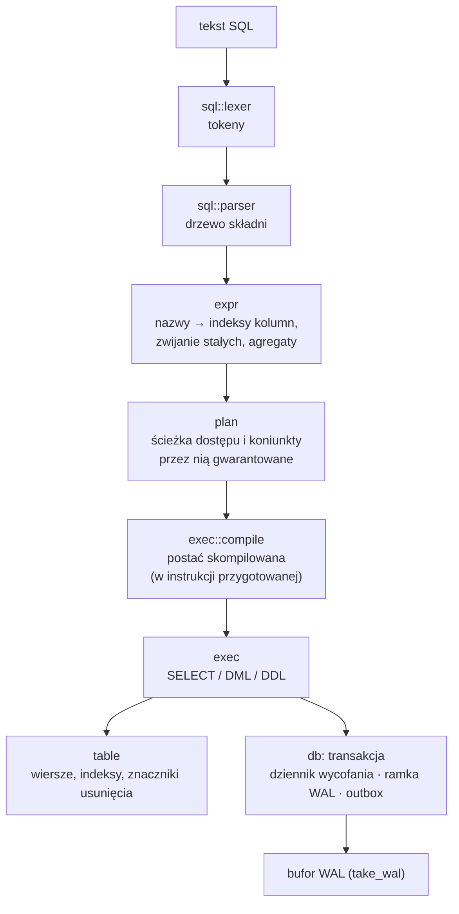

# flatsql-core – rdzeń silnika

Biblioteka Rust, która wykonuje Flat-SQL: parsuje zapytania, planuje je, wykonuje na danych w pamięci, prowadzi transakcje, koduje zmiany do dziennika zapisu z wyprzedzeniem (ang. *write-ahead log*, WAL) i wymienia zmiany z innymi replikami. Nie wykonuje żadnych operacji wejścia/wyjścia i nie ma zależności zewnętrznych: każda zatwierdzona transakcja zostaje zakodowana jako ramka WAL w buforze, a zapis tych bajtów na dysk, do IndexedDB czy na serwer należy do hosta. Dzięki temu ten sam kod działa w przeglądarce i Node.js (przez [flatsql-wasm](../flatsql-wasm/)) oraz natywnie (przez [flatsql-cli](../flatsql-cli/)).

## Miejsce w systemie

```text
aplikacja ─► bridge/ (FlatDB, SyncClient) ─► flatsql-wasm ─► flatsql-core
                                  flatsql-cli ─────────────────► flatsql-core
```

Rdzeń nie zależy od niczego. Korzystają z niego wiązania WebAssembly, CLI i program rozbicia kosztów z danych Benchmarku 1.

## Struktura

| Moduł | Odpowiedzialność | Opis |
|---|---|---|
| `sql/` | język | lekser, parser rekurencyjny zstępujący, drzewo składni; [specyfikacja Flat-SQL](src/sql/README.md) |
| `expr.rs`, `compile.rs` | wyrażenia | wiązanie nazw kolumn z indeksami, zwijanie stałych, wydzielanie agregatów, ewaluacja z logiką trójwartościową; warunki i wyrażenia `SET` kompilowane do domknięć wyspecjalizowanych według typu kolumny |
| `plan.rs` | planer | wybór ścieżki dostępu z koniunkcji `WHERE`, maska koniunktów gwarantowanych przez ścieżkę, liczenie wierszy bez ich czytania, opis do `EXPLAIN` |
| `exec.rs` | wykonanie | kompilacja i wykonanie SELECT (strumieniowo, top-k, grupowanie przez tablicę mieszającą), INSERT/UPDATE/DELETE, DDL |
| `db.rs` | baza | obiekt `Database`: katalog tabel, transakcje, instrukcje przygotowane, WAL, odtwarzanie, API synchronizacji |
| `table.rs`, `value.rs`, `hash.rs` | model danych | wiersze w `BTreeMap` po kluczu głównym, indeksy pomocnicze, znaczniki usunięcia; typ `Value` z porządkiem całkowitym; skrót wartości |
| `result.rs` | wynik | binarny format wyniku kodowany wprost z wierszy tabeli |
| `storage/` | trwałość | kodek, ramki WAL, snapshot, interfejs `Storage`, magazyn plikowy; [opis](src/storage/README.md) |
| `sync.rs` | synchronizacja | zegar HLC, znaczniki, zmiany, paczki, outbox |
| `error.rs` | błędy | kategorie błędów (`parse`, `schema`, `constraint`, `type`, `eval`, `transaction`, `storage`, `unsupported`) |
| `tests/` | testy | testy integracyjne; [opis](tests/README.md) |

Dokumentację API generuje `cargo doc -p flatsql-core --open` z komentarzy w kodzie.

## Interfejs

```rust
use flatsql_core::Database;

let mut db = Database::new(1); // identyfikator repliki
db.execute("CREATE TABLE items (id INT PRIMARY KEY, name TEXT, qty INT)")?;
db.execute("INSERT INTO items VALUES (1, 'sword', 1), (2, 'potion', 5)")?;
let result = db.execute("SELECT name FROM items WHERE qty > 2")?;

let stmt = db.prepare("SELECT * FROM items WHERE id = ?")?;
let row = db.execute_prepared(&stmt, &[1i64.into()])?;

let wal = db.take_wal(); // bajty do zapisania przez hosta
```

Najważniejsze grupy metod `Database`:

| Grupa | Metody |
|---|---|
| zapytania | `execute`, `execute_all`, `prepare`, `execute_prepared`, `execute_prepared_encoded`, `execute_many` |
| trwałość | `take_wal`, `unshift_wal`, `wal_pending`, `snapshot`, `snapshot_begin` / `snapshot_step` / `snapshot_finish`, `restore`, `recovery_report` |
| synchronizacja | `enable_sync`, `export_outbox`, `ack_outbox`, `apply_changes`, `export_state`, `clock_ahead`, `rebase_clock` |
| informacje | `stats`, `table_names`, `table_schema`, `row_count`, `in_transaction` |

`storage::Persistent<S: Storage>` łączy bazę z magazynem: po każdej instrukcji zapisuje WAL, a po przekroczeniu progu wykonuje checkpoint. Tak korzysta z rdzenia CLI; w przeglądarce tę samą rolę pełni `FlatDB` w JavaScripcie.

## Droga zapytania



Typ `Value` (`Null`, `Bool`, `Int`, `Float`, `Text`) ma porządek całkowity: liczby porównuje się numerycznie bez względu na typ, NaN jest na końcu, więc wartość może być kluczem drzewa. Krótkie teksty mieszczą się w samej wartości, dłuższe są na stercie. Koercja przy zapisie do kolumny jest bezstratna (`2.0` do `INT` tak, `2.5` nie).

Planer wybiera ścieżkę dostępu na podstawie koniunkcji `WHERE` w kolejności: wyszukanie po kluczu głównym, wiele kluczy (`IN`), indeks (`=`, `IN`), zakres klucza, zakres indeksu, pełny przegląd. Wykrywa warunki sprzeczne (`id > 5 AND id < 5`, `= NULL`) i zwraca maskę koniunktów, które ścieżka gwarantuje, więc wykonawca liczy tylko pozostałe ([ADR-0040](../../docs/adr/0040-warunek-gwarantowany-przez-sciezke-dostepu.md)). `COUNT(*)` z warunkiem przejętym w całości przez ścieżkę liczy wiersze bez ich czytania, przy indeksie jako długość zbioru kluczy wartości.

```text
EXPLAIN SELECT category, COUNT(*) FROM items WHERE price > 10 AND id BETWEEN 100 AND 200 GROUP BY category

SELECT FROM items
  ACCESS:    PRIMARY KEY RANGE SCAN (id >= 100 AND id <= 200)
  FILTER:    price > 10
  AGGREGATE: GROUP BY category; COUNT(*)
  OUTPUT:    category, COUNT(*)
```

Instrukcja przygotowana kompiluje się przy `prepare`: nazwy kolumn są rozwiązane, parametry zostają odwołaniami, a ścieżka dostępu jest wybrana albo przygotowana jako szablon wypełniany wartością parametru. Postać skompilowana jest ważna dla wersji katalogu, w której powstała; każda zmiana schematu, także wycofana i odebrana z innej repliki, wymusza ponowną kompilację ([ADR-0041](../../docs/adr/0041-plan-w-instrukcji-przygotowanej.md), [ADR-0042](../../docs/adr/0042-wyrazenia-kompilowane-warianty-i-domkniecia.md)).

## Transakcje

- Każda instrukcja zmieniająca dane działa w transakcji: niejawnej (autocommit) albo jawnej (`BEGIN … COMMIT/ROLLBACK`). Instrukcje wykonują się szeregowo ([ADR-0008](../../docs/adr/0008-transakcje-undo-log-wykonanie-szeregowe.md)).
- Każda zmiana wiersza i schematu zapisuje wpis w dzienniku wycofania. Błąd w połowie instrukcji (np. dzielenie przez zero w 500. wierszu `UPDATE`) cofa tylko tę instrukcję, także wewnątrz jawnej transakcji.
- Operacje są kodowane do bufora transakcji w chwili wykonania; przy `COMMIT` cały bufor staje się jedną ramką WAL, a wpisy outboxu stają się widoczne dla synchronizacji. `ROLLBACK` nie zostawia śladu w WAL.
- `UPDATE` zmienia wiersz w miejscu, przepisuje tylko przypisane kolumny i dotyka tylko indeksów zmienionych kolumn; zegar jest odczytywany raz na instrukcję ([ADR-0044](../../docs/adr/0044-update-w-miejscu-jeden-odczyt-zegara.md)).
- Snapshot, eksport outboxu i przyjmowanie zmian zdalnych są zabronione w trakcie jawnej transakcji, bo widziałyby niezatwierdzony stan.

## Synchronizacja

Model danych synchronizacji:

- Każda zmiana ma znacznik `Stamp { time, node }`: `time` z hybrydowego zegara logicznego (ang. *Hybrid Logical Clock*, HLC), czyli milisekundy czasu fizycznego przesunięte o 16 bitów z licznikiem logicznym, a `node` to losowy identyfikator repliki. Zegar nigdy się nie cofa i przyjmuje nowsze znaczniki innych replik ([ADR-0015](../../docs/adr/0015-hlc-i-lww-per-wiersz.md)).
- Granica dryfu (`MAX_DRIFT_MS`, 60 s): znacznik dalszy niż 60 s przed zegarem odbiorcy nie jest przyjmowany, a zmiana jest odrzucana (`ApplyReport.clock_drift`). Własna historia (snapshot, WAL) jest przyjmowana bez granicy. Zmiany zrobione, gdy zegar urządzenia się spieszył, po jego poprawieniu dostają nowe znaczniki (`rebase_clock`) ([ADR-0035](../../docs/adr/0035-granica-dryfu-zegara-wstrzymanie-i-nowe-znaczniki.md)).
- Reguła „ostatni zapis wygrywa” (ang. *last-writer-wins*, LWW) dla wiersza: zmiana zdalna jest stosowana tylko wtedy, gdy jej znacznik jest większy od znacznika wiersza albo jego znacznika usunięcia, żeby spóźniony `UPDATE` nie przywrócił usuniętego wiersza.
- Konflikt schematu: definicja tabeli z innej repliki, różna od lokalnej, nie jest stosowana, a wiersze tej definicji są odrzucane. `ApplyReport.conflicts` podaje jedną pozycję na tabelę: obie definicje, liczbę odrzuconych zmian i rodzaj różnicy ([ADR-0036](../../docs/adr/0036-jawne-konflikty-schematu-przed-wersjami-struktury.md)).
- Między replikami atomowa jest zmiana pojedynczego wiersza, nie cała transakcja ([ADR-0018](../../docs/adr/0018-atomowosc-wiersza-miedzy-replikami.md)).

Outbox, czyli kolejka zmian do wysłania:

- Outbox wierszy jest prowadzony od włączenia synchronizacji (`enable_sync`); krok jest zapisany w WAL i w snapshocie. Włączenie oznacza każdy wiersz i znacznik usunięcia jako oczekujący, więc pierwsza wysyłka zawiera cały stan. Baza bez synchronizacji nie płaci za outbox ([ADR-0043](../../docs/adr/0043-outbox-po-wlaczeniu-synchronizacji.md)).
- Zmiana wiersza zapisuje w outboksie tylko odwołanie `(tabela, klucz) → seq`; eksport czyta bieżący stan wiersza, więc 100 kolejnych `UPDATE` jednego wiersza wysyła jedną zmianę. Zmiany schematu są przechowywane w całości.
- Każda lokalna operacja w WAL niesie numer `seq`, a potwierdzenie serwera jest zapisywane w WAL jako `Ack(seq)`. Outbox odbudowuje się przy odtwarzaniu i przetrwa zamknięcie aplikacji offline ([ADR-0016](../../docs/adr/0016-outbox-w-wal.md)).
- Zmiany otrzymane z serwera trafiają do WAL z `seq = 0`, więc nie wracają do outboxu.

Protokół HTTP między klientem a serwerem opisuje [server/README.md](../../server/README.md), a format paczki zmian [storage/README.md](src/storage/README.md#formaty-binarne).

## Decyzje i kompromisy

| Decyzja | Uzasadnienie | Koszt |
|---|---|---|
| wymagany klucz główny, bez złączeń ([ADR-0004](../../docs/adr/0004-dialekt-flat-sql-bez-zlaczen.md)) | wiersz adresowany kluczem, replikacja per klucz, prosty i przewidywalny plan | zapytania wielotabelowe składa aplikacja |
| dane w pamięci ([ADR-0006](../../docs/adr/0006-dane-w-pamieci.md)) | odczyty w mikrosekundach, prosty silnik | rozmiar bazy ograniczony pamięcią; odtwarzanie wolniejsze niż w formacie stronicowym |
| rdzeń bez wejścia/wyjścia i bez zależności ([ADR-0005](../../docs/adr/0005-rdzen-rust-bez-io-i-zaleznosci.md)) | ten sam kod wszędzie, trwałość nie blokuje zapytań, mały moduł (268 KiB po kompresji gzip) | host musi odbierać WAL; własny parser, kodek i CRC |
| fizyczny WAL i snapshot ([ADR-0009](../../docs/adr/0009-wal-fizyczny-i-snapshot.md)) | proste odtwarzanie, koszt zatwierdzenia proporcjonalny do zmiany | checkpoint koduje całą bazę |
| LWW na znacznikach HLC ze znacznikami usunięcia | zbieżność bez koordynacji, praca offline | konflikt rozstrzygany dla całego wiersza; znaczniki usunięcia nie są kasowane |
| cel `wasm32` bez memory64 ([ADR-0007](../../docs/adr/0007-wasm32-bez-memory64.md)) | szybszy dostęp do pamięci w przeglądarce | najwyżej 4 GiB pamięci modułu |

## Budowanie i testy

```bash
cargo build -p flatsql-core --release
```

```bash
cargo test -p flatsql-core
```

```bash
cargo build -p flatsql-core --target wasm32-unknown-unknown --release
```

Testy integracyjne i co sprawdzają: [tests/README.md](tests/README.md). Testy jednostkowe są w modułach `src/` (`#[cfg(test)]`).

## Ograniczenia

Rozwiązywanie konfliktów tylko dla całego wiersza, unikalność klucza głównego tylko lokalnie, brak `CASE`, podzapytań i indeksów złożonych. Kierunki rozwoju rdzenia: [docs/future/README.md §1.1](../../docs/future/README.md#11-rdzeń-silnika).
