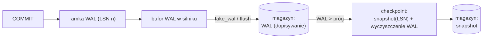

# storage – warstwa lokalnego składowania

Moduł definiuje, jak stan bazy zamienia się w bajty i z powrotem: kodek wartości, ramki dziennika zapisu z wyprzedzeniem (WAL), snapshot, interfejs magazynu `Storage` i magazyn plikowy dla wersji natywnej. Silnik nie zapisuje niczego sam. Rdzeń oddaje bajty WAL i snapshotu, a magazyn decyduje, gdzie trafią. Magazyny przeglądarki i Node.js (IndexedDB, pliki, pamięć) są w moście JavaScript ([bridge/](../../../../bridge/)) i używają tych samych formatów.

## Struktura

| Plik | Rola |
|---|---|
| `codec.rs` | kodowanie wartości i liczb (LEB128, zig-zag), suma kontrolna CRC32 |
| `wal.rs` | ramki WAL: zapis, odczyt do pierwszej uszkodzonej ramki |
| `snapshot.rs` | snapshot: kodowanie całego stanu (także krokami), odczyt formatów 1 i 2 |
| `mod.rs` | interfejs `Storage`, magazyn w pamięci `MemoryStorage`, `Persistent` łączący bazę z magazynem |
| `file.rs` | `FileStorage` (tylko natywnie): pliki `snapshot.fsql` i `wal.fsql`, interfejs `Vfs`, przez który testy podstawiają symulowany system plików |

## Model: snapshot i WAL



- WAL jest tylko dopisywany. Każda ramka ma numer kolejny (ang. *log sequence number*, LSN), liczbę operacji i sumę CRC32.
- Snapshot to pełny obraz zatwierdzonego stanu: tabele, znaczniki usunięcia, definicje indeksów, outbox, zegar, LSN i identyfikator repliki, z sumą CRC32. Indeksów się nie zapisuje; odbudowuje się je przy wczytaniu, hurtowo z wierszy pogrupowanych według wartości.
- Odtwarzanie to wczytanie snapshotu i odtworzenie ramek WAL o LSN większym niż w snapshocie. Ramki starsze są pomijane, co obsługuje awarię między zapisaniem snapshotu a wyczyszczeniem WAL.
- Urwany zapis: odczyt WAL zatrzymuje się na pierwszej niekompletnej ramce albo ramce z błędną sumą; wszystko przed nią jest poprawne. `RecoveryReport` podaje liczbę odrzuconych bajtów, a host od razu wykonuje checkpoint, żeby śmieci nie zostały przed nowymi ramkami.
- Operacje w WAL są fizyczne i idempotentne (`Put` to pełny wiersz, `Delete` to klucz), więc odtworzenie nie zależy od wyniku wcześniejszych zapytań ([ADR-0009](../../../../docs/adr/0009-wal-fizyczny-i-snapshot.md)).
- Checkpoint może kodować snapshot krokami (`snapshot_begin`, `snapshot_step`, `snapshot_finish`). Snapshot jest stanem z chwili rozpoczęcia: zanim zapis zmieni wiersz, do którego kroki jeszcze nie doszły, rdzeń zachowuje jego poprzedni stan. Zmiana schematu albo przestawienie zegara rozpoczyna kodowanie od nowa ([ADR-0049](../../../../docs/adr/0049-checkpoint-krokami.md)).

## Magazyny

| Magazyn | Gdzie | Zapis WAL | Checkpoint |
|---|---|---|---|
| `IndexedDbStore` (JavaScript) | przeglądarka | `add()` do magazynu `wal` (klucze rosnące) | snapshot jako `Blob` i wyczyszczenie WAL w jednej transakcji IndexedDB |
| `MemoryStore` (JavaScript), `MemoryStorage` (Rust) | testy, bazy tymczasowe | tablica fragmentów | podmiana |
| `FileStorage` (Rust) | natywnie (CLI) | dopisanie do `wal.fsql` i `fsync` (wyłączalny: `--no-fsync`) | `snapshot.fsql.tmp` i `fsync`, zmiana nazwy, `fsync` katalogu, obcięcie WAL i `fsync`; zawsze synchronizowany |
| `FsStore` (JavaScript) | Node.js (serwer) | dopisanie do `wal.fsql` przez otwarty uchwyt i `fsync` (wyłączalny: `fsync: false`) | jak `FileStorage`; `meta.json` (identyfikator repliki, kursor synchronizacji) przez plik tymczasowy, `fsync` i zmianę nazwy |

Format plików jest wspólny dla Rust i Node.js, więc katalog danych serwera można otworzyć w CLI ([ADR-0011](../../../../docs/adr/0011-przenosny-format-plikow.md)). Wybór magazynu w przeglądarce opisuje [bridge/README.md](../../../../bridge/README.md#magazyny).

Kolejność kroków checkpointu na plikach. Zmiana nazwy pliku jest operacją na katalogu i trafia na dysk dopiero po `fsync` katalogu, a system plików może utrwalić obcięcie WAL wcześniej niż zmianę nazwy. Po awarii zostałby wtedy stary snapshot z pustym WAL. Dlatego WAL jest obcinany dopiero po `fsync` katalogu, a katalog jest synchronizowany także po utworzeniu pliku WAL. W Windows katalog da się zsynchronizować tylko przez uchwyt otwarty z prawem zapisu i flagą `FILE_FLAG_BACKUP_SEMANTICS`; w Node.js to `open(dir, 'r+')`, a w Linuksie `'r'`, bo otwarcie katalogu do zapisu kończy się tam błędem `EISDIR` ([ADR-0033](../../../../docs/adr/0033-checkpoint-plikowy-fsync-katalogu.md), [eksperyment](../../../../docs/research/tests-results.md#12-eksperyment-synchronizacja-katalogu-w-windows)).

Wyłączenie `fsync` dotyczy tylko zatwierdzeń: po awarii mogą zniknąć ostatnie transakcje, ale checkpoint jest synchronizowany zawsze, więc starsze dane są bezpieczne. W `FsStore` bez `fsync` nie jest też synchronizowany `meta.json`; urwany plik jest przy otwarciu traktowany jak pusty. Utracony kursor oznacza pełne pobranie stanu z serwera, a utracony identyfikator repliki nowy identyfikator dla dalszych zmian.

## Formaty binarne

Wspólny kodek: liczby całkowite jako LEB128 (ze znakiem w kodowaniu zig-zag), tekst jako długość i UTF-8, wartości poprzedzone jednobajtowym znacznikiem typu (`0` NULL, `1` FALSE, `2` TRUE, `3` INT, `4` FLOAT jako f64 LE, `5` TEXT). Każdy NaN jest zapisywany jednym wzorcem bitów `0x7FF8000000000000`, bo arytmetyka różnych procesorów, a także WebAssembly, daje NaN o różnych bitach, a dla silnika to ta sama wartość. Te same dane dają więc zawsze te same bajty snapshotu, WAL i paczek. Odczyt przyjmuje dowolny NaN, więc wcześniejsze pliki pozostają czytelne. Zero ujemne zachowuje znak.

Ramka WAL:

```text
+-----------+-----------+---------------------------------------------+
| len u32LE | crc u32LE | payload: lsn, op_count, op₁, op₂, …         |
+-----------+-----------+---------------------------------------------+
op = 0x10 seq change      (zmiana; seq > 0 – lokalna, w outboksie, jeśli dotyczy schematu albo synchronizacja jest włączona)
   | 0x20 upto            (potwierdzenie outboxu)
   | 0x30 seq             (włączenie synchronizacji: wiersze i znaczniki usunięcia oczekujące, numerowane od seq)
change = tag stamp body   (1 CREATE TABLE, 2 DROP TABLE, 3 CREATE INDEX,
                           4 DROP INDEX, 5 PUT tabela wartości, 6 DELETE tabela klucz)
```

Snapshot:

```text
"FLATSQL1" format(2) node_id clock lsn next_seq acked_seq flagi (bit 0: synchronizacja włączona)
tabele: schemat, znacznik utworzenia, indeksy (nazwa, kolumna), wiersze (znacznik + wartości), znaczniki usunięcia
outbox: zmiany schematu (seq, zmiana); wiersze pogrupowane po tabeli (nazwa, pary seq + klucz)
crc32 (u32 LE)
```

Format 1 (bez flag, outbox jako lista `seq, rodzaj, tabela + klucz` z nazwą tabeli w każdym wpisie) jest nadal czytany; baza w formacie 1 ma synchronizację włączoną.

Paczka zmian wysyłana przy synchronizacji:

```text
"FSB1" count change₁ … changeₙ crc32
```

Konkatenacja paczek jest poprawną paczką, więc serwer przekazuje zapisane paczki bez ponownego kodowania.

## Testy

Odtwarzanie po ucięciu WAL w każdym bajcie, wszystkie stany po awarii dopuszczone przez model systemu plików, snapshot krokami i deterministyczny format: [tests/README.md](../../tests/README.md), opisy wyników w [tests-results.md §1](../../../../docs/research/tests-results.md#1-trwałość-i-odtwarzanie-po-awarii).

## Ograniczenia

Checkpoint koduje całą bazę, a otwarcie bazy dekoduje cały snapshot w jednym wywołaniu. Kierunki: odtwarzanie krokami, szybsza suma CRC32, magazyn OPFS w Web Workerze ([docs/future/README.md §1.2](../../../../docs/future/README.md#12-warstwa-składowania)).
