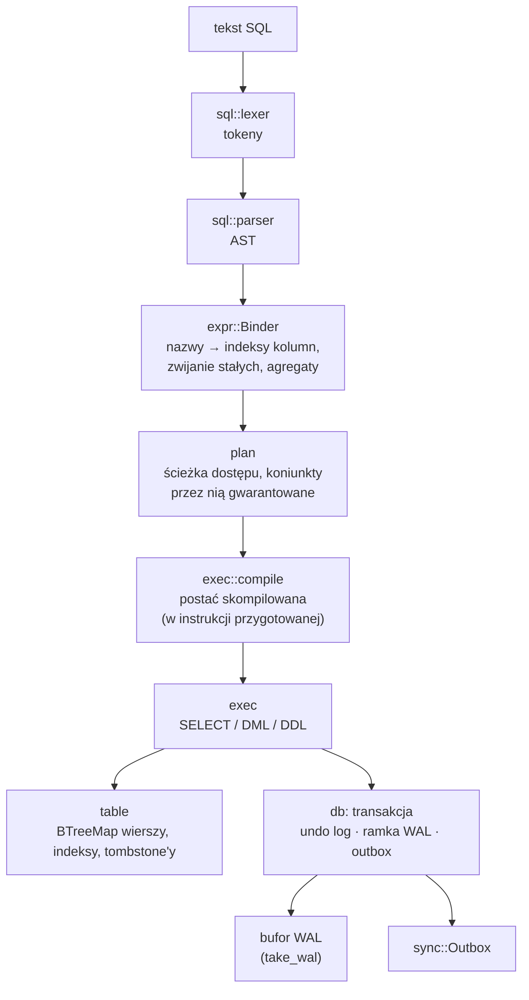
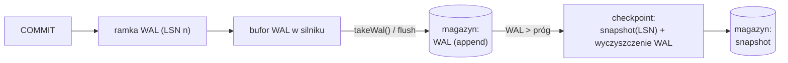

# Architektura Flat-SQL

Dokument opisuje budowę prototypu: warstwy silnika, ścieżkę zapytania i zapisu, warstwę lokalnego składowania, synchronizację Local-First oraz formaty binarne. Na końcu zebrano decyzje projektowe i ich konsekwencje.

## 1. Założenia architektoniczne

1. **Jeden rdzeń, wiele środowisk.** Silnik (`flatsql-core`) jest czystą biblioteką Rust bez zależności i bez operacji wejścia/wyjścia. Kompiluje się do `wasm32-unknown-unknown` (przeglądarka, Node.js, węzły edge) i natywnie (CLI, przyszły panel WinUI przez FFI).
2. **Silnik nie wie, gdzie są dane.** Każda zatwierdzona transakcja produkuje ramkę WAL w buforze w pamięci; host decyduje, gdzie ją zapisać (IndexedDB, plik, OPFS). Snapshot to po prostu tablica bajtów.
3. **Zapytania są synchroniczne i lokalne.** Odczyt i zapis kończą się w pamięci WebAssembly; trwałość i sieć są asynchroniczne i nie blokują aplikacji.
4. **Synchronizacja jest dodatkiem, nie warunkiem działania.** Brak sieci oznacza tylko, że rośnie outbox.

## 2. Warstwy silnika



| Moduł | Opis |
|---|---|
| `value` | typ `Value` (`Null`, `Bool`, `Int`, `Float`, `Text`) z **porządkiem całkowitym** – liczby porównywane numerycznie bez względu na `Int`/`Float`, NaN na końcu – dzięki czemu `Value` może być kluczem `BTreeMap`. Koercja przy zapisie do kolumny jest bezstratna (`2.0` → `INT` tak, `2.5` → `INT` nie). |
| `sql` | ręcznie napisany lekser (komentarze, cudzysłowy, Unicode w identyfikatorach) i parser rekurencyjny zstępujący z precedencją operatorów. Konstrukcje relacyjne (`JOIN`, `FOREIGN KEY`, `REFERENCES`, podzapytania, `UNION`) zwracają czytelny błąd `unsupported` – to część definicji języka. |
| `expr` | wiązanie wyrażeń do postaci `BExpr` (kolumny jako indeksy, parametry `?` jako odwołania czytane przy wykonaniu), zwijanie stałych, wydzielanie agregatów (`COUNT(*) + COUNT(*)` liczony raz). Ewaluacja: liście (kolumna, literał, parametr) obsługiwane inline bez wywołania funkcji, predykaty `WHERE` przez osobny ewaluator logiki trójwartościowej. |
| `plan` | wybór ścieżki dostępu na podstawie koniunkcji `WHERE`: PK lookup → PK multi-lookup (`IN`) → indeks (`=`/`IN`) → zakres PK → zakres indeksu → pełny skan; wykrywa warunki sprzeczne (`id > 5 AND id < 5`, `= NULL`); zwraca maskę koniunktów, które ścieżka gwarantuje, i liczy wiersze ścieżki bez ich czytania; dla instrukcji przygotowanej szablon ścieżki (`AccessPlan`) wypełniany wartością parametru. |
| `exec` | kompilacja SELECT, INSERT, UPDATE i DELETE względem katalogu (postać przechowywana w instrukcji przygotowanej i unieważniana numerem wersji katalogu); SELECT: strumieniowanie z wczesnym zakończeniem dla porządku PK, ograniczony bufor top-k dla `ORDER BY … LIMIT`, grupowanie po kluczach pożyczonych z tabeli, `COUNT(*)` bez czytania wierszy, gdy ścieżka gwarantuje warunek; DML i DDL. |
| `db` | obiekt `Database`: katalog, transakcje, WAL, odtwarzanie, API synchronizacji. |
| `storage` | kodek binarny, WAL, snapshot, trait `Storage` (pamięć, plik), `Persistent`. |
| `sync` | zegar HLC, `Change`/`Mutation`, paczki zmian, outbox. |

### Planer – przykład

```text
EXPLAIN SELECT category, COUNT(*) FROM items WHERE price > 10 AND id BETWEEN 100 AND 200 GROUP BY category

SELECT FROM items
  ACCESS:    PRIMARY KEY RANGE SCAN (id >= 100 AND id <= 200)
  FILTER:    price > 10
  AGGREGATE: GROUP BY category; COUNT(*)
  OUTPUT:    category, COUNT(*)
```

Ścieżka dostępu zwraca nadzbiór wyników, a planer mówi, które koniunkty warunku gwarantuje (równość wyszukania, granice zakresu); wykonawca sprawdza tylko pozostałe, więc w przykładzie warunek na `id` nie jest liczony w każdym wierszu ([ADR-0040](adr/0040-warunek-gwarantowany-przez-sciezke-dostepu.md)). `COUNT(*)` z warunkiem przejętym w całości przez ścieżkę liczy wiersze bez ich czytania: przy indeksie to długość zbioru kluczy wartości. Zgodność z pełnym przeglądem sprawdza test różnicowy planera.

Instrukcja przygotowana kompiluje się przy `prepare`: nazwy kolumn rozwiązane, parametry zostają odwołaniami, ścieżka dostępu wybrana albo przygotowana jako szablon wypełniany wartością parametru. Postać skompilowana jest ważna dla wersji katalogu, dla której powstała; każda zmiana schematu (także wycofana i odebrana z innej repliki) zmienia wersję i wymusza ponowną kompilację ([ADR-0041](adr/0041-plan-w-instrukcji-przygotowanej.md)).

## 3. Transakcje

- Każda instrukcja modyfikująca działa w transakcji: niejawnej (autocommit) albo jawnej (`BEGIN … COMMIT/ROLLBACK`).
- Każda zmiana wiersza/schematu zapisuje wpis w **undo logu** (poprzednia wersja wiersza i tombstone'u). Błąd w połowie instrukcji (np. dzielenie przez zero w 500. wierszu `UPDATE`) cofa tylko tę instrukcję – **atomowość na poziomie instrukcji** także wewnątrz jawnej transakcji.
- Operacje są kodowane do bufora transakcji w chwili wykonania; przy `COMMIT` cały bufor staje się **jedną ramką WAL**, a wpisy outboksu stają się widoczne dla synchronizacji. `ROLLBACK` nie zostawia śladu w WAL.
- Snapshot, eksport outboksu i przyjmowanie zmian zdalnych są zabronione w trakcie jawnej transakcji (widziałyby niezatwierdzony stan).

## 4. Warstwa lokalnego składowania

### 4.1 Model: snapshot + WAL



- **WAL** – tylko dopisywanie; każda ramka ma LSN, liczbę operacji i sumę CRC32.
- **Snapshot** – pełny obraz zatwierdzonego stanu (tabele, tombstone'y, definicje indeksów, outbox, zegar, LSN, node id) z sumą CRC32. Indeksy nie są zapisywane – odbudowuje się je przy wczytaniu.
- **Odtwarzanie** = wczytanie snapshotu + odtworzenie ramek WAL o `LSN > LSN snapshotu`. Ramki starsze są pomijane – to obsługuje awarię między zapisaniem snapshotu a wyczyszczeniem WAL.
- **Urwany zapis**: odczyt WAL zatrzymuje się na pierwszej ramce niekompletnej lub z błędną sumą kontrolną; wszystko przed nią jest poprawne. Raport (`RecoveryReport`) podaje liczbę odrzuconych bajtów, a host od razu wykonuje checkpoint, żeby śmieci nie zostały przed nowymi ramkami. Test `every_wal_prefix_recovers_to_a_committed_state` ucina WAL w **każdym** bajcie i sprawdza, że baza zawsze odpowiada stanowi po ostatniej pełnej transakcji.
- Operacje w WAL są **fizyczne i idempotentne** (`Put` = pełny wiersz, `Delete` = klucz), więc odtworzenie nigdy nie zależy od wyniku wcześniejszych zapytań.

### 4.2 Backendy

| Backend | Gdzie | Zapis WAL | Checkpoint |
|---|---|---|---|
| `IndexedDbStore` | przeglądarka | `add()` do magazynu `wal` (klucze rosnące) | `put` snapshotu i `clear()` WAL w **jednej** transakcji IndexedDB |
| `MemoryStore` | przeglądarka / testy | tablica fragmentów | podmiana |
| `FileStorage` (Rust) | natywnie (CLI) | dopisanie do `wal.fsql` i `fsync` (wyłączalny: `--no-fsync`) | `snapshot.fsql.tmp` i `fsync` → `rename` → `fsync` katalogu → obcięcie WAL i `fsync`; zawsze synchronizowany |
| `FsStore` (JS) | Node.js (serwer) | dopisanie do `wal.fsql` i `fsync` (wyłączalny: `new FsStore(dir, { fsync: false })`) | jak `FileStorage`; `meta.json` (identyfikator węzła, kursor synchronizacji) przez plik tymczasowy, `fsync` i `rename` |

Format plików jest wspólny dla Rust i Node.js – katalog danych serwera można otworzyć w CLI.

Magazyn wybiera aplikacja opcją `store` w `FlatDB.open`. Bez niej w przeglądarce baza trafia do `IndexedDbStore(name)` (opcja `name`, domyślnie `'default'`), więc dane przetrwają odświeżenie strony. Poza przeglądarką magazynu domyślnego nie ma: `FlatDB.open()` bez `store` kończy się błędem, żeby dane nie zostały po cichu tylko w pamięci ([ADR-0034](adr/0034-magazyn-domyslny-indexeddb-jawny-wybor-poza-przegladarka.md)).

**Kolejność kroków checkpointu na plikach.** Zmiana nazwy pliku jest operacją na katalogu i trafia na dysk dopiero po `fsync` katalogu, a system plików może utrwalić obcięcie WAL wcześniej niż zmianę nazwy. Po awarii zostałby wtedy stary snapshot z pustym WAL. Dlatego WAL jest obcinany dopiero po `fsync` katalogu; katalog jest synchronizowany także po utworzeniu pliku WAL. Ramki, które po awarii zostały w WAL, a są już w snapshocie, pomija odtwarzanie (LSN). W Windows katalog da się zsynchronizować tylko przez uchwyt otwarty z prawem zapisu i flagą `FILE_FLAG_BACKUP_SEMANTICS` (w Node.js: `open(dir, 'r+')`, bo libuv zawsze dodaje tę flagę; w Linuksie otwarcie katalogu do zapisu kończy się błędem `EISDIR`, więc tam `'r'`) ([eksperyment](research/tests-results.md#12-eksperyment-synchronizacja-katalogu-w-windows), [ADR-0033](adr/0033-checkpoint-plikowy-fsync-katalogu.md)). Operacje na plikach `FileStorage` wykonuje przez interfejs `Vfs`, za który testy podstawiają symulowany system plików; dla `FsStore` testy symulują w pamięci wywołania `node:fs/promises`. Na tej podstawie testy przeglądają wszystkie stany dysku, jakie po awarii w dowolnym miejscu dopuszcza model systemu plików, także z urwanymi zapisami ([tests-results.md §1.4](research/tests-results.md#14-wszystkie-stany-po-awarii-dopuszczone-przez-model)).

Wyłączenie `fsync` (`--no-fsync`, `fsync: false`) dotyczy tylko zatwierdzeń: po awarii mogą zniknąć ostatnie transakcje, ale checkpoint jest synchronizowany zawsze, więc starsze dane są bezpieczne. W `FsStore` bez `fsync` nie jest też synchronizowany `meta.json`; urwany plik jest przy otwarciu traktowany jak pusty. Utracony kursor oznacza pełne pobranie stanu z serwera, a utracony identyfikator węzła (przed pierwszym checkpointem, później jest też w snapshocie) – nowy identyfikator dla dalszych zmian.

### 4.3 Group commit w przeglądarce

`FlatDB.exec()` zwraca wynik synchronicznie. Jeśli transakcja wyprodukowała bajty WAL, `FlatDB` planuje `flush()` w najbliższym mikrozadaniu. Wszystkie zatwierdzenia wykonane w jednym „tiku” pętli zdarzeń trafiają więc do IndexedDB jednym zapisem (test: 101 zatwierdzeń → 1 zapis). `await db.flush()` gwarantuje, że wszystko zatwierdzone do tej chwili jest trwałe. Operacje na magazynie są serializowane w jednej kolejce, a checkpoint jest bezpieczny wobec zapisów wykonywanych w trakcie (rozstrzyga LSN).

Semantyka trwałości jest więc analogiczna do `synchronous=NORMAL` w SQLite: po `await flush()` dane są trwałe; zatwierdzenia z ostatnich milisekund mogą przepaść przy nagłym zamknięciu karty, ale baza zawsze wraca do spójnego stanu.

Co znaczy „trwałe”, zależy od trybu trwałości transakcji IndexedDB, który podaje się w `FlatDB.open({ durability })` (albo w konstruktorze `IndexedDbStore`) i który dotyczy każdego zapisu magazynu: dopisania WAL, checkpointu i metadanych.

| Tryb | `flush()` kończy się, gdy dane | Przetrwa |
|---|---|---|
| `relaxed` | zostały przekazane systemowi operacyjnemu | zamknięcie karty, awarię przeglądarki |
| `strict` | zostały zapisane na dysk | także awarię systemu i utratę zasilania |
| `default` (domyślny) | według przeglądarki – w Chrome 121+ jak `relaxed` [Q1] | jak wybrany tryb |

Tryb `strict` jest wolniejszy (koszt do zmierzenia: [todo 4.9](todo.md)). Opcja `durability` przy magazynie bez trybów (np. `MemoryStore`, `FsStore` – tam odpowiednikiem jest `fsync`) kończy się błędem. Bieżący tryb zwraca `stats().durability`, a demo pokazuje go w panelu magazynu i przyjmuje parametr adresu `?durability=strict` ([test](research/tests-results.md#15-tryb-trwałości-indexeddb)).

### 4.4 Usuwanie danych przez przeglądarkę

Magazyn strony jest domyślnie „najlepszej staranności” (ang. *best-effort*): przeglądarka może go usunąć przy braku miejsca, a Safari usuwa IndexedDB po 7 dniach używania przeglądarki bez interakcji z witryną [Q2]–[Q4]. Razem z bazą zniknąłby niewysłany outbox. Dlatego `FlatDB.open` z magazynem IndexedDB prosi przeglądarkę o magazyn trwały (`navigator.storage.persist()`). Wynik jest w `db.persisted` (`true` – dane nie zostaną usunięte, `false` – mogą, `null` – brak API) i w `stats().persisted`, a obietnica `db.persistence` rozstrzyga się po odpowiedzi. `open` nie czeka na odpowiedź, bo Firefox pyta użytkownika; aplikacja może wyłączyć prośbę przy otwarciu (`persist: false`) i wywołać `db.requestPersistence()` później, np. po kliknięciu. Chrome odpowiada bez pytania, według zaangażowania użytkownika w witrynę; dla nowej witryny zwykle odmawia ([test](research/tests-results.md#17-prośba-o-trwały-magazyn)). Demo pokazuje stan w panelu magazynu i przycisk ponownej prośby.

### 4.5 Wiele kart

Dwie karty z własnymi kopiami bazy w pamięci, dopisujące do tego samego WAL, rozjechałyby się. Demo używa **Web Locks API**: pierwsza karta trzyma blokadę i zapisuje do IndexedDB, kolejne przechodzą w tryb tylko-pamięć z ostrzeżeniem. Docelowo: jedna instancja silnika we wspólnym `SharedWorker` lub wybór lidera przez `BroadcastChannel`.

## 5. Synchronizacja Local-First

### 5.1 Model danych synchronizacji

- Każda zmiana ma **znacznik** `Stamp { time, node }`: `time` z hybrydowego zegara logicznego (HLC – milisekundy fizyczne << 16 | licznik logiczny), `node` – losowy identyfikator repliki. Zegar nigdy się nie cofa i „wchłania” znaczniki otrzymane od innych replik.
- **Granica dryfu** (`MAX_DRIFT_MS` = 60 s): znacznik dalszy niż 60 s przed zegarem ściennym odbiorcy nie jest wchłaniany, a zmiana jest odrzucana (`ApplyReport.clock_drift`). Bez tego urządzenie z zegarem w przyszłości wygrywałoby każdy konflikt i przesuwało zegary wszystkich replik [C2]. Własna historia (snapshot, WAL) jest wchłaniana bez granicy. Zmiany zrobione, gdy zegar urządzenia się spieszył, po jego poprawieniu dostają nowe znaczniki (`rebase_clock`, zob. §5.3); zegar cofa się wtedy tylko o znaczniki, które nie opuściły urządzenia ([ADR-0035](adr/0035-granica-dryfu-zegara-wstrzymanie-i-nowe-znaczniki.md)).
- **Last-writer-wins per wiersz**: zmiana zdalna jest stosowana tylko, gdy jej znacznik jest większy od znacznika wiersza lub jego **tombstone'u** (usunięte wiersze pamiętają znacznik usunięcia, żeby spóźniony `UPDATE` nie wskrzesił wiersza).
- **Konflikt schematu**: `CREATE TABLE` innej repliki dla tabeli, która lokalnie ma inną definicję, nie jest stosowany, a jej wiersze (także pasujące przypadkiem) są odrzucane. Raport zastosowania (`ApplyReport.conflicts`, odpowiedź `/sync/push`, zdarzenie `conflict` w `SyncClient`) podaje jedną pozycję na tabelę: obie definicje, liczbę odrzuconych zmian wierszy i rodzaj – „dokładanie” (jedna definicja dodaje na końcu tylko kolumny dopuszczające `NULL`; po wprowadzeniu wersji struktury przestanie być konfliktem) albo niezgodność ([ADR-0036](adr/0036-jawne-konflikty-schematu-przed-wersjami-struktury.md)).
- Porządek znaczników jest całkowity i identyczny na wszystkich replikach, więc stan zbiega się niezależnie od kolejności dostarczania zmian (test losowy: 25 ziaren × 300 operacji na 3 replikach z przerywaną łącznością; drugi test: 4 urządzenia z przesuniętymi zegarami, podziałami sieci, utraconymi potwierdzeniami i kursorami oraz restartami, [tests-results.md §2.3](research/tests-results.md#23-zbieżność-w-trudnych-warunkach)).

### 5.2 Outbox

- Outbox wierszy jest prowadzony od włączenia synchronizacji (`enableSync`, robi to `SyncClient` i serwer synchronizacji); krok jest zapisany w WAL i w snapshocie. Do tego czasu outbox przyjmuje tylko zmiany schematu, a włączenie oznacza każdy wiersz i tombstone jako oczekujący, czyli pierwsza wysyłka zawiera cały stan – to samo, co zawierałby outbox prowadzony od początku ([ADR-0043](adr/0043-outbox-po-wlaczeniu-synchronizacji.md)). Baza bez synchronizacji nie płaci za outbox w zapisie, snapshocie, odtworzeniu ani pamięci.
- Lokalna zmiana wiersza zapisuje w outboksie tylko **referencję** `(tabela, klucz) → seq`. Przy eksporcie odczytywany jest bieżący stan wiersza (albo tombstone), więc 100 kolejnych `UPDATE` tego samego wiersza wysyła jedną zmianę.
- Zmiany schematu (`CREATE/DROP TABLE/INDEX`) są przechowywane w całości.
- Każda lokalna operacja w WAL niesie swój numer `seq`; potwierdzenie serwera zapisywane jest w WAL jako `Ack(seq)`. Outbox jest więc odbudowywany przy odtwarzaniu i **przetrwa zamknięcie aplikacji w trybie offline**, a potwierdzone zmiany nie są wysyłane ponownie.
- Zmiany otrzymane z serwera są zapisywane w WAL z `seq = 0` – nie trafiają do outboksu (brak „echa”).

### 5.3 Protokół

| Żądanie | Treść | Odpowiedź |
|---|---|---|
| `POST /sync/push?client=ID` | paczka binarna zmian z outboksu | JSON `{applied, ignored, rejected, clockDrift, errors, seq, serverTime}` |
| `GET /sync/pull?since=N&epoch=E&client=ID` | – | paczka binarna; nagłówki `X-Sync-Cursor`, `X-Sync-Epoch` |
| `GET /sync/time` | – | JSON `{serverTime}` – sprawdzenie zegara |

Każda odpowiedź `/sync/*` ma nagłówek `X-Server-Time` (zegar serwera w ms).

Serwer utrzymuje własną replikę (ten sam silnik WASM) oraz log przyjętych paczek z numerami `seq`. Pull zwraca konkatenację paczek po kursorze (bez własnych zmian klienta). Gdy kursor jest nieznany – nowy klient, restart serwera (nowa `epoch`), log skompaktowany – serwer odsyła pełny stan (`exportState`), który dzięki LWW jest bezpieczny do ponownego zastosowania.

Kolejność kroków w kliencie (`SyncClient`) zapewnia idempotencję: (1) push i `ack` dopiero po odpowiedzi 200, (2) pull i zastosowanie zmian, (3) `flush` WAL, (4) zapis kursora.

**Zegar urządzenia.** Zegar serwera jest wzorcem. Klient mierzy odchylenie swojego zegara z nagłówka `X-Server-Time` (przed pierwszą wysyłką – przez `/sync/time`). Gdy przekracza 60 s albo serwer odrzucił wysłane zmiany za dryf (`clockDrift > 0`), klient wstrzymuje synchronizację: nie potwierdza paczki, więc zmiany zostają w outboksie, nie pobiera zmian, przechodzi w stan `clock` i zgłasza zdarzenie `clock`; kolejne rundy sprawdzają tylko zegar. Po poprawieniu zegara `FlatDB.rebaseClock()` nadaje nowe znaczniki niewysłanym zmianom „z przyszłości”, wykonuje checkpoint (nowe znaczniki nie trafiają do WAL) i synchronizacja rusza dalej. Zmiany pobrane z serwera, które są dalej niż 60 s przed zegarem klienta (dwa urządzenia mogą różnić się prawie o 2 × 60 s), nie przesuwają kursora i są pobierane ponownie. Demo pokazuje odchylenie w panelu synchronizacji. Przerwanie w dowolnym miejscu kończy się powtórzeniem rundy, a powtórnie dostarczone zmiany są ignorowane (równe znaczniki). Przy braku sieci klient ponawia próby z wykładniczym odstępem (do 30 s) i natychmiast po zdarzeniu `online`.

### 5.4 Tryb edge / cloud

Serwer (`server/server.js`) to Node.js z tym samym modułem `.wasm` – odpowiada wdrożeniu silnika na węźle brzegowym. `POST /api/query` wykonuje SQL zdalnie (model Cloud-First używany jako punkt odniesienia w benchmarkach; parametr `latency` symuluje opóźnienie sieci). Zapisy wykonane przez API trafiają do logu synchronizacji, więc docierają do klientów.

## 6. Formaty binarne

Wspólny kodek: liczby całkowite jako LEB128 (ze znakiem w kodowaniu zig-zag), tekst jako długość + UTF-8, wartości poprzedzone jednobajtowym znacznikiem typu (`0` NULL, `1` FALSE, `2` TRUE, `3` INT, `4` FLOAT (f64 LE), `5` TEXT). Każdy NaN jest zapisywany jako ten sam wzorzec bitów `0x7FF8000000000000`: arytmetyka różnych procesorów (i WebAssembly, które tego nie ustala) daje NaN o różnych bitach, a dla silnika to ta sama wartość, więc te same dane dają zawsze te same bajty snapshotu, WAL i paczek. Odczyt przyjmuje dowolny NaN, więc pliki zapisane wcześniej pozostają czytelne. Zero ujemne (`-0.0`) zachowuje znak: arytmetyka IEEE 754 daje je deterministycznie, a aplikacja może je odróżnić (`1 / -0.0`).

**Ramka WAL**

```text
+-----------+-----------+---------------------------------------------+
| len u32LE | crc u32LE | payload: lsn, op_count, op₁, op₂, …         |
+-----------+-----------+---------------------------------------------+
op = 0x10 seq change      (zmiana; seq > 0 → lokalna, w outboksie, jeśli dotyczy schematu albo synchronizacja jest włączona)
   | 0x20 upto            (potwierdzenie outboksu)
   | 0x30 seq             (włączenie synchronizacji: wiersze i tombstone'y oczekujące, numerowane od seq)
change = tag stamp body   (1 CREATE TABLE, 2 DROP TABLE, 3 CREATE INDEX,
                           4 DROP INDEX, 5 PUT tabela wartości, 6 DELETE tabela klucz)
```

**Snapshot**

```text
"FLATSQL1" format(2) node_id clock lsn next_seq acked_seq flagi (bit 0: synchronizacja włączona)
tabele: schemat, stamp utworzenia, indeksy (nazwa, kolumna), wiersze (stamp + wartości), tombstone'y
outbox: zmiany schematu (seq, zmiana); wiersze pogrupowane po tabeli (nazwa, pary seq + klucz)
crc32 (u32 LE)
```

Format 1 (bez flag, outbox jako lista `seq, rodzaj, tabela + klucz` z nazwą tabeli w każdym wpisie) jest nadal czytany; baza w formacie 1 ma synchronizację włączoną.

**Paczka zmian (synchronizacja)**

```text
"FSB1" count change₁ … changeₙ crc32
```

Konkatenacja paczek jest poprawną paczką – serwer przekazuje zapisane paczki bez ponownego kodowania.

## 7. Interfejs Rust ↔ JavaScript

`flatsql-wasm` udostępnia dwie ścieżki zwracania wyników, porównywane w badaniach:

- `exec`/`run` – obiekty i tablice JS dekodowane z binarnego formatu wyniku: rdzeń koduje wiersze SELECT wprost z tabeli (`ResultEncoder`, `Database::execute_prepared_encoded`) do bufora w pamięci WASM, a funkcja JavaScriptu dołączona do modułu tworzy obiekt wyniku jednym wywołaniem (liczby czytane z bajtów, wszystkie teksty dekodowane jednym wywołaniem `TextDecoder`); nazwy kolumn instrukcji przygotowanej powstają raz na plan i są kopiowane do każdego wyniku,
- `execJson`/`runJson` – wynik serializowany do JSON w Rust, parsowany przez `JSON.parse` (jedno przekazanie łańcucha).

Dla zapisów masowych `execute` zwraca tylko liczbę zmienionych wierszy, a `executeMany(statement, rows)` wykonuje przygotowany zapis dla wielu tablic parametrów jako jedną instrukcję: JavaScript koduje parametry do bufora (porcje około 64 KiB), rdzeń wykonuje je przez `Database::execute_many` z jednym odczytem zegara. Nazwy kolumn wyniku są wspólne dla wszystkich wyników jednej instrukcji przygotowanej, a komunikat (`message`) mają tylko instrukcje zmieniające dane lub schemat. `PreparedStatement.readOnly` pozwala mostowi pominąć sprawdzanie WAL po odczytach; `FlatDB` przechowuje ostatnio używane instrukcje `exec(sql)` i `query(sql, params)` według tekstu SQL (`statementCache`, domyślnie 64). Błędy są obiektami `Error` z polem `kind` (`parse`, `schema`, `constraint`, `type`, `eval`, `transaction`, `storage`, `unsupported`). Panika w Rust trafia do konsoli dzięki `console_error_panic_hook`.

## 8. Decyzje projektowe i kompromisy

| Decyzja | Uzasadnienie | Koszt |
|---|---|---|
| Wymagany `PRIMARY KEY`, brak JOIN | model „płaski” (NoSQL): wiersz adresowany kluczem, replikacja per klucz, prosta i przewidywalna egzekucja | zapytania wielotabelowe trzeba składać w aplikacji |
| Dane w pamięci (`BTreeMap`) | latencja w mikrosekundach, prosty silnik, naturalne dla przeglądarki | rozmiar bazy ograniczony pamięcią; wolniejsze odtwarzanie niż format stronicowy |
| Brak I/O w rdzeniu | ten sam kod w przeglądarce, Node.js, natywnie; trwałość asynchroniczna nie blokuje zapytań | host musi wywoływać `takeWal()` (robi to `FlatDB`/`Persistent`) |
| WAL fizyczny + snapshot | proste i odporne odtwarzanie, przyrostowa trwałość – koszt zatwierdzenia ∝ rozmiarowi zmiany | okresowy checkpoint kopiuje całą bazę |
| LWW z HLC i tombstone'ami | deterministyczna zbieżność bez koordynacji, działa offline | konflikt rozstrzygany dla całego wiersza; tombstone'y rosną (do zbierania po potwierdzeniu przez wszystkie repliki) |
| Rdzeń bez zależności | mały moduł `.wasm` (545 KiB, 206 KiB gzip), pełna kontrola nad formatami | własny parser, kodek i CRC zamiast bibliotek |

Pełne zapisy decyzji – kontekst, uzasadnienie, odrzucone alternatywy i konsekwencje – oraz decyzje spoza tej tabeli (m.in. tryb wątku, magazyn przeglądarki, `wasm32`, atomowość między replikami) są w [rejestrze decyzji (ADR)](adr/README.md).
