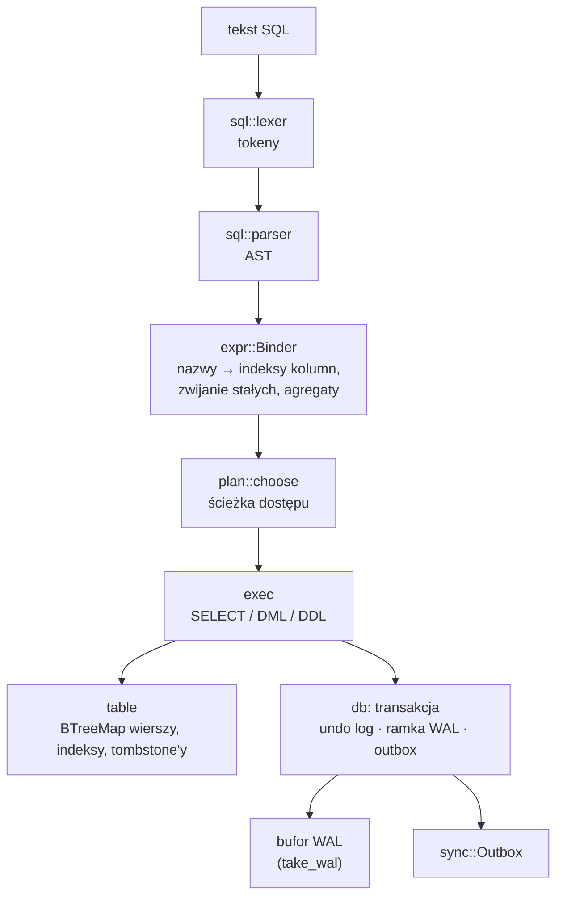
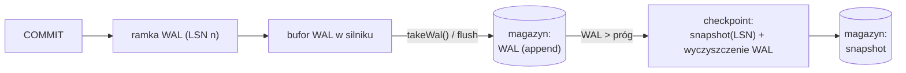

# Architektura Flat-SQL

Dokument opisuje budowę prototypu: warstwy silnika, ścieżkę zapytania i zapisu, warstwę lokalnego składowania, synchronizację Local-First oraz formaty binarne. Na końcu zebrano decyzje projektowe i ich konsekwencje.

## 1. Założenia architektoniczne

1. **Jeden rdzeń, wiele środowisk.** Silnik (`flatsql-core`) jest czystą biblioteką Rust bez zależności i bez operacji wejścia/wyjścia. Kompiluje się do `wasm32-unknown-unknown` (przeglądarka, Node.js, węzły edge) i natywnie (CLI, przyszły panel WinUI przez FFI).
2. **Silnik nie wie, gdzie są dane.** Każda zatwierdzona transakcja produkuje ramkę WAL w buforze w pamięci; host decyduje, gdzie ją zapisać (IndexedDB, plik, OPFS). Snapshot to po prostu tablica bajtów.
3. **Zapytania są synchroniczne i lokalne.** Odczyt i zapis kończą się w pamięci WebAssembly; trwałość i sieć są asynchroniczne i nie blokują aplikacji.
4. **Synchronizacja jest dodatkiem, nie warunkiem działania.** Brak sieci oznacza tylko, że rośnie outbox.

## 2. Warstwy silnika



| Moduł | Opis |
|---|---|
| `value` | typ `Value` (`Null`, `Bool`, `Int`, `Float`, `Text`) z **porządkiem całkowitym** – liczby porównywane numerycznie bez względu na `Int`/`Float`, NaN na końcu – dzięki czemu `Value` może być kluczem `BTreeMap`. Koercja przy zapisie do kolumny jest bezstratna (`2.0` → `INT` tak, `2.5` → `INT` nie). |
| `sql` | ręcznie napisany lekser (komentarze, cudzysłowy, Unicode w identyfikatorach) i parser rekurencyjny zstępujący z precedencją operatorów. Konstrukcje relacyjne (`JOIN`, `FOREIGN KEY`, `REFERENCES`, podzapytania, `UNION`) zwracają czytelny błąd `unsupported` – to część definicji języka. |
| `expr` | wiązanie wyrażeń do postaci `BExpr` (kolumny jako indeksy), zwijanie stałych, wydzielanie agregatów (`COUNT(*) + COUNT(*)` liczony raz). Ewaluacja: liście (kolumna, literał) obsługiwane inline bez wywołania funkcji, predykaty `WHERE` przez osobny ewaluator logiki trójwartościowej. |
| `plan` | wybór ścieżki dostępu na podstawie koniunkcji `WHERE`: PK lookup → PK multi-lookup (`IN`) → indeks (`=`/`IN`) → zakres PK → zakres indeksu → pełny skan; wykrywa warunki sprzeczne (`id > 5 AND id < 5`, `= NULL`). |
| `exec` | SELECT: strumieniowanie z wczesnym zakończeniem dla porządku PK, ograniczony bufor top-k dla `ORDER BY … LIMIT`, grupowanie po kluczach pożyczonych z tabeli; DML i DDL. |
| `db` | obiekt `Database`: katalog, transakcje, WAL, odtwarzanie, API synchronizacji. |
| `storage` | kodek binarny, WAL, snapshot, trait `Storage` (pamięć, plik), `Persistent`. |
| `sync` | zegar HLC, `Change`/`Mutation`, paczki zmian, outbox. |

### Planer – przykład

```text
EXPLAIN SELECT category, COUNT(*) FROM items WHERE price > 10 AND id BETWEEN 100 AND 200 GROUP BY category

SELECT FROM items
  ACCESS:    PRIMARY KEY RANGE SCAN (id >= 100 AND id <= 200)
  FILTER:    (price > 10) AND (id BETWEEN 100 AND 200)
  AGGREGATE: GROUP BY category; COUNT(*)
  OUTPUT:    category, COUNT(*)
```

Pełny warunek jest zawsze sprawdzany na wierszach kandydujących, więc ścieżka dostępu musi jedynie zwrócić nadzbiór wyników – upraszcza to planer i eliminuje całą klasę błędów.

## 3. Transakcje

- Każda instrukcja modyfikująca działa w transakcji: niejawnej (autocommit) albo jawnej (`BEGIN … COMMIT/ROLLBACK`).
- Każda zmiana wiersza/schematu zapisuje wpis w **undo logu** (poprzednia wersja wiersza i tombstone'u). Błąd w połowie instrukcji (np. dzielenie przez zero w 500. wierszu `UPDATE`) cofa tylko tę instrukcję – **atomowość na poziomie instrukcji** także wewnątrz jawnej transakcji.
- Operacje są kodowane do bufora transakcji w chwili wykonania; przy `COMMIT` cały bufor staje się **jedną ramką WAL**, a wpisy outboksu stają się widoczne dla synchronizacji. `ROLLBACK` nie zostawia śladu w WAL.
- Snapshot, eksport outboksu i przyjmowanie zmian zdalnych są zabronione w trakcie jawnej transakcji (widziałyby niezatwierdzony stan).

## 4. Warstwa lokalnego składowania

### 4.1 Model: snapshot + WAL



- **WAL** – tylko dopisywanie; każda ramka ma LSN, liczbę operacji i sumę CRC32.
- **Snapshot** – pełny obraz zatwierdzonego stanu (tabele, tombstone'y, definicje indeksów, outbox, zegar, LSN, node id) z sumą CRC32. Indeksy nie są zapisywane – odbudowuje się je przy wczytaniu.
- **Odtwarzanie** = wczytanie snapshotu + odtworzenie ramek WAL o `LSN > LSN snapshotu`. Ramki starsze są pomijane – to obsługuje awarię między zapisaniem snapshotu a wyczyszczeniem WAL.
- **Urwany zapis**: odczyt WAL zatrzymuje się na pierwszej ramce niekompletnej lub z błędną sumą kontrolną; wszystko przed nią jest poprawne. Raport (`RecoveryReport`) podaje liczbę odrzuconych bajtów, a host od razu wykonuje checkpoint, żeby śmieci nie zostały przed nowymi ramkami. Test `every_wal_prefix_recovers_to_a_committed_state` ucina WAL w **każdym** bajcie i sprawdza, że baza zawsze odpowiada stanowi po ostatniej pełnej transakcji.
- Operacje w WAL są **fizyczne i idempotentne** (`Put` = pełny wiersz, `Delete` = klucz), więc odtworzenie nigdy nie zależy od wyniku wcześniejszych zapytań.

### 4.2 Backendy

| Backend | Gdzie | Zapis WAL | Checkpoint |
|---|---|---|---|
| `IndexedDbStore` | przeglądarka | `add()` do magazynu `wal` (klucze rosnące) | `put` snapshotu i `clear()` WAL w **jednej** transakcji IndexedDB |
| `MemoryStore` | przeglądarka / testy | tablica fragmentów | podmiana |
| `FsStore` (JS) / `FileStorage` (Rust) | Node.js / natywnie | dopisanie do `wal.fsql` (opcjonalnie `fsync`) | zapis `snapshot.fsql.tmp` → `rename` → obcięcie WAL |

Format plików jest wspólny dla Rust i Node.js – katalog danych serwera można otworzyć w CLI.

### 4.3 Group commit w przeglądarce

`FlatDB.exec()` zwraca wynik synchronicznie. Jeśli transakcja wyprodukowała bajty WAL, `FlatDB` planuje `flush()` w najbliższym mikrozadaniu. Wszystkie zatwierdzenia wykonane w jednym „tiku” pętli zdarzeń trafiają więc do IndexedDB jednym zapisem (test: 101 zatwierdzeń → 1 zapis). `await db.flush()` gwarantuje, że wszystko zatwierdzone do tej chwili jest trwałe. Operacje na magazynie są serializowane w jednej kolejce, a checkpoint jest bezpieczny wobec zapisów wykonywanych w trakcie (rozstrzyga LSN).

Semantyka trwałości jest więc analogiczna do `synchronous=NORMAL` w SQLite: po `await flush()` dane są trwałe; zatwierdzenia z ostatnich milisekund mogą przepaść przy nagłym zamknięciu karty, ale baza zawsze wraca do spójnego stanu.

### 4.4 Wiele kart

Dwie karty z własnymi kopiami bazy w pamięci, dopisujące do tego samego WAL, rozjechałyby się. Demo używa **Web Locks API**: pierwsza karta trzyma blokadę i zapisuje do IndexedDB, kolejne przechodzą w tryb tylko-pamięć z ostrzeżeniem. Docelowo: jedna instancja silnika we wspólnym `SharedWorker` lub wybór lidera przez `BroadcastChannel`.

## 5. Synchronizacja Local-First

### 5.1 Model danych synchronizacji

- Każda zmiana ma **znacznik** `Stamp { time, node }`: `time` z hybrydowego zegara logicznego (HLC – milisekundy fizyczne << 16 | licznik logiczny), `node` – losowy identyfikator repliki. Zegar nigdy się nie cofa i „wchłania” znaczniki otrzymane od innych replik.
- **Last-writer-wins per wiersz**: zmiana zdalna jest stosowana tylko, gdy jej znacznik jest większy od znacznika wiersza lub jego **tombstone'u** (usunięte wiersze pamiętają znacznik usunięcia, żeby spóźniony `UPDATE` nie wskrzesił wiersza).
- Porządek znaczników jest całkowity i identyczny na wszystkich replikach, więc stan zbiega się niezależnie od kolejności dostarczania zmian (test losowy: 25 ziaren × 300 operacji na 3 replikach z przerywaną łącznością).

### 5.2 Outbox

- Lokalna zmiana wiersza zapisuje w outboksie tylko **referencję** `(tabela, klucz) → seq`. Przy eksporcie odczytywany jest bieżący stan wiersza (albo tombstone), więc 100 kolejnych `UPDATE` tego samego wiersza wysyła jedną zmianę.
- Zmiany schematu (`CREATE/DROP TABLE/INDEX`) są przechowywane w całości.
- Każda lokalna operacja w WAL niesie swój numer `seq`; potwierdzenie serwera zapisywane jest w WAL jako `Ack(seq)`. Outbox jest więc odbudowywany przy odtwarzaniu i **przetrwa zamknięcie aplikacji w trybie offline**, a potwierdzone zmiany nie są wysyłane ponownie.
- Zmiany otrzymane z serwera są zapisywane w WAL z `seq = 0` – nie trafiają do outboksu (brak „echa”).

### 5.3 Protokół

| Żądanie | Treść | Odpowiedź |
|---|---|---|
| `POST /sync/push?client=ID` | paczka binarna zmian z outboksu | JSON `{applied, ignored, rejected, errors, seq}` |
| `GET /sync/pull?since=N&epoch=E&client=ID` | – | paczka binarna; nagłówki `X-Sync-Cursor`, `X-Sync-Epoch` |

Serwer utrzymuje własną replikę (ten sam silnik WASM) oraz log przyjętych paczek z numerami `seq`. Pull zwraca konkatenację paczek po kursorze (bez własnych zmian klienta). Gdy kursor jest nieznany – nowy klient, restart serwera (nowa `epoch`), log skompaktowany – serwer odsyła pełny stan (`exportState`), który dzięki LWW jest bezpieczny do ponownego zastosowania.

Kolejność kroków w kliencie (`SyncClient`) zapewnia idempotencję: (1) push i `ack` dopiero po odpowiedzi 200, (2) pull i zastosowanie zmian, (3) `flush` WAL, (4) zapis kursora. Przerwanie w dowolnym miejscu kończy się powtórzeniem rundy, a powtórnie dostarczone zmiany są ignorowane (równe znaczniki). Przy braku sieci klient ponawia próby z wykładniczym odstępem (do 30 s) i natychmiast po zdarzeniu `online`.

### 5.4 Tryb edge / cloud

Serwer (`server/server.js`) to Node.js z tym samym modułem `.wasm` – odpowiada wdrożeniu silnika na węźle brzegowym. `POST /api/query` wykonuje SQL zdalnie (model Cloud-First używany jako punkt odniesienia w benchmarkach; parametr `latency` symuluje opóźnienie sieci). Zapisy wykonane przez API trafiają do logu synchronizacji, więc docierają do klientów.

## 6. Formaty binarne

Wspólny kodek: liczby całkowite jako LEB128 (ze znakiem w kodowaniu zig-zag), tekst jako długość + UTF-8, wartości poprzedzone jednobajtowym znacznikiem typu (`0` NULL, `1` FALSE, `2` TRUE, `3` INT, `4` FLOAT (f64 LE), `5` TEXT).

**Ramka WAL**

```text
+-----------+-----------+---------------------------------------------+
| len u32LE | crc u32LE | payload: lsn, op_count, op₁, op₂, …         |
+-----------+-----------+---------------------------------------------+
op = 0x10 seq change      (zmiana; seq > 0 → lokalna, w outboksie)
   | 0x20 upto            (potwierdzenie outboksu)
change = tag stamp body   (1 CREATE TABLE, 2 DROP TABLE, 3 CREATE INDEX,
                           4 DROP INDEX, 5 PUT tabela wartości, 6 DELETE tabela klucz)
```

**Snapshot**

```text
"FLATSQL1" format node_id clock lsn next_seq acked_seq
tabele: schemat, stamp utworzenia, indeksy (nazwa, kolumna), wiersze (stamp + wartości), tombstone'y
outbox: seq, rodzaj (1 = wiersz: tabela + klucz, 2 = zmiana schematu)
crc32 (u32 LE)
```

**Paczka zmian (synchronizacja)**

```text
"FSB1" count change₁ … changeₙ crc32
```

Konkatenacja paczek jest poprawną paczką – serwer przekazuje zapisane paczki bez ponownego kodowania.

## 7. Interfejs Rust ↔ JavaScript

`flatsql-wasm` udostępnia dwie ścieżki zwracania wyników, porównywane w badaniach:

- `exec`/`run` – obiekty i tablice JS budowane z Rust przez `js-sys` (wiele przejść przez granicę WASM↔JS),
- `execJson`/`runJson` – wynik serializowany do JSON w Rust, parsowany przez `JSON.parse` (jedno przekazanie łańcucha).

Dla zapisów masowych `execute` zwraca tylko liczbę zmienionych wierszy. Błędy są obiektami `Error` z polem `kind` (`parse`, `schema`, `constraint`, `type`, `eval`, `transaction`, `storage`, `unsupported`). Panika w Rust trafia do konsoli dzięki `console_error_panic_hook`.

## 8. Decyzje projektowe i kompromisy

| Decyzja | Uzasadnienie | Koszt |
|---|---|---|
| Wymagany `PRIMARY KEY`, brak JOIN | model „płaski” (NoSQL): wiersz adresowany kluczem, replikacja per klucz, prosta i przewidywalna egzekucja | zapytania wielotabelowe trzeba składać w aplikacji |
| Dane w pamięci (`BTreeMap`) | latencja w mikrosekundach, prosty silnik, naturalne dla przeglądarki | rozmiar bazy ograniczony pamięcią; wolniejsze odtwarzanie niż format stronicowy |
| Brak I/O w rdzeniu | ten sam kod w przeglądarce, Node.js, natywnie; trwałość asynchroniczna nie blokuje zapytań | host musi wywoływać `takeWal()` (robi to `FlatDB`/`Persistent`) |
| WAL fizyczny + snapshot | proste i odporne odtwarzanie, przyrostowa trwałość – koszt zatwierdzenia ∝ rozmiarowi zmiany | okresowy checkpoint kopiuje całą bazę |
| LWW z HLC i tombstone'ami | deterministyczna zbieżność bez koordynacji, działa offline | konflikt rozstrzygany dla całego wiersza; tombstone'y rosną (do zbierania po potwierdzeniu przez wszystkie repliki) |
| Rdzeń bez zależności | mały moduł `.wasm` (545 KiB, 206 KiB gzip), pełna kontrola nad formatami | własny parser, kodek i CRC zamiast bibliotek |
