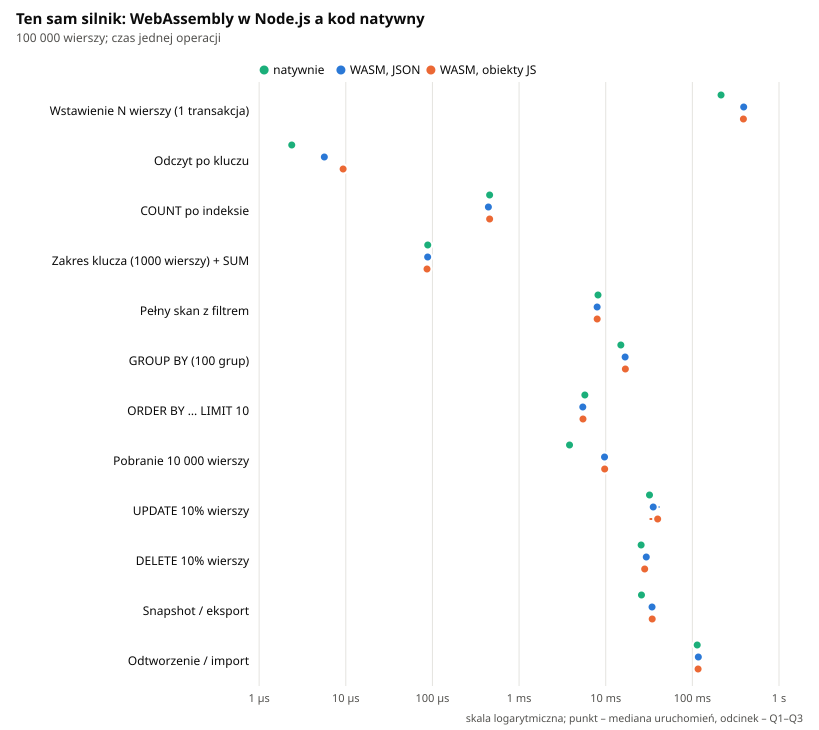
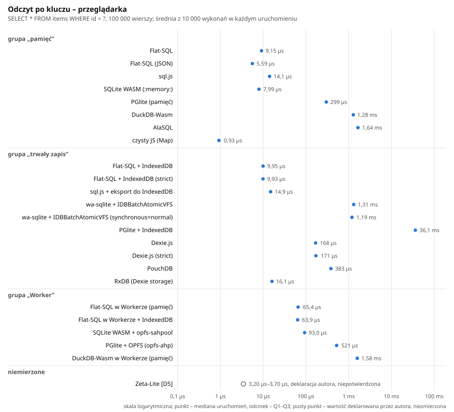
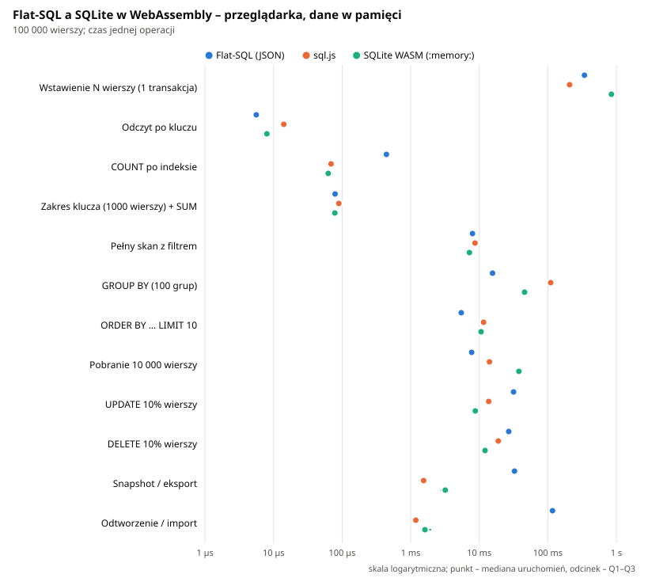
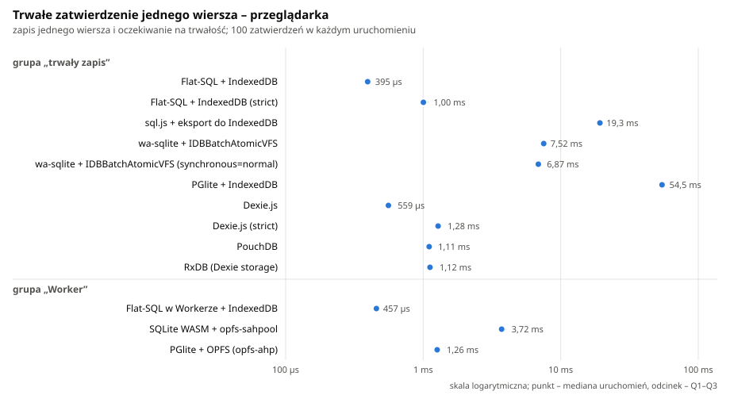
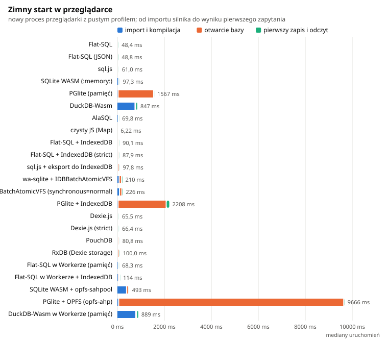
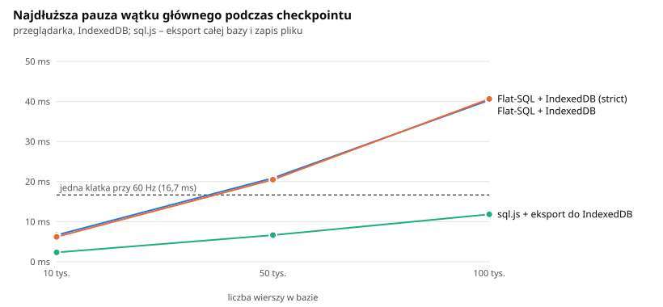
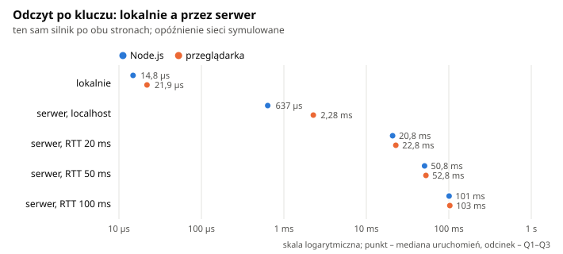
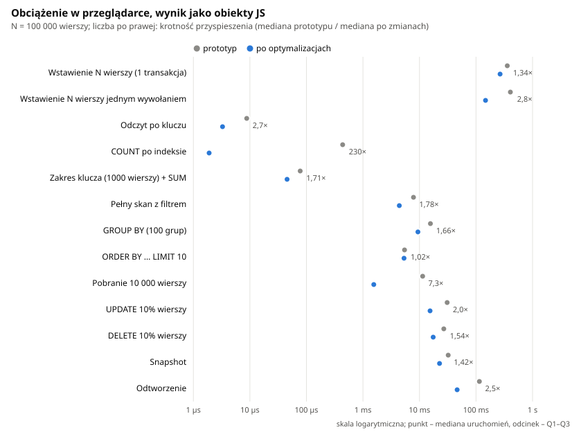
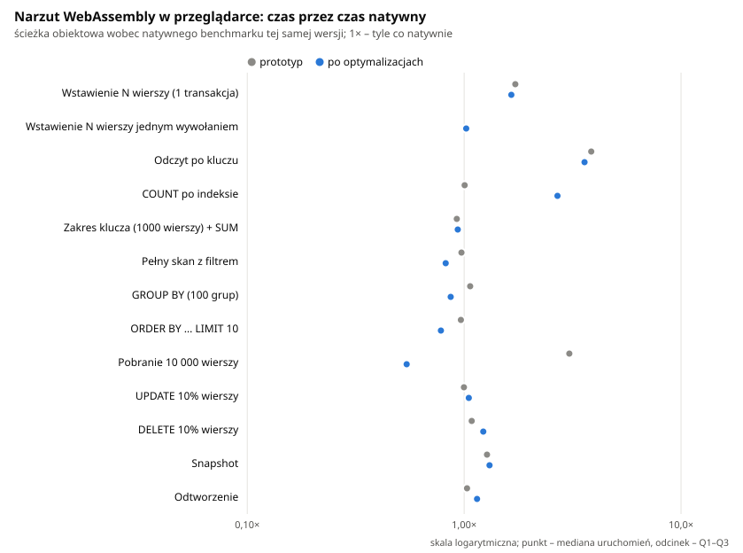

# Wyniki benchmarków i walidacji offline

Dokument zawiera wyniki „Benchmarku 1”, czyli pomiaru prototypu Flat-SQL przed optymalizacjami, wykonanego według [scenariusza badawczego](benchmark-scenario.md), wcześniejsze wyniki wstępne oraz wyniki „Benchmarku 2”, czyli pomiaru wersji po optymalizacjach razem z prototypem tym samym narzędziem ([§3](#3-benchmark-2-wersja-po-optymalizacjach)). Benchmark 1 jest stanem wyjściowym: późniejsze wersje silnika mierzy się tym samym narzędziem razem z prototypem. Surowe wyniki wszystkich procesów, skrypt tworzący tabele i wykresy oraz skrypty analizy leżą w [data/benchmark-1/](data/benchmark-1/); pełne tabele: [data/benchmark-1/tables.md](data/benchmark-1/tables.md).

## 1. Benchmark 1: prototyp przed optymalizacjami

### 1.1 Warunki pomiaru

Pomiar wykonano 24 października 2026 na laptopie z procesorem AMD Ryzen 5 4600H (6 rdzeni, 12 wątków), 16 GB RAM i dyskiem SSD NVMe, w systemie Windows 11 Home (10.0.26200) na zasilaniu sieciowym. Środowiska: Node.js 24.21.0, Microsoft Edge 156.0.4314.42 (Chromium 156) bez okna, sterowany przez playwright-core, strona izolowana (`crossOriginIsolated = true`), oraz natywny CLI skompilowany Rust 1.99.0. Mierzona wersja to tag `prototyp` (commit `261d78f`). Tabela ma N = 100 000 wierszy. Każdy pomiar powtórzono w 10 nowych procesach: 260 procesów Node.js, 20 natywnych i 580 procesów przeglądarki, bez żadnego nieudanego. Koszt utrwalania plików zmierzono dodatkowo w Linuksie (WSL 2, Ubuntu 24.04, ext4) w kolejnych 20 procesach.

Wartości w tabelach to mediana z 10 uruchomień, w nawiasie pierwszy i trzeci kwartyl. Wartość w nawiasie kwadratowym `[n/N]` oznacza, że operacja osiągnęła limit 20 s na uruchomienie i wykonano n z N powtórzeń. Mediana współczynnika zmienności (odchylenie standardowe przez średnią) wszystkich par silnik–operacja wynosi 4,1%, a 90. percentyl 16,5%. Największy rozrzut mają pojedyncze operacje zapisu w przeglądarce, w których jedno z dziesięciu uruchomień trwało kilka razy dłużej (np. UPDATE we Flat-SQL z IndexedDB: dziewięć wyników 38–48 ms i jeden 247 ms); mediana jest na takie uruchomienia odporna.

Pomiar RxDB powtórzono tego samego dnia po poprawce adaptera (pierwsza wersja wymuszała ponowne wykonanie zapytania warunkiem na polu bez indeksu, co zmieniało plan zapytania; zakres klucza trwał wtedy 2,9 s zamiast 30 ms), z tą samą wersją silnika i w tym samym środowisku. Wszystkie silniki w każdej grupie zwróciły te same wyniki: sumy kontrolne 7 zapytań i stan tabeli po każdej fazie zapisu zgadzają się w 3420 porównaniach. Jedynym odstępstwem jest RxDB, którego suma cen 100 000 dokumentów różni się od pozostałych silników o 10⁻⁶ w szóstym miejscu po przecinku, bo dokumenty są sumowane w innej kolejności; mieści się to w tolerancji przyjętej w metodyce. Natywny benchmark Rust daje te same sumy kontrolne co WebAssembly.

### 1.2 Dane w pamięci, Node.js

| Operacja | Flat-SQL | Flat-SQL (JSON) | sql.js | SQLite WASM (:memory:) | PGlite (pamięć) | DuckDB-Wasm | AlaSQL | czysty JS (Map) | Flat-SQL natywnie |
|---|---:|---:|---:|---:|---:|---:|---:|---:|---:|
| Wstawienie N wierszy (1 transakcja) | 388 (383–399) ms | 391 (385–397) ms | 223 (222–224) ms | 910 (896–935) ms | 28,1 (28,0–28,6) s | 53,4 (52,0–54,3) s | 168 (163–189) ms | 49,6 (47,9–50,4) ms | 214 (213–216) ms |
| Odczyt po kluczu | 9,32 (9,14–9,41) µs | 5,65 (5,59–5,72) µs | 15,4 (15,3–15,6) µs | 9,59 (9,52–9,88) µs | 395 (392–404) µs | 1,41 (1,41–1,44) ms | 3,04 (2,96–3,50) ms [4388/10000] | 0,64 (0,62–0,70) µs | 2,38 (2,31–2,39) µs |
| COUNT po indeksie | 457 (450–473) µs | 442 (440–453) µs | 73,1 (71,2–73,4) µs | 59,6 (59,3–61,2) µs | 1,22 (1,20–1,26) ms | 1,15 (1,14–1,19) ms | 4,40 (4,25–4,85) ms | 0,69 (0,58–0,95) µs | 457 (457–461) µs |
| Zakres klucza (1000 wierszy) + SUM | 86,6 (80,3–89,1) µs | 88,1 (85,9–91,7) µs | 97,3 (96,2–102) µs | 83,7 (83,1–86,7) µs | 691 (673–704) µs | 1,44 (1,43–1,45) ms | 3,39 (3,24–3,76) ms | 42,3 (39,2–48,5) µs | 88,3 (83,2–88,3) µs |
| Pełny skan z filtrem | 7,97 (7,92–8,05) ms | 7,96 (7,91–8,08) ms | 7,96 (7,89–8,09) ms | 6,73 (6,68–6,76) ms | 11,4 (11,3–11,8) ms | 770 (744–791) µs | 4,18 (3,72–4,37) ms | 1,03 (0,90–1,83) ms | 8,14 (8,10–8,19) ms |
| GROUP BY (100 grup) | 16,9 (15,9–17,2) ms | 16,8 (16,3–16,9) ms | 116 (115–117) ms | 46,3 (45,7–47,3) ms | 31,6 (31,4–32,5) ms | 4,00 (3,96–4,02) ms | 6,76 (6,38–7,59) ms | 2,76 (2,68–2,86) ms | 14,9 (14,8–15,0) ms |
| ORDER BY … LIMIT 10 | 5,46 (5,36–5,64) ms | 5,44 (5,39–5,48) ms | 11,9 (11,9–12,1) ms | 10,9 (10,8–11,0) ms | 22,4 (22,2–23,1) ms | 1,38 (1,36–1,43) ms | 109 (106–112) ms | 1,58 (1,54–1,71) ms | 5,74 (5,72–5,78) ms |
| Pobranie 10 000 wierszy | 9,73 (9,62–9,86) ms | 9,69 (9,63–9,75) ms | 12,6 (12,4–13,0) ms | 51,1 (50,9–52,3) ms | 95,4 (95,0–95,7) ms | 11,1 (10,9–11,2) ms | 4,94 (4,89–5,86) ms | 1,34 (1,22–1,57) ms | 3,82 (3,80–3,85) ms |
| UPDATE 10% wierszy | 39,8 (32,7–43,1) ms | 35,3 (32,8–40,9) ms | 16,7 (15,5–26,2) ms | 9,43 (9,19–9,73) ms | 97,1 (96,4–98,8) ms | 11,1 (10,4–12,9) ms | 10,8 (9,65–11,4) ms | 2,88 (2,81–3,19) ms | 32,0 (31,7–32,2) ms |
| DELETE 10% wierszy | 28,2 (28,0–29,2) ms | 29,4 (28,2–31,2) ms | 20,2 (19,9–21,1) ms | 11,9 (11,6–12,4) ms | 48,9 (48,6–52,3) ms | 25,0 (22,7–26,1) ms | 7,55 (7,36–8,77) ms | 7,94 (7,00–8,20) ms | 25,6 (25,5–26,0) ms |
| Snapshot / eksport | 34,4 (34,1–35,1) ms | 34,2 (33,7–35,4) ms | 1,59 (1,43–1,96) ms | 3,41 (3,18–3,67) ms | 120 (118–122) ms | – | – | 23,1 (22,5–23,4) ms | 25,9 (25,6–26,1) ms |
| Odtworzenie / import | 116 (116–117) ms | 117 (116–119) ms | 1,24 (1,17–1,27) ms | 1,76 (1,71–1,87) ms | 547 (534–590) ms | – | – | 47,0 (44,6–49,7) ms | 114 (113–114) ms |

Zgodność wyników (sumy kontrolne wszystkich zapytań i stanu tabeli po każdej fazie, wszystkie uruchomienia): zgodne we wszystkich 860 porównaniach; przy operacjach przerwanych limitem czasu porównano pierwsze 3 wyniki.

### 1.3 Dane w pamięci, przeglądarka

| Operacja | Flat-SQL | Flat-SQL (JSON) | sql.js | SQLite WASM (:memory:) | PGlite (pamięć) | DuckDB-Wasm | AlaSQL | czysty JS (Map) |
|---|---:|---:|---:|---:|---:|---:|---:|---:|
| Wstawienie N wierszy (1 transakcja) | 367 (364–369) ms | 343 (341–345) ms | 208 (208–213) ms | 846 (837–867) ms | 20,3 (20,2–20,7) s | 42,3 (42,0–42,6) s | 97,2 (95,4–102) ms | 53,9 (46,8–59,8) ms |
| Odczyt po kluczu | 9,15 (9,10–9,21) µs | 5,59 (5,51–5,65) µs | 14,1 (14,0–14,2) µs | 7,99 (7,92–8,16) µs | 299 (294–301) µs | 1,28 (1,28–1,28) ms | 1,64 (1,63–1,67) ms | 0,93 (0,86–0,98) µs |
| COUNT po indeksie | 438 (437–442) µs | 442 (437–448) µs | 68,9 (67,8–70,4) µs | 62,6 (61,6–65,7) µs | 1,12 (1,09–1,15) ms | 1,01 (1,00–1,04) ms | 2,86 (2,83–2,87) ms | 0,88 (0,78–0,99) µs |
| Zakres klucza (1000 wierszy) + SUM | 80,7 (79,5–81,5) µs | 78,9 (75,6–83,2) µs | 89,5 (88,9–89,7) µs | 78,2 (77,1–80,3) µs | 604 (594–613) µs | 1,31 (1,30–1,34) ms | 1,85 (1,83–1,88) ms | 41,1 (37,9–43,2) µs |
| Pełny skan z filtrem | 7,98 (7,92–8,09) ms | 7,97 (7,83–8,11) ms | 8,68 (8,31–8,74) ms | 7,19 (6,86–7,62) ms | 13,4 (13,3–13,5) ms | 589 (575–619) µs | 2,23 (2,19–2,29) ms | 632 (597–702) µs |
| GROUP BY (100 grup) | 15,7 (15,5–15,9) ms | 15,6 (15,4–15,8) ms | 110 (109–111) ms | 45,8 (45,0–46,3) ms | 33,2 (33,1–33,4) ms | 3,55 (3,52–3,58) ms | 4,10 (3,97–4,24) ms | 1,68 (1,63–1,83) ms |
| ORDER BY … LIMIT 10 | 5,52 (5,43–6,04) ms | 5,47 (5,45–5,50) ms | 11,6 (11,4–11,9) ms | 10,6 (10,5–10,7) ms | 23,2 (23,2–23,5) ms | 1,36 (1,34–1,39) ms | 87,4 (86,6–88,8) ms | 1,38 (1,25–1,55) ms |
| Pobranie 10 000 wierszy | 12,0 (11,9–12,1) ms | 7,75 (7,68–7,78) ms | 14,1 (14,0–14,2) ms | 37,9 (37,6–38,1) ms | 81,7 (81,3–82,8) ms | 12,2 (12,0–12,4) ms | 2,68 (2,60–2,76) ms | 598 (518–797) µs |
| UPDATE 10% wierszy | 31,0 (30,9–31,7) ms | 31,7 (31,2–32,0) ms | 13,7 (13,5–14,1) ms | 8,76 (8,68–8,93) ms | 101 (96,6–104) ms | 10,7 (10,0–12,1) ms | 8,19 (7,83–8,91) ms | 1,87 (1,77–2,26) ms |
| DELETE 10% wierszy | 27,3 (26,9–27,4) ms | 26,9 (26,7–27,2) ms | 18,9 (18,5–19,4) ms | 12,2 (11,9–12,3) ms | 49,7 (48,8–50,5) ms | 18,8 (18,4–19,3) ms | 6,69 (5,86–6,85) ms | 5,17 (5,08–5,68) ms |
| Snapshot / eksport | 32,1 (32,0–32,4) ms | 32,7 (32,5–33,1) ms | 1,54 (1,36–1,70) ms | 3,19 (2,78–3,41) ms | 131 (130–134) ms | – | – | 17,1 (16,9–17,4) ms |
| Odtworzenie / import | 116 (115–117) ms | 117 (116–117) ms | 1,19 (1,14–1,27) ms | 1,61 (1,57–1,95) ms | 470 (468–474) ms | – | – | 27,3 (27,0–28,0) ms |

Zgodność wyników (sumy kontrolne wszystkich zapytań i stanu tabeli po każdej fazie, wszystkie uruchomienia): zgodne we wszystkich 860 porównaniach.

### 1.4 Trwały zapis w IndexedDB, wątek główny przeglądarki

| Operacja | Flat-SQL + IndexedDB | Flat-SQL + IndexedDB (strict) | sql.js + eksport do IndexedDB | wa-sqlite + IDBBatchAtomicVFS | wa-sqlite + IDBBatchAtomicVFS (synchronous=normal) | PGlite + IndexedDB | Dexie.js | Dexie.js (strict) | PouchDB | RxDB (Dexie storage) |
|---|---:|---:|---:|---:|---:|---:|---:|---:|---:|---:|
| Wstawienie N wierszy (1 transakcja) | 471 (467–477) ms | 487 (477–491) ms | 235 (233–330) ms | 1,12 (1,10–1,17) s | 1,10 (1,09–1,13) s | 20,3 (20,2–20,7) s | 8,82 (8,74–9,00) s | 8,88 (8,76–9,07) s | 20,7 (20,4–21,1) s | 16,2 (16,0–16,4) s |
| Budowa indeksów (widoki PouchDB) | – | – | – | – | – | – | – | – | 96,2 (95,5–98,8) s | – |
| Odczyt po kluczu | 9,95 (9,85–10,0) µs | 9,93 (9,82–10,00) µs | 14,9 (14,7–15,1) µs | 1,31 (1,28–1,32) ms | 1,19 (1,17–1,23) ms | 36,1 (35,6–36,6) ms [538/10000] | 168 (162–172) µs | 171 (165–180) µs | 383 (381–389) µs | 10,8 (10,6–10,9) µs |
| COUNT po indeksie | 449 (439–460) µs | 450 (441–460) µs | 67,1 (66,8–68,9) µs | 1,36 (1,33–1,39) ms | 1,30 (1,24–1,31) ms | 36,8 (36,4–37,3) ms | 7,85 (7,77–7,91) ms | 7,86 (7,78–7,98) ms | 54,8 (54,7–56,0) ms [339/500] | 11,6 (11,6–11,8) ms |
| Zakres klucza (1000 wierszy) + SUM | 85,3 (82,9–87,3) µs | 84,8 (82,8–86,2) µs | 94,6 (93,5–95,6) µs | 2,15 (2,11–2,23) ms | 2,03 (1,98–2,14) ms | 36,3 (35,8–37,1) ms | 7,66 (7,55–7,96) ms | 7,57 (7,49–7,66) ms | 44,0 (43,4–44,6) ms | 30,3 (29,4–30,9) ms |
| Pełny skan z filtrem | 8,93 (8,86–9,06) ms | 9,04 (8,98–9,21) ms | 8,23 (8,22–8,30) ms | 163 (162–180) ms | 163 (161–170) ms | 49,0 (47,4–49,6) ms | 1,40 (1,37–1,43) s [14/20] | 1,42 (1,40–1,45) s [13/20] | 4,56 (4,53–4,61) s [5/20] | 1,92 (1,91–1,96) s [10/20] |
| GROUP BY (100 grup) | 16,2 (16,1–16,6) ms | 16,8 (16,3–17,3) ms | 110 (108–112) ms | 15,0 (14,8–15,2) s [4/20] | 14,9 (14,8–15,1) s [4/20] | 68,6 (67,2–69,4) ms | 573 (568–583) ms | 578 (573–581) ms | 4,61 (4,55–4,64) s [5/20] | 3,16 (3,11–3,24) s [7/20] |
| ORDER BY … LIMIT 10 | 5,95 (5,71–6,03) ms | 5,58 (5,51–5,86) ms | 11,3 (11,1–11,5) ms | 189 (180–193) ms | 177 (176–186) ms | 58,0 (56,8–58,7) ms | 700 (663–733) µs | 709 (664–747) µs | 7,47 (7,25–7,82) ms | 3,74 (3,69–3,75) s [6/20] |
| Pobranie 10 000 wierszy | 14,7 (14,6–14,8) ms | 14,7 (13,7–14,8) ms | 14,0 (13,8–14,2) ms | 29,3 (28,9–30,4) ms | 29,4 (28,8–43,0) ms | 115 (114–117) ms | 55,9 (55,6–56,4) ms | 55,5 (55,1–56,4) ms | 416 (414–427) ms | 267 (259–275) ms |
| UPDATE 10% wierszy | 38,9 (37,8–47,2) ms | 40,1 (39,0–41,1) ms | 36,8 (31,8–41,4) ms | 1,66 (1,59–1,72) s | 1,72 (1,70–2,02) s | 200 (198–202) ms | 2,88 (2,80–2,93) s | 2,90 (2,86–2,97) s | 7,17 (7,09–7,22) s | 5,82 (5,73–5,89) s |
| DELETE 10% wierszy | 33,4 (32,9–33,9) ms | 34,3 (34,3–34,7) ms | 37,7 (37,5–37,9) ms | 1,78 (1,75–1,80) s | 1,84 (1,83–1,87) s | 155 (148–158) ms | 2,49 (2,45–2,52) s | 2,55 (2,50–2,74) s | 7,15 (7,11–7,21) s | 4,87 (4,84–5,03) s |
| Trwałe zatwierdzenie 1 wiersza | 395 (384–403) µs | 1,00 (0,98–1,07) ms | 19,3 (19,2–19,3) ms | 7,52 (7,46–7,58) ms | 6,87 (6,79–7,13) ms | 54,5 (54,0–55,5) ms | 559 (550–587) µs | 1,28 (1,26–1,35) ms | 1,11 (1,07–1,15) ms | 1,33 (1,17–2,69) ms |
| 1000 zatwierdzeń, jedno oczekiwanie | 5,85 (5,73–5,95) ms | 6,66 (6,59–6,74) ms | 89,0 (85,9–93,6) ms | 4,79 (4,78–4,97) s | 3,70 (3,67–3,76) s | 57,4 (57,1–58,3) s | 358 (347–375) ms | 1,05 (0,99–1,09) s | 1,02 (0,99–1,05) s | 993 (917–1048) ms |
| Ponowne otwarcie + 1. zapytanie | 174 (172–175) ms | 173 (172–174) ms | 10,7 (10,5–10,8) ms | 7,69 (5,74–8,49) ms | 7,81 (6,96–8,05) ms | 847 (844–862) ms | 2,82 (2,77–2,96) ms | 3,12 (2,93–3,34) ms | 944 (937–957) ms | 13,6 (13,2–14,6) ms |

Zgodność wyników (sumy kontrolne wszystkich zapytań i stanu tabeli po każdej fazie, wszystkie uruchomienia): zgodne we wszystkich 1200 porównaniach; przy operacjach przerwanych limitem czasu porównano pierwsze 3 wyniki; stan tabeli zgodny w granicy błędu zaokrąglenia sumy (względnie 10^-9): RxDB (Dexie storage) (20 porównań).

| Silnik | Grupa | Wstawienie N wierszy do trwałości | Zatwierdzenie 1 wiersza | p95 zatwierdzenia | 1000 zatwierdzeń – na jedno | Ponowne otwarcie + 1. zapytanie |
|---|---|---:|---:|---:|---:|---:|
| Flat-SQL + IndexedDB | trwały zapis | 471 (467–477) ms | 395 (384–403) µs | 588 (551–615) µs | 5,85 (5,73–5,95) µs | 174 (172–175) ms |
| Flat-SQL + IndexedDB (strict) | trwały zapis | 487 (477–491) ms | 1,00 (0,98–1,07) ms | 1,24 (1,22–1,26) ms | 6,66 (6,59–6,74) µs | 173 (172–174) ms |
| sql.js + eksport do IndexedDB | trwały zapis | 235 (233–330) ms | 19,3 (19,2–19,3) ms | 21,1 (21,0–21,5) ms | 89,0 (85,9–93,6) µs | 10,7 (10,5–10,8) ms |
| wa-sqlite + IDBBatchAtomicVFS | trwały zapis | 1,12 (1,10–1,17) s | 7,52 (7,46–7,58) ms | 9,88 (9,60–10,2) ms | 4,79 (4,78–4,97) ms | 7,69 (5,74–8,49) ms |
| wa-sqlite + IDBBatchAtomicVFS (synchronous=normal) | trwały zapis | 1,10 (1,09–1,13) s | 6,87 (6,79–7,13) ms | 9,01 (8,78–9,11) ms | 3,70 (3,67–3,76) ms | 7,81 (6,96–8,05) ms |
| PGlite + IndexedDB | trwały zapis | 20,3 (20,2–20,7) s | 54,5 (54,0–55,5) ms | 57,9 (57,0–59,0) ms | 57,4 (57,1–58,3) ms | 847 (844–862) ms |
| Dexie.js | trwały zapis | 8,82 (8,74–9,00) s | 559 (550–587) µs | 777 (741–829) µs | 358 (347–375) µs | 2,82 (2,77–2,96) ms |
| Dexie.js (strict) | trwały zapis | 8,88 (8,76–9,07) s | 1,28 (1,26–1,35) ms | 1,56 (1,54–1,60) ms | 1,05 (0,99–1,09) ms | 3,12 (2,93–3,34) ms |
| PouchDB | trwały zapis | 20,7 (20,4–21,1) s | 1,11 (1,07–1,15) ms | 1,44 (1,42–1,49) ms | 1,02 (0,99–1,05) ms | 944 (937–957) ms |
| RxDB (Dexie storage) | trwały zapis | 16,2 (16,0–16,4) s | 1,33 (1,17–2,69) ms | 1,70 (1,50–13,5) ms | 993 (917–1048) µs | 13,6 (13,2–14,6) ms |
| Flat-SQL w Workerze + IndexedDB | Worker | 466 (464–468) ms | 457 (450–460) µs | 685 (642–720) µs | 6,27 (6,00–6,43) µs | 181 (181–183) ms |
| SQLite WASM + opfs-sahpool | Worker | 930 (922–934) ms | 3,72 (3,66–3,95) ms | 4,25 (4,22–4,64) ms | 3,48 (3,45–3,51) ms | 2,31 (2,16–2,46) ms |
| PGlite + OPFS (opfs-ahp) | Worker | 21,3 (21,2–21,3) s | 1,26 (1,24–1,33) ms | 1,58 (1,52–1,63) ms | 1,04 (1,03–1,05) ms | 7,14 (7,12–7,38) s |

### 1.5 Silnik w Web Workerze

| Operacja | Flat-SQL w Workerze (pamięć) | Flat-SQL w Workerze + IndexedDB | SQLite WASM + opfs-sahpool | PGlite + OPFS (opfs-ahp) | DuckDB-Wasm w Workerze (pamięć) |
|---|---:|---:|---:|---:|---:|
| Wstawienie N wierszy (1 transakcja) | 367 (362–370) ms | 466 (464–468) ms | 930 (922–934) ms | 21,3 (21,2–21,3) s | 42,3 (41,9–42,7) s |
| Odczyt po kluczu | 65,4 (64,2–68,8) µs | 63,9 (62,8–65,2) µs | 93,0 (92,4–93,5) µs | 521 (511–543) µs | 1,58 (1,56–1,60) ms |
| COUNT po indeksie | 615 (587–628) µs | 601 (580–616) µs | 159 (157–160) µs | 1,45 (1,42–1,48) ms | 1,32 (1,31–1,35) ms |
| Zakres klucza (1000 wierszy) + SUM | 150 (148–153) µs | 149 (146–153) µs | 175 (174–178) µs | 920 (914–941) µs | 1,64 (1,62–1,67) ms |
| Pełny skan z filtrem | 8,42 (8,32–8,59) ms | 9,37 (9,32–9,45) ms | 8,18 (8,10–8,22) ms | 13,8 (13,7–14,1) ms | 914 (871–943) µs |
| GROUP BY (100 grup) | 18,2 (17,9–18,5) ms | 18,1 (16,9–19,7) ms | 46,5 (45,7–47,2) ms | 34,1 (33,8–34,7) ms | 4,10 (4,08–4,15) ms |
| ORDER BY … LIMIT 10 | 5,85 (5,78–5,94) ms | 5,93 (5,76–5,98) ms | 11,1 (11,0–11,1) ms | 23,4 (23,1–23,6) ms | 1,67 (1,61–1,71) ms |
| Pobranie 10 000 wierszy | 23,1 (23,0–23,4) ms | 25,9 (25,9–26,2) ms | 43,8 (43,4–44,2) ms | 95,1 (94,0–96,6) ms | 23,9 (23,7–24,1) ms |
| UPDATE 10% wierszy | 35,7 (35,2–36,7) ms | 44,4 (43,3–47,4) ms | 54,0 (53,4–57,9) ms | 117 (114–120) ms | 13,7 (13,1–14,5) ms |
| DELETE 10% wierszy | 27,2 (26,9–27,8) ms | 33,3 (32,9–33,7) ms | 54,2 (53,8–58,0) ms | 93,3 (90,8–97,7) ms | 18,9 (18,8–19,4) ms |
| Trwałe zatwierdzenie 1 wiersza | – | 457 (450–460) µs | 3,72 (3,66–3,95) ms | 1,26 (1,24–1,33) ms | – |
| 1000 zatwierdzeń, jedno oczekiwanie | – | 6,27 (6,00–6,43) ms | 3,48 (3,45–3,51) s | 1,04 (1,03–1,05) s | – |
| Ponowne otwarcie + 1. zapytanie | – | 181 (181–183) ms | 2,31 (2,16–2,46) ms | 7,14 (7,12–7,38) s | – |

Zgodność wyników (sumy kontrolne wszystkich zapytań i stanu tabeli po każdej fazie, wszystkie uruchomienia): zgodne we wszystkich 500 porównaniach.

### 1.6 Rozmiar modułu, zimny start i pamięć

Zimny start: nowy proces przeglądarki z pustym profilem (bez pamięci podręcznej HTTP i skompilowanego kodu), od rozpoczęcia importu silnika do wyniku pierwszego zapytania: import i kompilacja modułu, otwarcie bazy ze schematem, pierwszy zapis i odczyt. Rozmiar: wszystkie pliki pakietu silnika pobrane w zimnym starcie (bez kodu pomiaru), gzip -9; dla pakietu z kilkoma konfiguracjami największy zestaw, bo lista zasobów strony w wątku głównym nie zawierała pliku .wasm pakietu synchronicznego DuckDB-Wasm, choć silnik go wczytał. Pamięć: po wczytaniu 100 000 wierszy, pamięć liniowa WebAssembly (nie maleje) i przyrost sterty JS w Node.js po pełnym odśmiecaniu.

| Silnik | Grupa | Wymagania | Moduł (gzip) | Zimny start – przeglądarka | w tym import i kompilacja | Zimny start – Node.js | Pamięć WASM po wczytaniu | Przyrost sterty JS (Node.js) |
|---|---|---|---:|---:|---:|---:|---:|---:|
| Flat-SQL | pamięć | brak | 230 KiB | 47,9 (45,3–54,6) ms | 38,0 (34,7–41,8) ms | 56,3 (54,1–57,4) ms | 73,3 MiB | 0,0 MiB |
| Flat-SQL (JSON) | pamięć | brak | 230 KiB | 48,3 (45,8–51,6) ms | 36,3 (34,1–39,6) ms | 54,6 (53,3–57,3) ms | 73,3 MiB | 0,0 MiB |
| sql.js | pamięć | brak | 331 KiB | 63,2 (59,5–68,9) ms | 35,7 (34,7–38,3) ms | 49,4 (48,4–50,5) ms | 21,1 MiB | 0,1 MiB |
| SQLite WASM (:memory:) | pamięć | brak | 583 KiB | 97,2 (93,5–103) ms | 73,5 (69,4–75,8) ms | 59,8 (58,7–60,0) ms | 8,0 MiB | 0,2 MiB |
| PGlite (pamięć) | pamięć | brak | 5748 KiB | 1,57 (1,56–1,59) s | 50,3 (48,5–52,7) ms | 1,78 (1,73–1,84) s | 189 MiB | 0,6 MiB |
| DuckDB-Wasm | pamięć | brak | 7813 KiB | 844 (836–862) ms | 770 (759–786) ms | 1,12 (1,10–1,15) s | 23,1 MiB | 2,5 MiB |
| AlaSQL | pamięć | brak | 111 KiB | 72,2 (65,2–78,5) ms | 59,1 (54,9–67,7) ms | 82,7 (82,0–83,7) ms | nie dotyczy | 13,5 MiB |
| czysty JS (Map) | pamięć | brak | 0 KiB | 6,22 (5,72–6,66) ms | 6,02 (5,50–6,46) ms | 1,97 (1,79–2,04) ms | nie dotyczy | 20,7 MiB |
| Flat-SQL + IndexedDB | trwały zapis | IndexedDB | 230 KiB | 91,7 (83,2–102) ms | 40,2 (35,8–47,4) ms | – | – | – |
| Flat-SQL + IndexedDB (strict) | trwały zapis | IndexedDB | 230 KiB | 87,2 (84,1–95,2) ms | 35,4 (34,9–38,6) ms | – | – | – |
| sql.js + eksport do IndexedDB | trwały zapis | IndexedDB | 331 KiB | 97,7 (93,5–107) ms | 34,3 (32,5–38,4) ms | – | – | – |
| wa-sqlite + IDBBatchAtomicVFS | trwały zapis | IndexedDB | 821 KiB | 211 (204–216) ms | 95,7 (93,4–105) ms | – | – | – |
| wa-sqlite + IDBBatchAtomicVFS (synchronous=normal) | trwały zapis | IndexedDB | 821 KiB | 220 (211–379) ms | 111 (103–116) ms | – | – | – |
| PGlite + IndexedDB | trwały zapis | IndexedDB | 5748 KiB | 2,22 (2,19–2,53) s | 50,0 (47,2–54,6) ms | – | – | – |
| Dexie.js | trwały zapis | IndexedDB | 49 KiB | 68,1 (62,5–70,4) ms | 23,0 (21,6–25,7) ms | – | nie dotyczy | – |
| Dexie.js (strict) | trwały zapis | IndexedDB | 49 KiB | 64,4 (63,8–66,9) ms | 23,4 (21,6–23,9) ms | – | nie dotyczy | – |
| PouchDB | trwały zapis | IndexedDB | 42 KiB | 77,9 (76,3–83,7) ms | 28,7 (25,6–29,8) ms | – | nie dotyczy | – |
| RxDB (Dexie storage) | trwały zapis | IndexedDB | 80 KiB | 103 (95,7–109) ms | 31,1 (29,1–37,3) ms | – | nie dotyczy | – |
| Flat-SQL w Workerze (pamięć) | Worker | Worker | 230 KiB | 70,0 (65,7–74,2) ms | 56,8 (55,0–62,7) ms | – | – | – |
| Flat-SQL w Workerze + IndexedDB | Worker | Worker, IndexedDB | 230 KiB | 116 (112–122) ms | 61,2 (56,2–71,3) ms | – | – | – |
| SQLite WASM + opfs-sahpool | Worker | Worker, OPFS | 583 KiB | 490 (487–501) ms | 410 (404–418) ms | – | – | – |
| PGlite + OPFS (opfs-ahp) | Worker | Worker, OPFS | 5748 KiB | 9,67 (9,62–9,71) s | 75,2 (69,9–83,8) ms | – | – | – |
| DuckDB-Wasm w Workerze (pamięć) | Worker | Worker | 7813 KiB | 891 (887–903) ms | 805 (802–818) ms | – | – | – |

Silniki niemierzone, dla porównania z deklaracjami autorów (wartości niepotwierdzone pomiarem, uzyskane w innych warunkach):

Wartości podane przez autorów, niepotwierdzone pomiarem w tym benchmarku; warunki ich pomiaru są inne niż w tabelach powyżej i nie można ich porównywać wprost.

| Silnik | Źródło | Odczyt po kluczu | Moduł (gzip) | Uwagi |
|---|---|---:|---:|---:|
| Zeta-Lite | [D5] | 3,20–3,70 µs | 2,87 MB | preprint, wrzesień 2026; warunki pomiaru autora, nie powtórzone w tym benchmarku |

### 1.7 Pauza checkpointu

Najdłuższa przerwa między kolejnymi obrotami pętli zdarzeń (sonda `MessageChannel`) podczas `checkpoint()`; dla sql.js – eksport całej bazy i zapis do IndexedDB. Budżet jednej klatki przy 60 Hz: 16,7 ms.

| Silnik | 10 tys. – najdłuższa pauza | 10 tys. – cały checkpoint | 50 tys. – najdłuższa pauza | 50 tys. – cały checkpoint | 100 tys. – najdłuższa pauza | 100 tys. – cały checkpoint | Snapshot przy 100 tys. | Bezczynność – najdłuższa przerwa |
|---|---:|---:|---:|---:|---:|---:|---:|---:|
| Flat-SQL + IndexedDB | 6,66 (5,98–6,77) ms | 11,5 (11,0–11,7) ms | 20,9 (20,6–21,1) ms | 26,7 (26,2–27,1) ms | 40,3 (40,2–40,7) ms | 48,2 (47,6–48,6) ms | 5,7 MiB | 2,30 (1,17–2,49) ms |
| Flat-SQL + IndexedDB (strict) | 6,21 (6,19–6,34) ms | 12,9 (12,1–13,2) ms | 20,5 (20,3–20,7) ms | 28,7 (27,9–29,2) ms | 40,6 (40,4–40,9) ms | 53,3 (51,9–56,1) ms | 5,7 MiB | 2,25 (2,19–2,42) ms |
| sql.js + eksport do IndexedDB | 2,34 (2,05–2,53) ms | 6,45 (5,90–6,80) ms | 6,65 (6,54–7,06) ms | 11,9 (11,4–15,3) ms | 11,8 (11,5–12,1) ms | 19,2 (18,5–20,1) ms | 4,5 MiB | 2,34 (1,97–2,67) ms |

### 1.8 Local-First a Cloud-First

Odczyt po kluczu z tabeli 10 000 wierszy: lokalnie (`db.exec`, z parsowaniem SQL) i przez `POST /api/query` do serwera z tym samym silnikiem; opóźnienie sieci symulowane po stronie serwera.

| Tryb | Node.js | krotność lokalnego | Przeglądarka | krotność lokalnego |
|---|---:|---:|---:|---:|
| lokalnie (WASM w procesie) | 14,8 (14,6–15,3) µs | 1,00× | 21,9 (20,7–22,7) µs | 1,00× |
| serwer, localhost | 637 (622–665) µs | 43× | 2,28 (2,22–2,34) ms | 104× |
| serwer, RTT 20 ms | 20,8 (20,8–20,8) ms | 1403× | 22,8 (22,7–22,8) ms | 1040× |
| serwer, RTT 50 ms | 50,8 (50,8–50,8) ms | 3426× | 52,8 (52,7–52,9) ms | 2412× |
| serwer, RTT 100 ms | 101 (101–101) ms | 6796× | 103 (103–103) ms | 4701× |

### 1.9 Koszt utrwalania plików

Linux: WSL 2 na tym samym laptopie, katalog roboczy /tmp na ext4 (wirtualny dysk WSL na tym samym SSD), CLI zbudowane na x86_64-unknown-linux-musl z rust-lld, bo w systemie nie ma kompilatora C; jądro 6.6.87.2-microsoft-standard-WSL2, Ubuntu 24.04.4 LTS, Node.js v24.21.0.

| Magazyn | Wstawienie N wierszy (1 transakcja) | Trwałe zatwierdzenie 1 wiersza | 1000 zatwierdzeń, jedno oczekiwanie | Checkpoint (snapshot + fsync katalogu) | Ponowne otwarcie + 1. zapytanie |
|---|---:|---:|---:|---:|---:|
| Windows: FileStorage (CLI), fsync | 282 (268–430) ms | 579 (525–596) µs | 3,61 (3,50–3,86) ms | 39,7 (38,2–40,9) ms | 120 (120–121) ms |
| Windows: FileStorage (CLI), bez fsync | 263 (258–267) ms | 10,1 (9,76–10,5) µs | 2,79 (2,75–2,92) ms | 40,1 (38,4–41,3) ms | 121 (120–121) ms |
| Windows: FsStore (Node.js), fsync | 610 (602–616) ms | 1,34 (1,30–1,36) ms | 7,05 (6,83–7,13) ms | 48,2 (47,4–48,6) ms | 112 (112–115) ms |
| Windows: FsStore (Node.js), bez fsync | 399 (397–402) ms | 602 (588–624) µs | 5,54 (5,18–5,61) ms | 47,8 (46,9–48,4) ms | 101 (99,0–102) ms |
| Linux: FileStorage (CLI), fsync | 358 (353–360) ms | 2,15 (2,10–2,18) ms | 7,68 (7,33–7,92) ms | 56,5 (55,8–56,6) ms | 166 (165–167) ms |
| Linux: FileStorage (CLI), bez fsync | 344 (342–348) ms | 9,01 (8,73–9,19) µs | 4,11 (3,96–4,30) ms | 54,5 (54,3–56,2) ms | 166 (165–167) ms |
| Linux: FsStore (Node.js), fsync | 628 (624–636) ms | 2,91 (2,84–2,95) ms | 10,5 (10,3–11,0) ms | 78,9 (76,1–80,9) ms | 133 (132–135) ms |
| Linux: FsStore (Node.js), bez fsync | 462 (461–466) ms | 400 (387–413) µs | 5,09 (4,94–5,31) ms | 74,8 (72,2–76,7) ms | 121 (119–121) ms |

Windows: runda synchronizacji z jedną zmianą (`/sync/push` + `/sync/pull`, localhost) wobec serwera z katalogiem danych (FsStore, fsync) 698 (676–730) µs, wobec serwera w pamięci 583 (571–607) µs.

Linux: runda synchronizacji z jedną zmianą (`/sync/push` + `/sync/pull`, localhost) wobec serwera z katalogiem danych (FsStore, fsync) 798 (761–830) µs, wobec serwera w pamięci 633 (620–671) µs.

### 1.10 Odniesienie do hipotez

H1 (Local-First a Cloud-First) potwierdzona. Lokalne zapytanie po kluczu z tekstem SQL trwa 14,8 µs w Node.js i 21,9 µs w przeglądarce. Zapytanie przez serwer na tym samym komputerze jest 43 razy (Node.js) i 104 razy (przeglądarka) wolniejsze, a przy symulowanym RTT 20–100 ms od 1040 do 6796 razy wolniejsze, czyli o trzy do czterech rzędów wielkości. Czas zapytania przez sieć niemal równa się RTT; koszt wykonania na serwerze jest pomijalny, a ten wynik jest dolnym ograniczeniem, bo symulacja pomija TLS, zestawianie połączeń i zmienność opóźnień.

H2 (narzut WebAssembly) potwierdzona tylko częściowo, z przesunięciem przyczyny. Operacje wykonywane w całości w silniku trwają w WebAssembly tyle samo co natywnie: pełny skan, top-k, zakres klucza, `COUNT` po indeksie i odtworzenie snapshotu mają stosunek 0,89–1,03, a grupowanie 1,05–1,13. Hipoteza zakładała 1,2–3×; w tym obciążeniu na V8 sam WebAssembly prawie nic nie kosztuje. Różnica pojawia się tam, gdzie dane przechodzą przez granicę JS↔WASM: odczyt po kluczu jest 2,3–3,9 razy wolniejszy niż natywnie, pobranie 10 000 wierszy 2,0–3,1 razy, wstawienie 1,6–1,8 razy, snapshot 1,24–1,33 razy. Wstępne pomiary, które pokazywały 1,1–1,8× także dla skanów, miały jedno uruchomienie na silnik i nie da się z nich wyciągnąć różnicy na tym poziomie.

H3 (koszt granicy Rust↔JS) potwierdzona. Wynik jako JSON parsowany w JavaScripcie jest szybszy od obiektów budowanych w Rust przy wynikach jednowierszowych: 5,6 wobec 9,2–9,3 µs (1,65×), w obu środowiskach. Przy 10 000 wierszy JSON wygrywa w przeglądarce (7,8 wobec 12,0 ms), a w Node.js obie ścieżki są równe (9,7 ms). Profil V8 odczytu po kluczu (`data/benchmark-1/analysis/profile.txt`) przypisuje ścieżce obiektów około 24% czasu na dekodowanie UTF-8 i około 19% na kod sklejający i przejścia WASM→JS; przy każdym wyniku powstaje 11 łańcuchów niezależnych od danych (klucze obiektu wyniku, nazwy kolumn, komunikat).

H4 (Flat-SQL na tle SQLite) potwierdzona w odczytach i agregacji, z wyraźnie większymi słabościami w zapisach niż zakładano. Na tle sql.js i oficjalnego SQLite WASM Flat-SQL (wynik jako JSON) jest szybszy w odczycie po kluczu (1,4–2,7×), grupowaniu (2,8–7,0×), top-k (1,9–2,2×) i pobieraniu 10 000 wierszy (1,3–5,3×), porównywalny w zakresie klucza i pełnym skanie (0,85–1,13), wolniejszy we wstawianiu niż sql.js (1,6–1,8×, ale 2,3–2,5× szybszy od SQLite WASM z API oo1), w `COUNT` po indeksie (6–8×), UPDATE (2,1–3,7×), DELETE (1,4–2,5×), snapshocie (10–20×) i odtworzeniu (70–100×). Pamięć liniowa po wczytaniu 100 000 wierszy w jednej transakcji to 73,3 MiB wobec 21,1 MiB w sql.js i 8,0 MiB w SQLite WASM. W pozostałych silnikach grupy „pamięć” DuckDB-Wasm wygrywa skany i agregacje (pełny skan 0,6 ms, grupowanie 3,6 ms), ale odczyt po kluczu zajmuje mu 1,3 ms, a wstawienie 100 000 wierszy pojedynczymi instrukcjami 42 s. To potwierdza granicę zastosowań: silnik kolumnowy dla analityki, Flat-SQL dla odczytów i zapisów pojedynczych rekordów. PGlite jest 33–70 razy wolniejszy od Flat-SQL w odczycie po kluczu. AlaSQL (SQL bez WebAssembly) potrzebuje na odczyt po kluczu 1,6 ms, czyli rząd wielkości pełnego skanu z filtrem (2,2 ms).

H5 (koszt trwałego zatwierdzenia) potwierdzona. Trwałe zatwierdzenie jednego wiersza we Flat-SQL z IndexedDB trwa 0,40 ms w trybie domyślnym i 1,00 ms w trybie `strict`, a 1000 zatwierdzeń z jednym oczekiwaniem na trwałość 5,9 ms (5,9 µs na zatwierdzenie). sql.js płaci za każde zatwierdzenie eksportem całej bazy: 19,3 ms przy 100 000 wierszy, a sam eksport z zapisem pliku rośnie z rozmiarem bazy (6,5 ms przy 10 000, 11,9 ms przy 50 000 i 19,2 ms przy 100 000 wierszy, tabela pauzy checkpointu). SQLite zapisujący strony w IndexedDB (wa-sqlite) potrzebuje 6,9–7,5 ms, a z OPFS w Workerze 3,7 ms, bo utrwala każdą transakcję osobno; Dexie.js 0,56 ms, PouchDB 1,1 ms, RxDB 1,3 ms. Koszt Flat-SQL przenosi się na checkpoint i otwarcie bazy: ponowne otwarcie 100 000 wierszy z IndexedDB trwa 174 ms, wobec 10,7 ms w sql.js i 2,8 ms w Dexie.js, które nie wczytuje danych do pamięci.

Tryb `strict` IndexedDB kosztuje Flat-SQL 0,6 ms na pojedynczym zatwierdzeniu (2,5×) i 0,8 ms na grupie 1000 zatwierdzeń; Dexie.js płaci podobnie (0,56 → 1,28 ms). Pauza checkpointu i odczyty od trybu nie zależą.

Przeniesienie Flat-SQL do Web Workera kosztuje 56 µs na każde wywołanie (odczyt po kluczu 65,4 µs wobec 9,2 µs w wątku głównym) i 11 ms przy pobraniu 10 000 wierszy (kopiowanie wyniku). Operacje trwające kilka milisekund (skan, grupowanie, top-k) różnią się o 6–16%. Wątek główny pozostaje lepszym trybem domyślnym dla odczytów pojedynczych rekordów, a Worker opłaca się dla operacji dłuższych niż jedna klatka (grupowanie dużej tabeli, checkpoint), które w wątku głównym blokowałyby interfejs. W grupie Worker Flat-SQL nadal ma najszybszy odczyt po kluczu (65 µs wobec 93 µs w SQLite z OPFS) i najtańsze trwałe zatwierdzenie (0,46 ms wobec 3,7 ms).

Checkpoint blokuje wątek główny na 6,7 ms przy 10 000, 20,9 ms przy 50 000 i 40,3 ms przy 100 000 wierszy, czyli powyżej budżetu jednej klatki (16,7 ms) od około 40 000 wierszy. Eksport sql.js z zapisem do IndexedDB blokuje wątek na 11,8 ms przy 100 000 wierszy.

Zatwierdzenie z `fsync` w natywnym CLI trwa 0,58 ms w Windows i 2,15 ms w Linuksie (WSL 2); bez `fsync` zatwierdzenie trwa 9–10 µs. W `FsStore` (Node.js) zatwierdzenie bez `fsync` trwa 0,40–0,60 ms, bo magazyn otwiera i zamyka plik przy każdym dopisaniu. Runda synchronizacji serwera z katalogiem danych jest o 0,1–0,2 ms dłuższa niż serwera w pamięci.

Zimny start Flat-SQL w przeglądarce trwa 48 ms przy module 230 KiB po kompresji, najmniej ze wszystkich mierzonych silników: sql.js 63 ms (331 KiB), SQLite WASM 97 ms (572 KiB), PGlite 1,6 s (5,6 MiB), DuckDB-Wasm 0,84 s (7,6 MiB), a także biblioteki bez WebAssembly: Dexie.js 68 ms, AlaSQL 72 ms, PouchDB 78 ms, RxDB 103 ms. Szybciej startuje tylko czysty JavaScript bez biblioteki.

### 1.11 Słabe strony prototypu i hipotezy przyczyn

Lista jest wejściem do optymalizacji. Każda pozycja podaje objaw z Benchmarku 1 i przyczynę wskazaną przez profil, plan zapytania (`data/benchmark-1/analysis/explain.txt`), pomiar pamięci (`data/benchmark-1/analysis/memory.txt`) albo analizę kodu. Przyczyny są hipotezami do potwierdzenia pomiarem po zmianie.

| | Objaw (przeglądarka, 100 000 wierszy) | Hipoteza przyczyny | Dowód |
|---|---|---|---|
| S1 | `COUNT(*)` po indeksie 438 µs wobec 63–69 µs w SQLite (6–8×); natywnie tak samo (457 µs) | indeks przechowuje zbiór kluczy, ale wykonawca pobiera każdy wiersz z drzewa klucza głównego i ponownie sprawdza filtr; SQLite liczy wpisy w indeksie pokrywającym | `EXPLAIN`: `INDEX LOOKUP` + `FILTER category = …` (1000 odczytanych wierszy na kategorię); SQLite: `USING COVERING INDEX` |
| S2 | powtórne sprawdzenie warunku, który ścieżka dostępu już gwarantuje | planer zostawia pełny filtr przy wyszukiwaniu po kluczu, zakresie i indeksie | `EXPLAIN` odczytu po kluczu, zakresu i `COUNT`: `FILTER id = 5`, `FILTER id BETWEEN …` |
| S3 | odczyt po kluczu 9,2 µs (obiekty) i 5,6 µs (JSON) wobec 2,4 µs natywnie; pobranie 10 000 wierszy 2–3× wolniej niż natywnie | koszt granicy: dekodowanie UTF-8 łańcuchów niezależnych od danych, budowa obiektów przez `Reflect.set`, przejścia WASM→JS na każdą wartość | profil V8: ~24% dekodowanie UTF-8, ~19% kod sklejający i przejścia; operacje bez przekazywania danych mają narzut 0,9–1,1× |
| S4 | UPDATE 10% 31 ms wobec 8,8–13,7 ms w SQLite (2,3–3,5×); DELETE 27 ms wobec 12–19 ms | zmiana wiersza kopiuje cały wiersz, wyszukuje go drugi raz, usuwa i wstawia klucz we wszystkich indeksach także bez zmiany kolumny indeksu, odczytuje zegar dla każdego wiersza; dochodzi dziennik wycofania, WAL i outbox | analiza kodu (`exec.rs`, `db.rs`, `table.rs`); natywnie UPDATE 32 ms, więc to koszt samego silnika |
| S5 | snapshot 32 ms wobec 1,5–3,2 ms, odtworzenie 116 ms wobec 1,2–1,6 ms; ponowne otwarcie z IndexedDB 174 ms | snapshot koduje każdą wartość osobno, odtworzenie dekoduje je, alokuje wiersze i klucze i buduje indeksy od nowa; SQLite kopiuje strony | `storage/snapshot.rs` (indeksy odbudowywane z wierszy); odtworzenie natywnie 114 ms |
| S6 | 42 MiB pamięci liniowej na 100 000 wierszy przy wczytywaniu po 1000, 73 MiB przy jednej transakcji, wobec 5,3 MiB snapshotu | osobna alokacja `Vec<Value>` na wiersz (32 B na wartość), kopie klucza w drzewie i w indeksie, wpis outboxa na każdy wstawiony wiersz (100 002 wpisy bez synchronizacji); w dużej transakcji jednocześnie dziennik wycofania, WAL transakcji i outbox transakcji, a pamięć liniowa nie maleje | `data/benchmark-1/analysis/memory.txt`; `table.rs`, `db.rs` |
| S7 | checkpoint blokuje wątek główny na 40 ms przy 100 000 wierszy (2,4 klatki) | synchroniczne kodowanie całego snapshotu w jednym zadaniu pętli zdarzeń | sonda pętli zdarzeń; czas pauzy rośnie liniowo z liczbą wierszy (ok. 0,4 ms na 1000) |
| S8 | wstawienie 100 000 wierszy 343–391 ms wobec 208–223 ms w sql.js i 214 ms natywnie | przejście przez granicę z pięcioma parametrami na wiersz, w tym kodowanie dwóch łańcuchów do UTF-8 | narzut 1,6–1,8× tylko w operacjach przekazujących dane |
| S9 | grupowanie 15,6 ms wobec 3,6 ms w DuckDB-Wasm; pełny skan 8,0 ms wobec 0,6 ms (80 ns na wiersz) | wiersze rozproszone po stercie (węzły `BTreeMap`, osobne alokacje), klucz grupy budowany jako wektor dla każdego wiersza | analiza kodu (`exec.rs`, typ `Groups`); natywnie te same czasy |
| S10 | w trybie Worker każde wywołanie kosztuje 56 µs, a 10 000 wierszy dodatkowo 11 ms | komunikat w obie strony i *structured clone* tablic wierszy | różnica konfiguracji Worker i wątku głównego |
| S11 | `FsStore` (serwer) zatwierdza w 0,40–0,60 ms bez `fsync`, CLI w 10 µs | otwarcie i zamknięcie pliku WAL przy każdym dopisaniu | `bridge/stores/fs.js` |

Pozycje S1–S5, S7 i S6 (w części dotyczącej reprezentacji wierszy) pokrywają się z zaplanowanymi optymalizacjami silnika i granicy JS↔WASM. Pozostałe, razem z propozycjami, które z nich wynikają, opisuje [hyphotetical-optimalizations.md](../hyphotetical-optimalizations.md).

### 1.12 Rozbicie kosztów silnika (pomiar pomocniczy)

Cel. Benchmark 1 mierzy całe operacje, więc nie rozstrzyga, która część pracy silnika odpowiada za słabości S3, S4, S5, S6 i S9. Pomiar pomocniczy rozdziela czas trzech operacji na części i porównuje silnik z pętlą napisaną ręcznie na tych samych strukturach danych. Wynik wskazuje, od której zmiany zacząć.

Założenia. Pomiar jest natywny, bo operacje wykonywane w całości w silniku mają w WebAssembly ten sam czas co natywnie (H2), a programu nie trzeba przenosić przez granicę JS↔WASM. Korzysta tylko z publicznego API rdzenia: tabeli z drzewem wierszy, bindera wyrażeń i funkcji wyboru ścieżki dostępu. Dane i ciąg kluczy są takie jak w Benchmarku 1 (100 000 wierszy, ten sam generator). To pomiar orientacyjny: jeden proces i trzy powtórzenia, bez metodyki z sekcji 5 scenariusza.

Procedura. Program `data/benchmark-1/analysis/cost-split/` (Rust, uruchomienie opisane w [README danych](data/benchmark-1/README.md)) mierzy:

- odczyt po kluczu jako całą instrukcję przygotowaną (`SELECT *` i `SELECT id`) oraz osobno: wiązanie nazw z wyborem ścieżki dostępu, samo wyszukanie w drzewie, wyszukanie z kopią wiersza, kopię nazw kolumn z utworzeniem komunikatu (średnia z 200 000 wywołań);
- pełny skan z filtrem i grupowanie w silniku oraz ręczną pętlę po tym samym drzewie z tym samym warunkiem i samo przejście drzewa (średnia z 20 wykonań);
- snapshot, odtworzenie i `UPDATE` 10% bazy, której outbox zawiera wszystkie 100 002 lokalne zmiany, oraz tej samej bazy po potwierdzeniu całego outboxa; osobno budowę indeksu pomocniczego;
- liczbę alokacji pamięci w tych samych operacjach. Liczy je osobny program tego pakietu (`allocations`), który opakowuje systemowy alokator licznikiem; w programie mierzącym czas licznika nie ma, więc go nie spowalnia. Liczba alokacji nie zależy od obciążenia maszyny.

Wyniki. Program uruchomiono dwa razy po trzy rundy na laptopie z Benchmarku 1, bez innych aplikacji obciążających procesor (wyjście pierwszego uruchomienia: `analysis/cost-split.txt`). Rundy różnią się o kilka procent, a całe operacje trwają tyle co w Benchmarku 1: odczyt po kluczu 2,2 µs wobec 2,38 µs, pełny skan 8,1 ms wobec 8,14 ms, grupowanie 15,2 ms wobec 14,9 ms, odtworzenie 118 ms wobec 114 ms, `UPDATE` 30 ms wobec 32 ms. Wcześniejsze uruchomienie przy procesorze obciążonym inną aplikacją dało wartości 1,4–2 razy wyższe przy tych samych udziałach i zostało odrzucone.

| Operacja | Część | Czas | Udział |
|---|---|---:|---:|
| odczyt po kluczu (`SELECT *`, 2,2 µs) | wyszukanie w drzewie | 0,20 µs | 9% |
| | kopia wiersza (pięć wartości, dwa teksty) | 0,50 µs | 22% |
| | wiązanie nazw i wybór ścieżki dostępu | 0,26 µs | 12% |
| | nazwy kolumn i komunikat | 0,26 µs | 12% |
| | pozostałe (struktury planu, wektor wyniku, zwalnianie) | ok. 1,0 µs | 45% |
| pełny skan z filtrem (8,1 ms) | przejście drzewa | 1,5 ms | 19% |
| | odczyt wartości i warunek w pętli ręcznej | 1,3 ms | 16% |
| | interpreter wyrażeń (różnica silnika i pętli ręcznej) | 5,3 ms | 65% |

| Operacja | Z outboxem | Outbox potwierdzony |
|---|---:|---:|
| rozmiar snapshotu | 5,55 MB | 4,17 MB |
| snapshot | 26,8–27,2 ms | 18,3–18,9 ms |
| odtworzenie | 117–120 ms | 58–61 ms |
| `UPDATE` 10% | 29,8–30,6 ms | 27,8–29,1 ms |

Budowa indeksu pomocniczego zajmuje 20–21,5 ms, czyli około jednej szóstej obecnego czasu odtworzenia i jednej trzeciej czasu odtworzenia bez outboxa. Sam warunek `id % 10 = 0`, wykonany jako zapytanie, trwa 6,9–7,6 ms, czyli około jednej czwartej czasu `UPDATE`; outbox wydłuża `UPDATE` o około 5%.

Liczba alokacji (`analysis/allocations.txt`) była identyczna w dwóch uruchomieniach:

| Operacja | Alokacje | Przydzielone bajty |
|---|---:|---:|
| odczyt po kluczu, `SELECT *` | 26 | 1590 |
| odczyt po kluczu, `SELECT id` | 13 | 738 |
| pełny skan z filtrem | 25 | 3022 |
| `GROUP BY` (100 grup) | 540 | 72 442 |
| odtworzenie z outboxem | 559 268 | 67,9 MB |
| odtworzenie bez outboxa | 325 926 | 37,6 MB |
| `UPDATE` 10% (10 000 wierszy) | 41 769 | 15,6 MB |

Pełny skan i grupowanie alokują pamięć tylko na początku i na końcu zapytania, a nie dla każdego z 100 000 wierszy. Klucz grupy powstaje w buforze używanym ponownie, a kopia klucza powstaje tylko dla nowej grupy. Czas skanu i grupowania wyznacza więc interpretacja wyrażeń i porównania kluczy w drzewie, a nie przydział pamięci; hipoteza S9 o kluczu grupy budowanym osobno dla każdego wiersza się nie potwierdziła. Odczyt po kluczu wykonuje 26 alokacji, z czego połowa przypada na kopie wartości i nazw czterech kolumn, których `SELECT id` nie zwraca. Outbox dodaje do odtworzenia 233 tys. alokacji (42% wszystkich), a `UPDATE` wykonuje około czterech alokacji na zmieniany wiersz.

Wnioski. Wyszukanie wiersza to mniej niż jedna dziesiąta czasu odczytu po kluczu; reszta to praca, którą silnik powtarza przy każdym wykonaniu instrukcji przygotowanej (instrukcja przechowuje tylko drzewo składni, a plan powstaje od nowa), i kopiowanie danych do wyniku. Czas pełnego skanu wyznacza głównie interpretacja wyrażeń wiersz po wierszu, a nie rozproszenie wierszy w pamięci ani przydział pamięci: ta sama pętla bez interpretera jest prawie trzy razy szybsza, a skan wykonuje 25 alokacji. Outbox, który przy braku synchronizacji zawiera wpis dla każdego wstawionego wiersza, odpowiada za około połowę czasu odtworzenia, jedną trzecią czasu snapshotu i jedną czwartą jego rozmiaru. Pomiar zmienił kolejność planowanych optymalizacji: zapamiętanie planu w instrukcji przygotowanej, kompilacja wyrażeń i zmiana outboxa idą przed zmianą reprezentacji wierszy.

## 2. Wyniki wstępne (6 października 2026, inna metodyka)

Wyniki z tej sekcji pochodzą z pierwszej wersji narzędzia: jedno uruchomienie procesu na silnik, średnia z pętli bez rozrzutu między uruchomieniami, zgodność wyników sprawdzana tylko liczbą wierszy, zapytanie top-k bez rozstrzygania remisów, przeglądarka Chromium 152 bez izolacji (zegar 100 µs), Node.js 22.23.2, silniki odniesienia tylko sql.js i czysty JavaScript. Nie porównuje się ich liczbowo z Benchmarkiem 1. Pomiary: AMD Ryzen 5 4600H, 16 GB RAM, Windows 11, Rust 1.99, sql.js 1.14.2, N = 100 000 wierszy; polecenie ówczesnego narzędzia: `node bench/run.js --rows 100000 --native`.

### 2.1 Node.js (V8) – operacje w pamięci

Średni czas operacji (w nawiasie p95). Insert – czas całej transakcji i przepustowość.

| Operacja | Flat-SQL WASM (obiekty) | Flat-SQL WASM (JSON) | sql.js (SQLite) | czysty JS (`Map`) | Flat-SQL natywnie |
|---|---:|---:|---:|---:|---:|
| Insert, 1 transakcja | 758 ms (132 tys./s) | 555 ms (180 tys./s) | 344 ms (291 tys./s) | 45 ms (2,2 mln/s) | 223 ms (447 tys./s) |
| PK lookup | 18,6 µs (24,4) | **9,7 µs** (9,5) | 20,3 µs (26,6) | 0,64 µs | 2,3 µs |
| Lookup po indeksie + COUNT | 613 µs (975) | 573 µs (801) | **100 µs** (136) | 2,6 µs | 442 µs |
| Zakres PK (1000 wierszy) + SUM | 153 µs | 124 µs | 128 µs | 78 µs | 85 µs |
| Pełny skan z filtrem | 13,4 ms | 11,5 ms | 9,7 ms | 2,0 ms | 8,2 ms |
| GROUP BY (100 grup) | 27,9 ms | **26,4 ms** | 130,3 ms | 3,8 ms | 15,1 ms |
| ORDER BY … LIMIT 10 | 7,4 ms | **7,1 ms** | 10,6 ms | 1,7 ms | 6,5 ms |
| Pobranie 10 000 wierszy do JS | 16,8 ms | 18,5 ms | 16,9 ms | 1,0 ms | – |
| UPDATE 10% wierszy | 57,8 ms | 56,2 ms | **18,0 ms** | 6,0 ms | 30,9 ms |
| DELETE 10% wierszy | 43,4 ms | 41,6 ms | **25,1 ms** | 6,8 ms | 25,2 ms |
| Snapshot / eksport | 49,0 ms | 43,4 ms | **2,2 ms** | 28,5 ms | 25,8 ms |
| Odtworzenie / import | 200 ms | 192 ms | **1,2 ms** | 51 ms | 114 ms |
| Rozmiar snapshotu | 5,27 MB | 5,27 MB | 4,70 MB | 3,17 MB (JSON) | 5,27 MB |

| Moduł WebAssembly | Rozmiar | gzip | Kompilacja (`WebAssembly.compile`) |
|---|---:|---:|---:|
| Flat-SQL (Rust → wasm32) | 545 KiB | **206 KiB** | 2,7 ms |
| sql.js (SQLite → Emscripten) | 643 KiB | 315 KiB | 3,3 ms |

Wszystkie silniki zwróciły te same liczby wierszy dla każdego zapytania i po odtworzeniu snapshotu (90 000).

### 2.2 Przeglądarka (Chromium 152) – operacje w pamięci

`performance.now()` w przeglądarce ma rozdzielczość 100 µs, więc wiarygodne są średnie (percentyle krótkich operacji pominięto).

| Operacja | Flat-SQL WASM (obiekty) | Flat-SQL WASM (JSON) | sql.js | czysty JS |
|---|---:|---:|---:|---:|
| Insert, 1 transakcja | 765 ms (131 tys./s) | 580 ms (172 tys./s) | 280 ms (357 tys./s) | 54 ms |
| PK lookup | 15,5 µs | **11,4 µs** | 18,0 µs | 1,1 µs |
| Lookup po indeksie + COUNT | 614 µs | 569 µs | **72 µs** | 0,8 µs |
| Zakres PK + SUM | 132 µs | 152 µs | 100 µs | 29 µs |
| Pełny skan z filtrem | 11,1 ms | 11,4 ms | 9,0 ms | 1,4 ms |
| GROUP BY | 28,6 ms | **26,1 ms** | 121,8 ms | 2,8 ms |
| ORDER BY … LIMIT 10 | **7,0 ms** | 7,2 ms | 11,8 ms | 1,4 ms |
| Pobranie 10 000 wierszy | 21,1 ms | **14,9 ms** | 24,9 ms | 1,0 ms |
| UPDATE 10% | 51,9 ms | 41,0 ms | **14,7 ms** | 4,9 ms |
| DELETE 10% | 42,4 ms | 38,0 ms | **22,0 ms** | 9,5 ms |
| Snapshot / eksport | 57,5 ms | 40,6 ms | **1,2 ms** | 22,1 ms |
| Odtworzenie / import | 187 ms | 200 ms | **1,1 ms** | 49,8 ms |

| Moduł | Pobranie (localhost) | Kompilacja |
|---|---:|---:|
| Flat-SQL | 21,7 ms | 28,8 ms |
| sql.js | 16,8 ms | 51,9 ms |

### 2.3 Trwałość w przeglądarce (IndexedDB)

| Pomiar (50 000 wierszy) | Wynik |
|---|---:|
| Flat-SQL: 50 000 insertów w 1 transakcji – wykonanie | 211,5 ms |
| Flat-SQL: … + zapis WAL (2,86 MB) w IndexedDB | 225,2 ms |
| Flat-SQL: pojedyncze zatwierdzenie + `await flush()` | **0,34 ms** (p95 0,5 ms) |
| Flat-SQL: 1000 zatwierdzeń + 1 `flush()` (group commit) | 5,6 ms (5,6 µs / zatwierdzenie) |
| Flat-SQL: checkpoint (snapshot 3,02 MB do IndexedDB) | 34,9 ms |
| Flat-SQL: ponowne otwarcie bazy (IndexedDB → pamięć) | 49,3 ms (odtworzenie: 40,0 ms) |
| sql.js: zatwierdzenie = `export()` całej bazy (1,68 MB) + zapis do IndexedDB | **8,68 ms** |

Ten sam pomiar dla 10 000 wierszy: Flat-SQL 0,53 ms, sql.js 3,84 ms (plik 0,33 MB).

### 2.4 Local-First vs Cloud-First

PK lookup na tabeli 10 000 wierszy (ten sam silnik lokalnie i na serwerze).

| Tryb | Node.js – średnio | Node.js – p95 | Przeglądarka – średnio |
|---|---:|---:|---:|
| lokalnie (WASM w procesie, z parsowaniem SQL) | **0,011 ms** | 0,012 ms | ≈ 0,011 ms |
| cloud API, localhost | 0,63 ms | 0,78 ms | 4,0 ms |
| cloud API, RTT 20 ms | 20,9 ms | 21,3 ms | 23,8 ms |
| cloud API, RTT 50 ms | 52,3 ms | 52,8 ms | 60,2 ms |
| cloud API, RTT 100 ms | 102,5 ms | 103,1 ms | 108,6 ms |

### 2.5 Wpływ optymalizacji silnika (natywnie, 100 000 wierszy)

Pierwsza wersja silnika vs wersja po profilowaniu (commit „engine: speed up predicate evaluation, grouping and top-k”):

| Operacja | Przed | Po | Zmiana |
|---|---:|---:|---:|
| Insert | 344 tys./s | 447 tys./s | +30% |
| Pełny skan z filtrem | 15,9 ms | 8,2 ms | −48% |
| GROUP BY | 27,9 ms | 15,1 ms | −46% |
| ORDER BY … LIMIT 10 | 27,5 ms | 6,5 ms | −76% |
| Odtworzenie snapshotu | 145 ms | 114 ms | −21% |

Główna przyczyna wolnego filtrowania okazała się nieoczywista: rekurencyjna funkcja `eval` z dużym `match` (wiele inlinowanych gałęzi, obsługa błędów) miała ramkę stosu ~500 B i zapisywała wszystkie rejestry przy **każdym** wywołaniu – także dla odczytu kolumny. Obsługa liści wyrażeń inline i osobny ewaluator predykatów skróciły koszt porównania `kolumna < stała` z ~90 ns do ~30 ns.

### 2.6 Interpretacja

**H1 – Local-First vs Cloud-First: potwierdzona.** Lokalne zapytanie (11 µs) jest ~57× szybsze niż zapytanie do serwera na tej samej maszynie i ~1 900× / ~9 300× szybsze przy RTT 20 / 100 ms. Czas zapytania przez sieć jest praktycznie równy RTT – koszt wykonania na serwerze jest pomijalny, a skrócić go może tylko przeniesienie danych bliżej użytkownika. W przeglądarce dochodzi jeszcze ~3–8 ms narzutu `fetch` na każde żądanie.

**H2 – narzut WebAssembly: potwierdzona z zastrzeżeniem.** Dla operacji obliczeniowych wewnątrz silnika WASM jest 1,1–1,8× wolniejszy od kodu natywnego (top-k 1,10×, lookup po indeksie 1,30×, pełny skan 1,41×, zakres 1,45×, snapshot/odtworzenie 1,68×, GROUP BY 1,74×). Większe różnice (PK lookup 4,3×, insert 2,5×) wynikają głównie z kosztu granicy JS↔WASM (konwersja parametrów i wyników), a nie z wolniejszego kodu – przy operacjach trwających pojedyncze mikrosekundy koszt przejścia przez granicę dominuje.

**H3 – koszt interfejsu Rust↔JS: potwierdzona.** Zwracanie wyniku jako JSON (jedno przekazanie łańcucha + `JSON.parse`) jest ~1,9× szybsze niż budowanie obiektów JS z Rust dla wyników jednowierszowych (9,7 vs 18,6 µs). Dla dużych wyników różnica zależy od środowiska (Node.js: porównywalnie; przeglądarka: JSON 1,4× szybszy). Wniosek projektowy: domyślna ścieżka bridge'a powinna używać JSON lub binarnego formatu kolumnowego, a nie budowania obiektów przez `js-sys`.

**H4 – Flat-SQL vs SQLite (sql.js): potwierdzona.**
- Flat-SQL jest szybszy w zapytaniach punktowych (2,1×), grupowaniu (4,9×; plan SQLite to `SCAN items USING INDEX items_category` – przegląd w kolejności indeksu i pobranie każdego wiersza po `rowid`, czyli 100 000 losowych odczytów, podczas gdy Flat-SQL agreguje w jednym sekwencyjnym przebiegu) i top-k (1,5×; SQLite: `USE TEMP B-TREE FOR ORDER BY`, Flat-SQL: ograniczony bufor k najlepszych wierszy), porównywalny w zakresach i pobieraniu wyników, nieco wolniejszy w pełnym skanie (1,2×).
- SQLite wygrywa wyraźnie tam, gdzie korzysta ze swojej architektury stronicowej: snapshot i odtworzenie to kopia pliku (20× i 160× szybciej), a `COUNT(*)` po indeksie liczy wpisy w B-drzewie indeksu bez odczytu wierszy (`USING COVERING INDEX`, 5,7×). Flat-SQL pobiera każdy wiersz z drzewa klucza głównego i ponownie sprawdza filtr; dalsze kierunki: indeksy pokrywające / zliczanie po indeksie, pominięcie filtra rezydualnego, gdy ścieżka dostępu pokrywa cały warunek, oraz zapis wierszy w ciągłych blokach zamiast osobnych alokacji.
- Inserty, UPDATE i DELETE: SQLite 1,6–3,1× szybszy; w Flat-SQL każda zmiana tworzy wpis w undo logu, kodowaną operację WAL i referencję w outboksie (koszt wbudowanej trwałości i synchronizacji, którego sql.js nie ponosi, bo ich nie ma).

**H5 – trwałość: potwierdzona.** Trwałe zatwierdzenie w Flat-SQL kosztuje ~0,3–0,5 ms niezależnie od rozmiaru bazy (zapisywana jest tylko ramka WAL), a przy group commit ~6 µs na transakcję. W sql.js jedyną drogą do trwałości jest eksport całej bazy – 3,8 ms przy 10 000 i 8,7 ms przy 50 000 wierszy (wzrost liniowy z rozmiarem). Koszt Flat-SQL przenosi się na checkpoint (35 ms dla 3 MB) wykonywany rzadko, w tle, oraz na czas otwarcia bazy (49 ms dla 50 000 wierszy).

**H6 – praca offline i zbieżność: potwierdzona.** Wszystkie testy z sekcji 6 scenariusza przechodzą (82 testy Rust, 14 testów end-to-end). Scenariusz ręczny w przeglądarce wykonano w pełni: przy zatrzymanym serwerze aplikacja uruchomiła się z cache Service Workera, odtworzyła bazę z IndexedDB w 8,7 ms (10 ramek WAL), zapis wykonał się lokalnie w 0,6 ms, niewysłana zmiana przetrwała odświeżenie strony, a po ponownym uruchomieniu serwera została wysłana automatycznie i była widoczna w zapytaniu do serwera. Repliki osiągają identyczny stan także w losowych sesjach z konfliktami.

### 2.7 Wnioski

1. Przeniesienie wykonania zapytań do klienta daje latencję na poziomie mikrosekund – o 2–4 rzędy wielkości mniejszą niż w modelu Cloud-First – co realizuje założenie „latencji 0 ms”.
2. Silnik napisany w Rust i skompilowany do WASM jest konkurencyjny wobec SQLite w WASM w typowych zapytaniach aplikacji (odczyty punktowe, agregacje, sortowanie), przy module o ~1/3 mniejszym po kompresji.
3. Największymi kosztami okazały się granica JS↔WASM i reprezentacja danych w pamięci (osobne alokacje wierszy), a nie sam WebAssembly; to wyznacza kierunki dalszej optymalizacji.
4. Przyrostowy WAL z group commitem jest właściwą strategią trwałości w przeglądarce – koszt zatwierdzenia nie rośnie z rozmiarem bazy, w przeciwieństwie do eksportu całego pliku.
5. Model płaskich tabel adresowanych kluczem umożliwił prostą, deterministyczną synchronizację (LWW per wiersz), która zachowuje pełną funkcjonalność offline.

## 3. Benchmark 2: wersja po optymalizacjach

### 3.1 Warunki pomiaru

Pomiar wykonano 28 października 2026 na tym samym laptopie i w tych samych środowiskach co Benchmark 1 (§1.1): Node.js 24.21.0, Microsoft Edge 156 bez okna, natywny CLI. Porównano prototyp (tag `prototyp`, commit `261d78f`) z wersją po optymalizacjach opisanych w [optimization-results.md](optimization-results.md) (tag `po-2.5`, commit `45f581d`). Obie wersje mierzył ten sam runner, na przemian: uruchomienie prototypu, uruchomienie wersji po zmianach, w następnej parze odwrotnie, każda wersja w 10 nowych procesach dla każdej konfiguracji. Mierzono wszystkie konfiguracje Flat-SQL z Benchmarku 1 (dane w pamięci z wynikiem jako obiekty JS i jako JSON, IndexedDB w trybie domyślnym i `strict`, Web Worker w pamięci i z IndexedDB, benchmark natywny) i wszystkie rodzaje pomiarów: obciążenie, zimny start, pamięć, pauzę checkpointu, Local-First, zapis plików. W Windows to 540 procesów (160 Node.js, 40 natywnych, 340 przeglądarki), bez żadnego nieudanego; koszt utrwalania plików w Linuksie (WSL 2, Ubuntu 24.04, ext4, Node.js 24.21.0) zmierzono w kolejnych 40 procesach. Obciążenie procesora przed pomiarem wynosiło 6,2%.

Obciążenie ma identyfikator `benchmark-2`: operacje Benchmarku 1 są niezmienione, a na końcu doszło wstawienie N wierszy do drugiej tabeli o tej samej definicji jednym wywołaniem (`executeMany`); prototyp, który takiego wywołania nie ma, wykonuje tę operację pętlą pojedynczych instrukcji. Wyniki zapytań i stan tabeli po każdej fazie zapisu obu wersji zgadzają się w 2100 porównaniach sum kontrolnych. Tabele podają medianę z 10 uruchomień; kwartyle, rozłączność 95% przedziałów ufności średnich i wszystkie konfiguracje są w [data/benchmark-2/tables.md](data/benchmark-2/tables.md), surowe wyniki i skrypt tabel i wykresów w [data/benchmark-2/](data/benchmark-2/). Krotność to mediana prototypu podzielona przez medianę wersji po zmianach.

### 3.2 Dane w pamięci

| Operacja | Node.js, obiekty | Przeglądarka, obiekty | Przeglądarka, JSON | Natywnie |
|---|---:|---:|---:|---:|
| Wstawienie N wierszy (1 transakcja) | 371 → 286 ms | 357 → 267 ms | 334 → 269 ms | 208 → 162 ms |
| Wstawienie N wierszy jednym wywołaniem | 1,16 s → 151 ms | 405 → 147 ms | 401 → 146 ms | – → 144 ms |
| Odczyt po kluczu | 8,94 → 2,45 µs | 8,78 → 3,28 µs | 5,50 → 4,16 µs | 2,28 → 0,91 µs |
| COUNT po indeksie | 427 → 2,09 µs | 437 → 1,90 µs | 427 → 2,88 µs | 435 → 0,71 µs |
| Zakres klucza (1000 wierszy) + SUM | 80,8 → 41,0 µs | 77,6 → 45,5 µs | 77,3 → 47,4 µs | 83,9 → 48,7 µs |
| Pełny skan z filtrem | 7,74 → 4,49 ms | 7,83 → 4,40 ms | 7,79 → 4,45 ms | 8,06 → 5,35 ms |
| GROUP BY (100 grup) | 15,5 → 9,58 ms | 15,6 → 9,38 ms | 15,4 → 9,77 ms | 14,6 → 10,8 ms |
| ORDER BY … LIMIT 10 | 5,24 → 5,27 ms | 5,44 → 5,33 ms | 5,42 → 5,35 ms | 5,63 → 6,82 ms |
| Pobranie 10 000 wierszy | 9,54 → 1,65 ms | 11,4 → 1,55 ms | 7,80 → 7,06 ms | 3,72 → 2,86 ms |
| UPDATE 10% wierszy | 41,4 → 15,4 ms | 30,9 → 15,4 ms | 30,7 → 15,0 ms | 30,9 → 14,6 ms |
| DELETE 10% wierszy | 27,7 → 17,6 ms | 26,9 → 17,5 ms | 26,8 → 17,6 ms | 24,8 → 14,3 ms |
| Snapshot | 33,8 → 22,1 ms | 32,2 → 22,6 ms | 32,5 → 21,6 ms | 25,3 → 17,3 ms |
| Odtworzenie | 115 → 48,2 ms | 115 → 46,4 ms | 115 → 46,7 ms | 111 → 40,4 ms |

Wszystkie operacje poza top-k są w każdym środowisku szybsze przy rozłącznych przedziałach ufności. Najwięcej zyskał `COUNT` po indeksie (204–617 razy), bo wiersze nie są już czytane, następnie pobranie 10 000 wierszy z wynikiem jako obiekty (5,8–7,3 razy), odczyt po kluczu z wynikiem jako obiekty (2,7–3,6 razy), odtworzenie (2,4–2,8 razy) i `UPDATE` (2,0–2,7 razy). Wstawienie pojedynczymi instrukcjami jest szybsze o 22–25%, a jednym wywołaniem trwa w przeglądarce 146–147 ms, tyle co natywnie (144 ms). W Node.js pętla prototypu wykonana na końcu obciążenia trwa 1,16 s, trzy razy dłużej niż ta sama pętla w fazie wstawienia; przyczyny w prototypie nie badano. Top-k nie zmienił się w WebAssembly (0,99–1,02 razy), a natywnie jest wolniejszy o 21%, co wiąże się z przechowywaniem krótkich tekstów w wartości ([optimization-results.md §14](optimization-results.md#14-krótkie-teksty-w-wartości)). Ścieżka z wynikiem jako JSON zyskała w operacjach przekazujących dane mniej (odczyt po kluczu −24%, 10 000 wierszy −8 do −10%), bo binarny format wyniku dotyczy ścieżki obiektowej; ta jest teraz szybsza od JSON zarówno przy jednym wierszu (3,28 wobec 4,16 µs), jak i przy 10 000 wierszy (1,55 wobec 7,06 ms).

### 3.3 Narzut WebAssembly

Krotność czasu natywnego tej samej wersji, ścieżka z wynikiem jako obiekty JS (prototyp → wersja po zmianach):

| Operacja | Node.js | Przeglądarka |
|---|---:|---:|
| Wstawienie N wierszy (1 transakcja) | 1,79× → 1,77× | 1,72× → 1,65× |
| Wstawienie N wierszy jednym wywołaniem | – → 1,05× | – → 1,02× |
| Odczyt po kluczu | 3,9× → 2,7× | 3,9× → 3,6× |
| Zakres klucza + SUM | 0,96× → 0,84× | 0,92× → 0,93× |
| Pełny skan z filtrem | 0,96× → 0,84× | 0,97× → 0,82× |
| GROUP BY | 1,06× → 0,89× | 1,07× → 0,87× |
| Pobranie 10 000 wierszy | 2,6× → 0,58× | 3,1× → 0,54× |
| Snapshot | 1,34× → 1,28× | 1,27× → 1,31× |
| Odtworzenie | 1,03× → 1,19× | 1,03× → 1,15× |

Operacje wykonywane w całości w silniku są w WebAssembly co najmniej tak szybkie jak natywnie: zakres klucza, pełny skan i grupowanie 0,82–0,93 razy, top-k 0,77–0,78 razy, bo natywnie zwolnił. Pobranie 10 000 wierszy jest w WebAssembly szybsze niż natywnie, bo moduł koduje wynik wprost z wierszy tabeli, a benchmark natywny kopiuje każdy wiersz do wyniku pośredniego. Wstawienie wielu wierszy jednym wywołaniem ma narzut 2–5%, wobec 65–77% przy instrukcji na wiersz. Odczyt po kluczu jest nadal 2,7–3,6 razy wolniejszy niż natywnie, choć szybszy niż w prototypie, bo natywne wykonanie przyspieszyło bardziej (2,28 → 0,91 µs) niż przejście przez granicę.

### 3.4 Trwały zapis w IndexedDB i silnik w Web Workerze

| Operacja | IndexedDB, tryb domyślny | IndexedDB, `strict` | Worker, pamięć | Worker + IndexedDB |
|---|---:|---:|---:|---:|
| Wstawienie N wierszy | 442 → 324 ms | 453 → 334 ms | 350 → 271 ms | 449 → 332 ms |
| Odczyt po kluczu | 9,47 → 3,71 µs | 9,59 → 3,63 µs | 59,2 → 48,1 µs | 59,4 → 49,2 µs |
| Pobranie 10 000 wierszy | 13,9 → 1,50 ms | 13,9 → 1,40 ms | 23,2 → 13,5 ms | 25,7 → 13,8 ms |
| Trwałe zatwierdzenie 1 wiersza | 376 → 364 µs | 975 → 979 µs | – | 419 → 448 µs |
| 1000 zatwierdzeń, jedno oczekiwanie | 5,86 → 5,07 ms | 6,62 → 5,89 ms | – | 6,15 → 5,21 ms |
| Ponowne otwarcie + 1. zapytanie | 173 → 81,4 ms | 173 → 81,4 ms | – | 179 → 88,7 ms |

Trwałe zatwierdzenie pojedynczego wiersza nie zmieniło się (różnice w rozrzucie), bo jego koszt to transakcja IndexedDB. Ponowne otwarcie bazy skróciło się o połowę razem z odtworzeniem. W trybie Worker każde wywołanie nadal kosztuje około 45 µs komunikatu w obie strony, więc odczyt po kluczu zyskał tylko 18%, a pobranie 10 000 wierszy 42–46%: przesłanie tablic wierszy między wątkami zostało bez zmian.

### 3.5 Pauza checkpointu

| Liczba wierszy | Najdłuższa pauza: prototyp | po zmianach | Cały checkpoint: prototyp | po zmianach |
|---:|---:|---:|---:|---:|
| 10 000 | 6,27 ms | 2,69 ms | 10,8 ms | 10,4 ms |
| 50 000 | 20,4 ms | 1,22 ms | 25,7 ms | 19,2 ms |
| 100 000 | 40,3 ms | 2,60 ms | 47,9 ms | 35,6 ms |

Flat-SQL z IndexedDB w trybie domyślnym; w trybie `strict` pauza przy 100 000 wierszy 40,0 → 1,56 ms. Najdłuższa pauza pętli zdarzeń jest teraz na poziomie sondy w bezczynności (2,1 ms) i nie rośnie z liczbą wierszy, więc mieści się w budżecie klatki (16,7 ms) przy każdym rozmiarze bazy. Cały checkpoint przy 50 000 i 100 000 wierszy trwa krócej o około 25%, przy 10 000 wierszy tyle samo.

### 3.6 Rozmiar modułu, zimny start i pamięć

Moduł WebAssembly urósł z 219 575 do 274 098 B po kompresji gzip (+25%), a pliki pobierane przy zimnym starcie przeglądarki z 230 do 287 KiB. Zimny start wydłużył się: w Node.js 53,9 → 58,3 ms (+8%, przedziały rozłączne), w przeglądarce 42,5 → 49,0 ms (+15%) i z IndexedDB 80,8 → 90,5 ms (+12%), w obu przypadkach w rozrzucie. Otwarcie bazy w pamięci jest szybsze o 11–23%, a dłuższe są inicjalizacja modułu (+6–28%) i pierwsze zapytanie, które trwa 5,6–6,9 ms wobec 3,8–4,8 ms: zapytanie wykonywane po raz pierwszy kompiluje plan i wyrażenia, a moduł ma więcej kodu do pierwszej kompilacji przez V8; podziału tego czasu nie mierzono. Pamięć liniowa WebAssembly po wczytaniu 100 000 wierszy w jednej transakcji zmalała z 73,3 do 51,8 MiB (−29%) w Node.js i w przeglądarce.

### 3.7 Local-First a Cloud-First

Lokalny odczyt po kluczu z tekstem SQL skrócił się w Node.js z 14,5 do 10,1 µs, w przeglądarce pozostał na 14,2 µs. Odczyt przez serwer na tym samym komputerze trwa 0,67 ms w Node.js (+11% wobec prototypu) i 2,55 ms w przeglądarce, a z symulowanym RTT 20–100 ms tyle co RTT, jak w Benchmarku 1. Różnica rzędów wielkości między odczytem lokalnym i przez sieć się nie zmieniła.

### 3.8 Koszt utrwalania plików

| Operacja | Windows: prototyp → po zmianach | Linux (WSL 2): prototyp → po zmianach |
|---|---:|---:|
| `FsStore`, zatwierdzenie z `fsync` | 1,36 → 0,68 ms | 2,68 → 2,47 ms |
| `FsStore`, zatwierdzenie bez `fsync` | 585 → 77,7 µs | 368 → 161 µs |
| `FsStore`, ponowne otwarcie | 111 → 52,2 ms | 123 → 58,8 ms |
| `FsStore`, checkpoint z `fsync` | 47,1 → 37,3 ms | 72,9 → 56,3 ms |
| CLI, zatwierdzenie z `fsync` | 485 → 491 µs | 1,97 → 2,05 ms |
| CLI, zatwierdzenie bez `fsync` | 9,98 → 9,23 µs | 8,25 → 6,28 µs |
| CLI, ponowne otwarcie | 118 → 45,9 ms | 152 → 72,2 ms |

Zatwierdzenie w magazynie plikowym Node.js przyspieszyło przez otwarty plik WAL: bez `fsync` 7,5 razy w Windows i 2,3 razy w Linuksie. Zatwierdzenie z `fsync` w CLI nie zmieniło się, bo jego koszt to sam `fsync`; w `FsStore` w Linuksie różnica jest w rozrzucie z tego samego powodu.

### 3.9 Słabe strony prototypu po optymalizacjach

| | Objaw w Benchmarku 1 (przeglądarka) | Benchmark 2 (przeglądarka, wynik jako obiekty) | Stan |
|---|---|---|---|
| S1 | `COUNT(*)` po indeksie 438 µs | 1,90 µs | usunięta |
| S2 | ponowne sprawdzanie warunku gwarantowanego przez ścieżkę dostępu | zakres klucza 77,6 → 45,5 µs, plan bez tego warunku | usunięta |
| S3 | odczyt po kluczu 9,2 µs (obiekty), 5,6 µs (JSON); 10 000 wierszy 12,0 ms | 3,28 µs (JSON 4,16 µs); 1,55 ms | zmniejszona; odczyt po kluczu nadal 3,6× natywnego |
| S4 | `UPDATE` 10% 31 ms, `DELETE` 27 ms | 15,4 ms i 17,5 ms | zmniejszona |
| S5 | snapshot 32 ms, odtworzenie 116 ms, ponowne otwarcie 174 ms | 22,6 ms, 46,4 ms, 81,4 ms | zmniejszona; SQLite kopiuje strony (1,2–1,6 ms) |
| S6 | 73 MiB pamięci liniowej po wczytaniu w jednej transakcji | 51,8 MiB | zmniejszona |
| S7 | pauza checkpointu 40 ms przy 100 000 wierszy | 2,6 ms | usunięta |
| S8 | wstawienie 343–391 ms | 267 ms pojedynczo, 147 ms jednym wywołaniem (natywnie 144 ms) | usunięta przy wstawianiu wielu wierszy |
| S9 | grupowanie 15,6 ms, pełny skan 8,0 ms | 9,38 ms, 4,40 ms | zmniejszona; DuckDB-Wasm 3,6 ms i 0,6 ms |
| S10 | Worker: 56 µs na wywołanie | około 45 µs (prototyp w tym pomiarze około 50 µs) | koszt komunikatu bez zmian (poza zakresem optymalizacji) |
| S11 | `FsStore` zatwierdza bez `fsync` w 0,40–0,60 ms | 78 µs (Windows), 161 µs (Linux) | zmniejszona |

### 3.10 Odniesienie do hipotez

H2 po optymalizacjach: operacje wykonywane w całości w silniku są w WebAssembly szybsze niż natywnie lub równe (0,82–0,93 razy), a narzut ogranicza się do operacji przekazujących pojedyncze wartości przez granicę (odczyt po kluczu 2,7–3,6 razy); operacje przekazujące dużo danych jednym buforem mają narzut bliski zeru albo są szybsze niż natywnie (pobranie 10 000 wierszy, wstawienie jednym wywołaniem). H3 po optymalizacjach: przewaga JSON nad obiektami przestała istnieć; wynik dekodowany w JavaScripcie z jednego bufora jest szybszy od JSON przy jednym wierszu (1,27 razy) i przy 10 000 wierszy (4,6 razy). H5: koszt trwałego zatwierdzenia w IndexedDB się nie zmienił, a koszt przeniesiony na checkpoint i ponowne otwarcie zmalał (pauza checkpointu 16 razy, ponowne otwarcie 2,1 razy).
