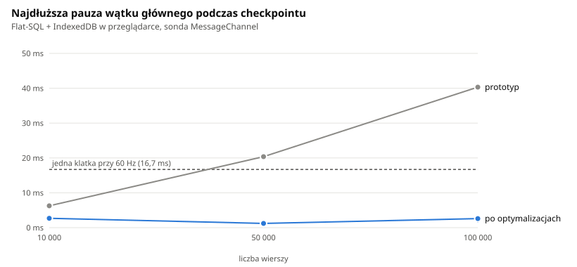
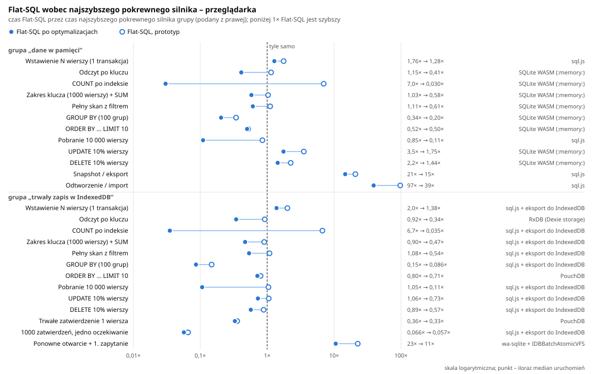

# Wyniki benchmarków

Po optymalizacjach Flat-SQL jest w przeglądarce szybszy od sql.js i oficjalnego SQLite WASM we wszystkich odczytach i ma najtańsze trwałe zatwierdzenie wśród silników zapisujących do IndexedDB. Wolniejszy jest w zapisach, w snapshocie i w odtwarzaniu bazy, bo SQLite kopiuje gotowe strony pliku. W WebAssembly operacje wykonywane w całości w silniku są tak szybkie jak natywnie, a narzut zostaje tylko na granicy z JavaScriptem.

Dokument podaje najważniejsze liczby. Pełne tabele z kwartylami tworzy skrypt z surowych wyników: [Benchmark 1](data/benchmark-1/tables.md), [Benchmark 2](data/benchmark-2/tables.md), [wersja po optymalizacjach na tle innych silników](data/benchmark-2/engines.md). Metodyka: [metodyka benchmarków](benchmark-scenario.md). Co z wyników wynika: [wnioski](conclusions.md).

Wartości to mediana z 10 uruchomień, każde w nowym procesie, dla tabeli 100 000 wierszy. `[n/N]` oznacza, że operacja osiągnęła limit 20 s i wykonano n z N powtórzeń.

## Benchmark 1: prototyp na tle innych silników

Pomiar z 24 października 2026, wersja `v1-prototyp`, Edge 156 i Node.js 24 na laptopie z Windows 11. 860 procesów, żaden nieudany. Wszystkie silniki zwróciły te same odpowiedzi: sumy kontrolne zgadzają się w 3420 porównaniach. Jedyny wyjątek to suma cen w RxDB, która różni się na szóstym miejscu po przecinku przez inną kolejność dodawania i mieści się w tolerancji.

### Dane w pamięci, przeglądarka

| Operacja | Flat-SQL | sql.js | SQLite WASM | DuckDB-Wasm | AlaSQL | czysty JS (`Map`) |
|---|---:|---:|---:|---:|---:|---:|
| Wstawienie 100 000 wierszy | 367 ms | 208 ms | 846 ms | 42,3 s | 97,2 ms | 53,9 ms |
| Odczyt po kluczu | 9,15 µs | 14,1 µs | 7,99 µs | 1,28 ms | 1,64 ms | 0,93 µs |
| `COUNT` po indeksie | 438 µs | 68,9 µs | 62,6 µs | 1,01 ms | 2,86 ms | 0,88 µs |
| Zakres 1000 kluczy + `SUM` | 80,7 µs | 89,5 µs | 78,2 µs | 1,31 ms | 1,85 ms | 41,1 µs |
| Pełny przegląd z warunkiem | 7,98 ms | 8,68 ms | 7,19 ms | 589 µs | 2,23 ms | 632 µs |
| `GROUP BY` (100 grup) | 15,7 ms | 110 ms | 45,8 ms | 3,55 ms | 4,10 ms | 1,68 ms |
| `ORDER BY … LIMIT 10` | 5,52 ms | 11,6 ms | 10,6 ms | 1,36 ms | 87,4 ms | 1,38 ms |
| Pobranie 10 000 wierszy | 12,0 ms | 14,1 ms | 37,9 ms | 12,2 ms | 2,68 ms | 0,60 ms |
| `UPDATE` 10% | 31,0 ms | 13,7 ms | 8,76 ms | 10,7 ms | 8,19 ms | 1,87 ms |
| `DELETE` 10% | 27,3 ms | 18,9 ms | 12,2 ms | 18,8 ms | 6,69 ms | 5,17 ms |
| Snapshot | 32,1 ms | 1,54 ms | 3,19 ms | – | – | 17,1 ms |
| Odtworzenie | 116 ms | 1,19 ms | 1,61 ms | – | – | 27,3 ms |

PGlite był w odczycie po kluczu 33–70 razy wolniejszy od Flat-SQL. Wyniki w Node.js mają te same proporcje.

### Trwały zapis w IndexedDB

| Silnik | Trwałe zatwierdzenie 1 wiersza | 1000 zatwierdzeń, jedno oczekiwanie | Ponowne otwarcie i pierwsze zapytanie |
|---|---:|---:|---:|
| Flat-SQL | 395 µs | 5,85 ms | 174 ms |
| Flat-SQL, `strict` | 1,00 ms | 6,66 ms | 173 ms |
| sql.js z eksportem bazy | 19,3 ms | 89,0 ms | 10,7 ms |
| wa-sqlite | 7,52 ms | 4,79 s | 7,69 ms |
| PGlite | 54,5 ms | 57,4 s | 847 ms |
| Dexie.js | 559 µs | 358 ms | 2,82 ms |
| PouchDB | 1,11 ms | 1,02 s | 944 ms |
| RxDB | 1,33 ms | 993 ms | 13,6 ms |

Flat-SQL zapisuje tylko zmiany i grupuje zatwierdzenia, więc 1000 zatwierdzeń kosztuje 5,9 µs na zatwierdzenie. sql.js przy każdym zapisie eksportuje całą bazę. Silniki SQLite i bazy dokumentów utrwalają każdą transakcję osobno. Koszt Flat-SQL wraca przy otwarciu bazy, bo trzeba ją całą zdekodować do pamięci.

### Silnik w Web Workerze

Każde wywołanie Flat-SQL w Workerze kosztuje dodatkowo 56 µs (odczyt po kluczu 65,4 µs wobec 9,2 µs w wątku głównym), a pobranie 10 000 wierszy dodatkowo 11 ms na kopiowanie wyniku. Operacje trwające kilka milisekund różnią się o 6–16%. W grupie Worker Flat-SQL i tak ma najszybszy odczyt po kluczu (65 µs wobec 93 µs w SQLite z OPFS) i najtańsze trwałe zatwierdzenie (0,46 ms wobec 3,7 ms).

### Rozmiar, zimny start, pamięć

| Silnik | Pliki silnika po kompresji | Zimny start w przeglądarce | Pamięć po wczytaniu 100 000 wierszy |
|---|---:|---:|---:|
| Flat-SQL | 230 KiB | 47,9 ms | 73,3 MiB |
| sql.js | 331 KiB | 63,2 ms | 21,1 MiB |
| SQLite WASM | 583 KiB | 97,2 ms | 8,0 MiB |
| wa-sqlite | 821 KiB | 211 ms | – |
| PGlite | 5,6 MiB | 1,57 s | 189 MiB |
| DuckDB-Wasm | 7,6 MiB | 844 ms | 23,1 MiB |
| AlaSQL | 111 KiB | 72,2 ms | – |
| Dexie.js / PouchDB / RxDB | 49 / 42 / 80 KiB | 68 / 78 / 103 ms | – |

Flat-SQL ma najmniejszy moduł wśród silników SQL w WebAssembly i najkrótszy zimny start wśród wszystkich silników. Zajmuje jednak najwięcej pamięci, bo każdy wiersz jest osobną alokacją, a duża transakcja trzyma na chwilę dodatkowe kopie (patrz [z czego składa się pamięć](#z-czego-składa-się-pamięć)).

### Pauza checkpointu

Checkpoint blokował wątek główny na 6,7 ms przy 10 000, 20,9 ms przy 50 000 i 40,3 ms przy 100 000 wierszy, czyli ponad jedną klatkę (16,7 ms) od około 40 000 wierszy. Eksport sql.js z zapisem do IndexedDB blokował wątek na 11,8 ms przy 100 000 wierszy.

### Lokalnie a przez serwer

Odczyt po kluczu z tekstem SQL, tabela 10 000 wierszy, ten sam silnik po obu stronach.

| Tryb | Node.js | Przeglądarka |
|---|---:|---:|
| lokalnie | 14,8 µs | 21,9 µs |
| serwer na tym samym komputerze | 637 µs | 2,28 ms |
| serwer, opóźnienie sieci 20 ms | 20,8 ms | 22,8 ms |
| serwer, opóźnienie sieci 100 ms | 101 ms | 103 ms |

Zapytanie przez sieć trwa tyle, ile opóźnienie sieci, czyli trzy do czterech rzędów wielkości dłużej niż lokalnie. W przeglądarce sonda mierzy każde wywołanie z dokładnością 5 µs, więc wynik lokalny nadaje się tylko do porównania rzędu wielkości.

### Koszt utrwalania plików

| Magazyn | Zatwierdzenie z `fsync` | Zatwierdzenie bez `fsync` |
|---|---:|---:|
| narzędzie natywne, Windows | 579 µs | 10,1 µs |
| narzędzie natywne, Linux (WSL 2) | 2,15 ms | 9,01 µs |
| magazyn Node.js, Windows | 1,34 ms | 602 µs |
| magazyn Node.js, Linux (WSL 2) | 2,91 ms | 400 µs |

Magazyn Node.js bez `fsync` był wolny, bo otwierał i zamykał plik WAL przy każdym dopisaniu.

### Rozbicie kosztów silnika

Pomiar pomocniczy rozdzielił natywnie czas trzech operacji na części, żeby ustalić kolejność optymalizacji. To pomiar orientacyjny: jeden proces, trzy powtórzenia. Program: `data/benchmark-1/analysis/cost-split/`.

| Operacja | Część | Udział |
|---|---|---:|
| odczyt po kluczu (2,2 µs) | samo wyszukanie w drzewie | 9% |
| | kopia wiersza | 22% |
| | wiązanie nazw i wybór ścieżki dostępu | 12% |
| | nazwy kolumn i komunikat | 12% |
| | reszta (struktury planu, wektor wyniku, zwalnianie) | 45% |
| pełny przegląd z warunkiem (8,1 ms) | przejście drzewa | 19% |
| | odczyt wartości i warunek w pętli pisanej ręcznie | 16% |
| | interpreter wyrażeń | 65% |

Kolejka zmian, która bez synchronizacji miała wpis dla każdego wstawionego wiersza, odpowiadała za około połowę czasu odtworzenia, jedną trzecią czasu snapshotu i jedną czwartą jego rozmiaru. Przegląd i grupowanie alokują pamięć tylko na początku i na końcu zapytania, więc ich czas wyznacza interpretacja wyrażeń, a nie przydział pamięci. Dlatego plan w instrukcji przygotowanej, kompilacja warunków i zmiana kolejki zmian poszły przed zmianą układu wierszy.

## Benchmark 2: prototyp i wersja po optymalizacjach

Pomiar z 28 października 2026, ten sam laptop i to samo narzędzie. Prototyp (`v1-prototyp`) i wersję po optymalizacjach (`v2-optymalizacja`) mierzono na przemian, każdą w 10 procesach na konfigurację; 580 procesów, żaden nieudany. Odpowiedzi obu wersji zgadzają się w 2100 porównaniach sum kontrolnych. Obciążenie ma na końcu nową operację: wstawienie wszystkich wierszy jednym wywołaniem (`executeMany`). Prototyp, który go nie ma, wykonuje pętlę pojedynczych instrukcji.

### Dane w pamięci

Prototyp → po optymalizacjach:

| Operacja | Node.js | Przeglądarka | Przeglądarka, wynik jako JSON | Natywnie |
|---|---:|---:|---:|---:|
| Wstawienie 100 000 wierszy | 371 → 286 ms | 357 → 267 ms | 334 → 269 ms | 208 → 162 ms |
| Wstawienie jednym wywołaniem | 1,16 s → 151 ms | 405 → 147 ms | 401 → 146 ms | – → 144 ms |
| Odczyt po kluczu | 8,94 → 2,45 µs | 8,78 → 3,28 µs | 5,50 → 4,16 µs | 2,28 → 0,91 µs |
| `COUNT` po indeksie | 427 → 2,09 µs | 437 → 1,90 µs | 427 → 2,88 µs | 435 → 0,71 µs |
| Zakres 1000 kluczy + `SUM` | 80,8 → 41,0 µs | 77,6 → 45,5 µs | 77,3 → 47,4 µs | 83,9 → 48,7 µs |
| Pełny przegląd z warunkiem | 7,74 → 4,49 ms | 7,83 → 4,40 ms | 7,79 → 4,45 ms | 8,06 → 5,35 ms |
| `GROUP BY` (100 grup) | 15,5 → 9,58 ms | 15,6 → 9,38 ms | 15,4 → 9,77 ms | 14,6 → 10,8 ms |
| `ORDER BY … LIMIT 10` | 5,24 → 5,27 ms | 5,44 → 5,33 ms | 5,42 → 5,35 ms | 5,63 → 6,82 ms |
| Pobranie 10 000 wierszy | 9,54 → 1,65 ms | 11,4 → 1,55 ms | 7,80 → 7,06 ms | 3,72 → 2,86 ms |
| `UPDATE` 10% | 41,4 → 15,4 ms | 30,9 → 15,4 ms | 30,7 → 15,0 ms | 30,9 → 14,6 ms |
| `DELETE` 10% | 27,7 → 17,6 ms | 26,9 → 17,5 ms | 26,8 → 17,6 ms | 24,8 → 14,3 ms |
| Snapshot | 33,8 → 22,1 ms | 32,2 → 22,6 ms | 32,5 → 21,6 ms | 25,3 → 17,3 ms |
| Odtworzenie | 115 → 48,2 ms | 115 → 46,4 ms | 115 → 46,7 ms | 111 → 40,4 ms |

Wszystkie operacje poza `ORDER BY … LIMIT 10` przyspieszyły, a przedziały ufności się nie nakładają. Najwięcej zyskał `COUNT` po indeksie, bo wiersze nie są już czytane. Natywnie `ORDER BY … LIMIT 10` zwolnił o 21% po zmianie przechowywania krótkich tekstów; przyczyny nie ustalono. Wynik jako obiekty jest teraz szybszy od wyniku jako JSON. W Node.js pętla prototypu na końcu obciążenia trwała trzy razy dłużej niż ta sama pętla wcześniej; przyczyny w prototypie nie badano.

### Narzut WebAssembly

Ile razy dłużej trwa operacja w WebAssembly niż natywnie w tej samej wersji (prototyp → po optymalizacjach):

| Operacja | Node.js | Przeglądarka |
|---|---:|---:|
| Wstawienie, instrukcja na wiersz | 1,79 → 1,77 | 1,72 → 1,65 |
| Wstawienie jednym wywołaniem | – → 1,05 | – → 1,02 |
| Odczyt po kluczu | 3,9 → 2,7 | 3,9 → 3,6 |
| Zakres klucza | 0,96 → 0,84 | 0,92 → 0,93 |
| Pełny przegląd | 0,96 → 0,84 | 0,97 → 0,82 |
| `GROUP BY` | 1,06 → 0,89 | 1,07 → 0,87 |
| Pobranie 10 000 wierszy | 2,6 → 0,58 | 3,1 → 0,54 |
| Snapshot | 1,34 → 1,28 | 1,27 → 1,31 |
| Odtworzenie | 1,03 → 1,19 | 1,03 → 1,15 |

Pobranie wielu wierszy jest w WebAssembly szybsze niż natywnie, bo moduł koduje wynik wprost z tabeli, a benchmark natywny kopiuje wiersze do wyniku pośredniego. Odczyt po kluczu przekracza granicę przy każdym wywołaniu, więc zostaje 2,7–3,6 raza wolniejszy.

### Trwały zapis i Web Worker

| Operacja | IndexedDB | IndexedDB, `strict` | Worker, pamięć | Worker i IndexedDB |
|---|---:|---:|---:|---:|
| Wstawienie 100 000 wierszy | 442 → 324 ms | 453 → 334 ms | 350 → 271 ms | 449 → 332 ms |
| Odczyt po kluczu | 9,47 → 3,71 µs | 9,59 → 3,63 µs | 59,2 → 48,1 µs | 59,4 → 49,2 µs |
| Pobranie 10 000 wierszy | 13,9 → 1,50 ms | 13,9 → 1,40 ms | 23,2 → 13,5 ms | 25,7 → 13,8 ms |
| Trwałe zatwierdzenie 1 wiersza | 376 → 364 µs | 975 → 979 µs | – | 419 → 448 µs |
| 1000 zatwierdzeń | 5,86 → 5,07 ms | 6,62 → 5,89 ms | – | 6,15 → 5,21 ms |
| Ponowne otwarcie | 173 → 81,4 ms | 173 → 81,4 ms | – | 179 → 88,7 ms |

Trwałe zatwierdzenie się nie zmieniło, bo jego koszt to sama transakcja IndexedDB. W Workerze każde wywołanie nadal kosztuje około 45 µs komunikatu.

### Pauza checkpointu

| Wiersze | Najdłuższa pauza: prototyp → po | Cały checkpoint: prototyp → po |
|---:|---:|---:|
| 10 000 | 6,27 → 2,69 ms | 10,8 → 10,4 ms |
| 50 000 | 20,4 → 1,22 ms | 25,7 → 19,2 ms |
| 100 000 | 40,3 → 2,60 ms | 47,9 → 35,6 ms |

Najdłuższa pauza jest teraz na poziomie zakłóceń w bezczynności (2,1 ms) i nie rośnie z liczbą wierszy.

### Rozmiar, zimny start, pamięć, sieć, pliki

- Moduł WebAssembly urósł z 219 575 do 274 098 B po kompresji (+25%), a wszystkie pliki silnika z 230 do 287 KiB.
- Zimny start w przeglądarce wydłużył się z 42,5 do 49,0 ms (+15%, w granicach rozrzutu). Pierwsze zapytanie trwa dłużej, bo kompiluje plan, a moduł ma więcej kodu do pierwszej kompilacji.
- Pamięć po wczytaniu 100 000 wierszy jedną transakcją spadła z 73,3 do 51,8 MiB.
- Lokalny odczyt po kluczu z tekstem SQL skrócił się w Node.js z 14,5 do 10,1 µs. Przez sieć trwa tyle co opóźnienie sieci, jak wcześniej.
- Zatwierdzenie w magazynie plikowym Node.js bez `fsync` przyspieszyło z 585 do 78 µs w Windows i z 368 do 161 µs w Linuksie, bo plik WAL zostaje otwarty. Zatwierdzenie z `fsync` w narzędziu natywnym się nie zmieniło, bo jego koszt to sam `fsync`.
- Ponowne otwarcie bazy z plików skróciło się o połowę (narzędzie natywne w Windows 118 → 45,9 ms).

## Wersja po optymalizacjach na tle innych silników

Benchmark 2 mierzył tylko Flat-SQL, więc wersję po optymalizacjach zestawiono z wynikami innych silników z Benchmarku 1. Różnicę między sesjami mierzy prototyp zmierzony w obu: mediana zmiany wynosi −2,3%, a w 111 ze 113 par mieści się w ±10%. Miejsce bliższe innemu silnikowi niż 10% jest niepewne i oznaczone gwiazdką. Silniki „pokrewne” to te, które rozwiązują to samo zadanie: sql.js, SQLite WASM, wa-sqlite, PouchDB, RxDB.

Przeglądarka, dane w pamięci. Miejsce liczone wśród sześciu silników, bez czystego JavaScriptu:

| Operacja | Flat-SQL: prototyp | Flat-SQL: po | sql.js | SQLite WASM | DuckDB-Wasm | Miejsce: prototyp → po |
|---|---:|---:|---:|---:|---:|---:|
| Wstawienie 100 000 wierszy | 367 ms | 267 ms | 208 ms | 846 ms | 42,3 s | 3 → 3 |
| Odczyt po kluczu | 9,15 µs | 3,28 µs | 14,1 µs | 7,99 µs | 1,28 ms | 2 → 1 |
| `COUNT` po indeksie | 438 µs | 1,90 µs | 68,9 µs | 62,6 µs | 1,01 ms | 3 → 1 |
| Zakres 1000 kluczy | 80,7 µs | 45,5 µs | 89,5 µs | 78,2 µs | 1,31 ms | 2 → 1 |
| Pełny przegląd | 7,98 ms | 4,40 ms | 8,68 ms | 7,19 ms | 589 µs | 4 → 3 |
| `GROUP BY` | 15,7 ms | 9,38 ms | 110 ms | 45,8 ms | 3,55 ms | 3 → 3 |
| `ORDER BY … LIMIT 10` | 5,52 ms | 5,33 ms | 11,6 ms | 10,6 ms | 1,36 ms | 2 → 2 |
| Pobranie 10 000 wierszy | 12,0 ms | 1,55 ms | 14,1 ms | 37,9 ms | 12,2 ms | 2 → 1 |
| `UPDATE` 10% | 31,0 ms | 15,4 ms | 13,7 ms | 8,76 ms | 10,7 ms | 5 → 5 |
| `DELETE` 10% | 27,3 ms | 17,5 ms | 18,9 ms | 12,2 ms | 18,8 ms | 5 → 3* |
| Snapshot | 32,1 ms | 22,6 ms | 1,54 ms | 3,19 ms | – | 3 → 3 z 4 |
| Odtworzenie | 116 ms | 46,4 ms | 1,19 ms | 1,61 ms | – | 3 → 3 z 4 |

Przed Flat-SQL w odczytach zostały tylko silniki spoza grupy pokrewnych: DuckDB-Wasm w przeglądzie, grupowaniu i sortowaniu oraz AlaSQL w przeglądzie i grupowaniu. Wobec szybszego z dwóch SQLite wstawienie trwa 1,28 raza dłużej, `UPDATE` 1,75 raza, snapshot 15 razy, a odtworzenie 39 razy. W Node.js wynik jest podobny.

W trwałym zapisie w IndexedDB Flat-SQL po optymalizacjach jest pierwszy w 10 z 13 operacji (prototyp w 6). Drugi jest we wstawieniu (za sql.js) i w sortowaniu (za Dexie.js, które czyta posortowany indeks). W ponownym otwarciu bazy jest piąty z siedmiu: 81,4 ms wobec 2,8–13,6 ms w silnikach, które czytają dane dopiero przy zapytaniu. W grupie Worker jest szybszy od SQLite z OPFS we wszystkim poza ponownym otwarciem.

Pliki silnika (287 KiB) pozostają najmniejsze wśród silników SQL w WebAssembly, a zimny start (49,0 ms) najkrótszy w grupie „pamięć” poza czystym JavaScriptem. Po uwzględnieniu różnicy sesji zimny start wyniósłby około 55 ms, nadal mniej niż w sql.js (63,2 ms). Pamięć po wczytaniu (51,8 MiB) jest 2,5 raza większa niż w sql.js i 6,5 raza większa niż w SQLite WASM. Najdłuższa pauza checkpointu (2,6 ms) jest krótsza niż przy eksporcie sql.js (11,8 ms).

## Z czego składa się pamięć

Benchmark mierzy pamięć modułu po wczytaniu danych jedną transakcją. Pamięć modułu nie maleje, więc wynik obejmuje też szczyt z wczytywania. Eksperyment rozdzielił te części (skrypt `data/tests/memory-peak/memory-peak.mjs`, Node.js, 29.10.2026):

| Wariant, 100 000 wierszy | Prototyp | Po optymalizacjach |
|---|---:|---:|
| jedna transakcja, przed `COMMIT` | 55,8 MiB | 41,6 MiB |
| jedna transakcja, po `COMMIT` | 73,3 MiB | 51,8 MiB |
| transakcje po 10 000 wierszy | 45,9 MiB | 25,4 MiB |
| transakcje po 1000 wierszy | 42,3 MiB | 21,8 MiB |
| odtworzenie ze snapshotu | 45,6 MiB | 22,8 MiB |
| rozmiar snapshotu | 5,3 MiB | 4,0 MiB |

Sama baza po optymalizacjach zajmuje około 22 MiB, tyle co sql.js. Wczytanie jedną transakcją dokłada około 30 MiB. Około 20 MiB narasta w trakcie wstawiania: dziennik wycofania ma wpis 80 B na wiersz, a zakodowane operacje WAL zajmują 5,1 MiB. Kolejne 10 MiB dokłada samo zatwierdzenie, które przez chwilę trzyma trzy kopie operacji. Dwie zmiany, które by to zmniejszyły, są w [liście na później](../management/future.md). Aplikacja może już teraz wczytywać dane porcjami po kilka tysięcy wierszy, kosztem atomowości całego wczytania.
