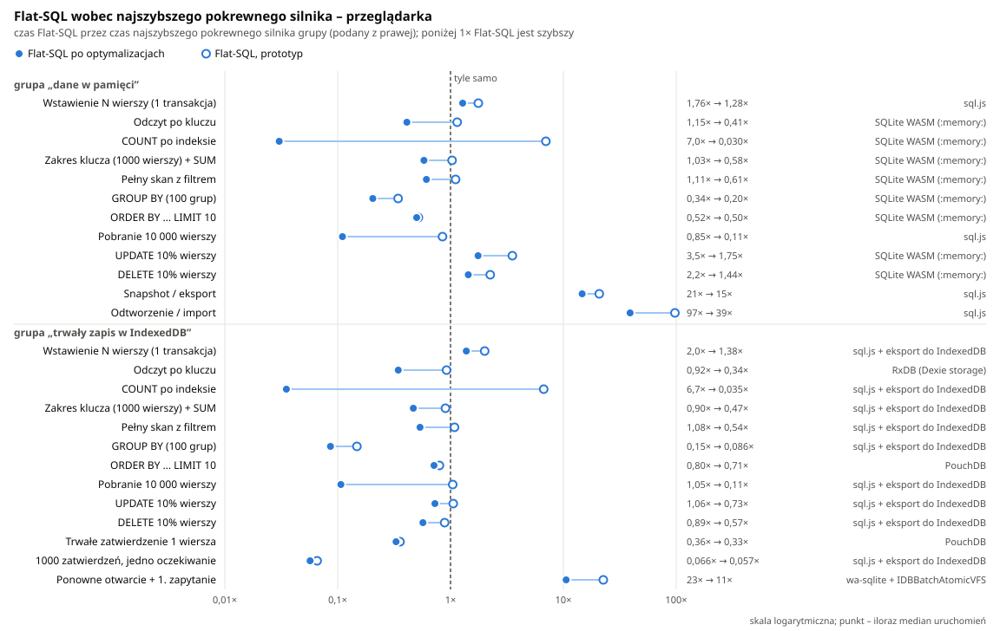
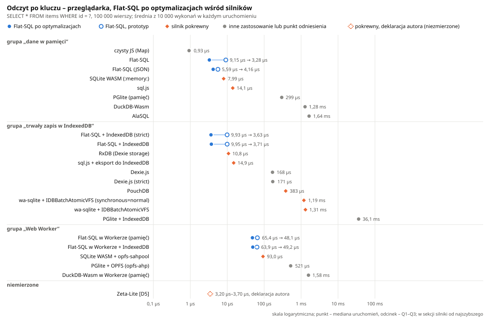
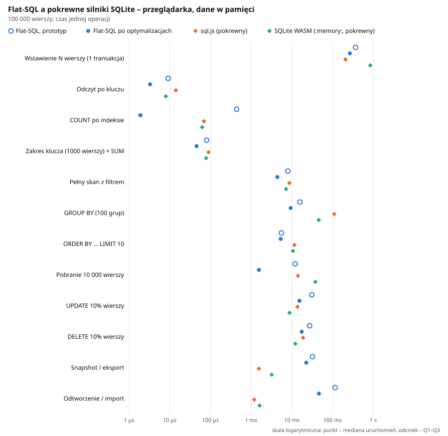
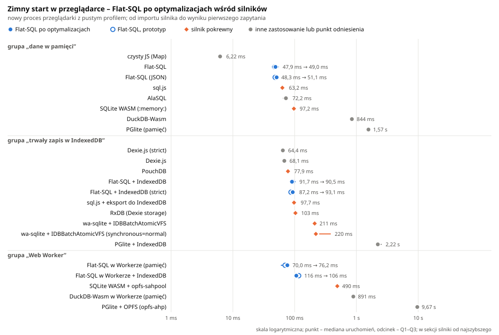
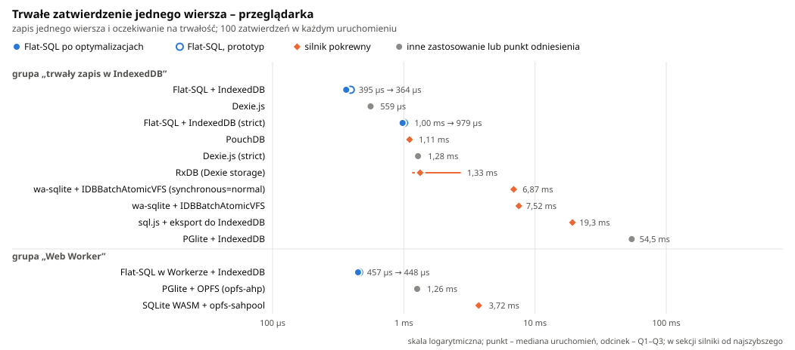
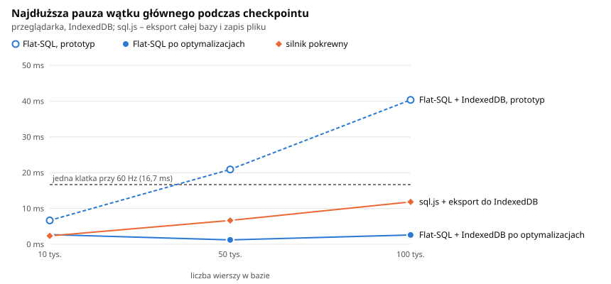

# Benchmark 2 – Flat-SQL wśród silników Benchmarku 1

Wygenerowano skryptem `engines-report.mjs`. Flat-SQL po optymalizacjach (`po-2.5`, 45f581d9ff) pochodzi z `after/raw` (pomiar 2026-10-28), prototyp Flat-SQL (`prototyp`) i pozostałe silniki z `../benchmark-1/raw` (pomiar 2026-10-24). Wartość: mediana z 10 uruchomień procesu, w nawiasie pierwszy i trzeci kwartyl; [n/N] – operacja przerwana limitem czasu po n z N powtórzeń. Miejsce liczone według mediany wśród domyślnych konfiguracji silników grupy (bez czystego JavaScriptu i bez wariantów z innym ustawieniem trwałości). Rola silnika według analizy porównawczej silników: pokrewny – SQL w WebAssembly dla danych operacyjnych aplikacji albo magazyn local-first z synchronizacją; inne zastosowanie – PGlite i DuckDB-Wasm; punkt odniesienia – AlaSQL, Dexie.js, czysty JavaScript.

## Różnica między sesjami pomiaru

Prototyp zmierzony w obu sesjach (Benchmark 1: 2026-10-24, przeglądarka msedge 156.0.4314.42; Benchmark 2: 2026-10-28, przeglądarka msedge 156.0.4314.50). Zmiana mediany prototypu z Benchmarku 2 wobec Benchmarku 1 w 113 parach konfiguracja–operacja: mediana −2,3%, w Benchmarku 2 szybciej w 103 parach; mediana wartości bezwzględnej 2,6%, 90. percentyl 6,7%; w granicach ±5%: 91, ±10%: 111. Poniżej pary o zmianie większej niż 5%. Miejsce wersji końcowej oznaczone gwiazdką (*) jest niepewne: inny silnik grupy różni się od niej o mniej niż 10%.

| Środowisko | Konfiguracja | Pomiar | Benchmark 1 | Benchmark 2 | Zmiana |
|---|---|---|---:|---:|---:|
| node | Flat-SQL | COUNT po indeksie | 457 µs | 427 µs | −6,7% |
| node | Flat-SQL | Zakres klucza (1000 wierszy) + SUM | 86,6 µs | 80,8 µs | −6,8% |
| node | Flat-SQL | GROUP BY (100 grup) | 16,9 ms | 15,5 ms | −7,9% |
| node | Flat-SQL (JSON) | Wstawienie N wierszy (1 transakcja) | 391 ms | 369 ms | −5,6% |
| node | Flat-SQL (JSON) | Odczyt po kluczu | 5,65 µs | 5,36 µs | −5,3% |
| node | Flat-SQL (JSON) | COUNT po indeksie | 442 µs | 416 µs | −5,9% |
| node | Flat-SQL (JSON) | Zakres klucza (1000 wierszy) + SUM | 88,1 µs | 82,2 µs | −6,7% |
| node | Flat-SQL (JSON) | UPDATE 10% wierszy | 35,3 ms | 31,9 ms | −9,7% |
| browser | Flat-SQL + IndexedDB | Wstawienie N wierszy (1 transakcja) | 471 ms | 442 ms | −6,3% |
| browser | Flat-SQL + IndexedDB | ORDER BY … LIMIT 10 | 5,95 ms | 5,47 ms | −8,1% |
| browser | Flat-SQL + IndexedDB | Pobranie 10 000 wierszy | 14,7 ms | 13,9 ms | −5,4% |
| browser | Flat-SQL + IndexedDB (strict) | Wstawienie N wierszy (1 transakcja) | 487 ms | 453 ms | −6,9% |
| browser | Flat-SQL + IndexedDB (strict) | Pobranie 10 000 wierszy | 14,7 ms | 13,9 ms | −5,2% |
| browser | Flat-SQL w Workerze (pamięć) | Odczyt po kluczu | 65,4 µs | 59,2 µs | −9,6% |
| browser | Flat-SQL w Workerze (pamięć) | COUNT po indeksie | 615 µs | 566 µs | −8,0% |
| browser | Flat-SQL w Workerze (pamięć) | Zakres klucza (1000 wierszy) + SUM | 150 µs | 142 µs | −5,4% |
| browser | Flat-SQL w Workerze + IndexedDB | Odczyt po kluczu | 63,9 µs | 59,4 µs | −7,1% |
| browser | Flat-SQL w Workerze + IndexedDB | COUNT po indeksie | 601 µs | 561 µs | −6,7% |
| browser | Flat-SQL w Workerze + IndexedDB | Zakres klucza (1000 wierszy) + SUM | 149 µs | 139 µs | −6,2% |
| browser | Flat-SQL w Workerze + IndexedDB | Trwałe zatwierdzenie 1 wiersza | 457 µs | 419 µs | −8,3% |
| browser | Flat-SQL | cold totalMs | 47,9 ms | 42,5 ms | −11,3% |
| browser | Flat-SQL + IndexedDB | cold totalMs | 91,7 ms | 80,8 ms | −11,9% |

Wyniki wersji końcowej zgodne z wynikami Flat-SQL z Benchmarku 1 (a więc ze wszystkimi silnikami): 630 porównań sum kontrolnych.

## Dane w pamięci, Node.js

| Operacja | Flat-SQL: prototyp | Flat-SQL: po optymalizacjach | Flat-SQL (JSON): po optymalizacjach | sql.js | SQLite WASM (:memory:) | PGlite (pamięć) | DuckDB-Wasm | AlaSQL | czysty JS (Map) | Miejsce Flat-SQL: prototyp → po |
|---|---:|---:|---:|---:|---:|---:|---:|---:|---:|---:|
| Rola | badany | badany | badany | pokrewny | pokrewny | inne zastosowanie | inne zastosowanie | punkt odniesienia | punkt odniesienia |  |
| Wstawienie N wierszy (1 transakcja) | 388 (383–399) ms | 286 (285–287) ms | 285 (284–287) ms | 223 (222–224) ms | 910 (896–935) ms | 28,1 (28,0–28,6) s | 53,4 (52,0–54,3) s | 168 (163–189) ms | 49,6 (47,9–50,4) ms | 3 → 3 z 6 |
| Odczyt po kluczu | 9,32 (9,14–9,41) µs | 2,45 (2,44–2,47) µs | 4,11 (4,07–4,13) µs | 15,4 (15,3–15,6) µs | 9,59 (9,52–9,88) µs | 395 (392–404) µs | 1,41 (1,41–1,44) ms | 3,04 (2,96–3,50) ms [4388/10000] | 0,64 (0,62–0,70) µs | 1 → 1 z 6 |
| COUNT po indeksie | 457 (450–473) µs | 2,09 (1,79–2,46) µs | 3,40 (3,06–4,15) µs | 73,1 (71,2–73,4) µs | 59,6 (59,3–61,2) µs | 1,22 (1,20–1,26) ms | 1,15 (1,14–1,19) ms | 4,40 (4,25–4,85) ms | 0,69 (0,58–0,95) µs | 3 → 1 z 6 |
| Zakres klucza (1000 wierszy) + SUM | 86,6 (80,3–89,1) µs | 41,0 (40,7–41,5) µs | 44,1 (43,5–44,8) µs | 97,3 (96,2–102) µs | 83,7 (83,1–86,7) µs | 691 (673–704) µs | 1,44 (1,43–1,45) ms | 3,39 (3,24–3,76) ms | 42,3 (39,2–48,5) µs | 2 → 1 z 6 |
| Pełny skan z filtrem | 7,97 (7,92–8,05) ms | 4,49 (4,47–4,52) ms | 4,51 (4,48–4,54) ms | 7,96 (7,89–8,09) ms | 6,73 (6,68–6,76) ms | 11,4 (11,3–11,8) ms | 770 (744–791) µs | 4,18 (3,72–4,37) ms | 1,03 (0,90–1,83) ms | 5 → 3* z 6 |
| GROUP BY (100 grup) | 16,9 (15,9–17,2) ms | 9,58 (9,52–9,87) ms | 10,0 (9,88–10,1) ms | 116 (115–117) ms | 46,3 (45,7–47,3) ms | 31,6 (31,4–32,5) ms | 4,00 (3,96–4,02) ms | 6,76 (6,38–7,59) ms | 2,76 (2,68–2,86) ms | 3 → 3 z 6 |
| ORDER BY … LIMIT 10 | 5,46 (5,36–5,64) ms | 5,27 (5,23–5,52) ms | 5,34 (5,29–5,66) ms | 11,9 (11,9–12,1) ms | 10,9 (10,8–11,0) ms | 22,4 (22,2–23,1) ms | 1,38 (1,36–1,43) ms | 109 (106–112) ms | 1,58 (1,54–1,71) ms | 2 → 2 z 6 |
| Pobranie 10 000 wierszy | 9,73 (9,62–9,86) ms | 1,65 (1,64–1,75) ms | 8,76 (8,71–8,86) ms | 12,6 (12,4–13,0) ms | 51,1 (50,9–52,3) ms | 95,4 (95,0–95,7) ms | 11,1 (10,9–11,2) ms | 4,94 (4,89–5,86) ms | 1,34 (1,22–1,57) ms | 2 → 1 z 6 |
| UPDATE 10% wierszy | 39,8 (32,7–43,1) ms | 15,4 (15,3–15,5) ms | 15,2 (15,2–15,5) ms | 16,7 (15,5–26,2) ms | 9,43 (9,19–9,73) ms | 97,1 (96,4–98,8) ms | 11,1 (10,4–12,9) ms | 10,8 (9,65–11,4) ms | 2,88 (2,81–3,19) ms | 5 → 4* z 6 |
| DELETE 10% wierszy | 28,2 (28,0–29,2) ms | 17,6 (17,5–18,0) ms | 17,7 (17,5–17,7) ms | 20,2 (19,9–21,1) ms | 11,9 (11,6–12,4) ms | 48,9 (48,6–52,3) ms | 25,0 (22,7–26,1) ms | 7,55 (7,36–8,77) ms | 7,94 (7,00–8,20) ms | 5 → 3 z 6 |
| Snapshot / eksport | 34,4 (34,1–35,1) ms | 22,1 (22,0–22,7) ms | 21,5 (21,5–22,4) ms | 1,59 (1,43–1,96) ms | 3,41 (3,18–3,67) ms | 120 (118–122) ms | – | – | 23,1 (22,5–23,4) ms | 3 → 3 z 4 |
| Odtworzenie / import | 116 (116–117) ms | 48,2 (48,0–48,5) ms | 48,2 (47,9–49,0) ms | 1,24 (1,17–1,27) ms | 1,76 (1,71–1,87) ms | 547 (534–590) ms | – | – | 47,0 (44,6–49,7) ms | 3 → 3 z 4 |

## Dane w pamięci, przeglądarka

| Operacja | Flat-SQL: prototyp | Flat-SQL: po optymalizacjach | Flat-SQL (JSON): po optymalizacjach | sql.js | SQLite WASM (:memory:) | PGlite (pamięć) | DuckDB-Wasm | AlaSQL | czysty JS (Map) | Miejsce Flat-SQL: prototyp → po |
|---|---:|---:|---:|---:|---:|---:|---:|---:|---:|---:|
| Rola | badany | badany | badany | pokrewny | pokrewny | inne zastosowanie | inne zastosowanie | punkt odniesienia | punkt odniesienia |  |
| Wstawienie N wierszy (1 transakcja) | 367 (364–369) ms | 267 (266–269) ms | 269 (266–271) ms | 208 (208–213) ms | 846 (837–867) ms | 20,3 (20,2–20,7) s | 42,3 (42,0–42,6) s | 97,2 (95,4–102) ms | 53,9 (46,8–59,8) ms | 3 → 3 z 6 |
| Odczyt po kluczu | 9,15 (9,10–9,21) µs | 3,28 (3,15–3,30) µs | 4,16 (4,13–4,25) µs | 14,1 (14,0–14,2) µs | 7,99 (7,92–8,16) µs | 299 (294–301) µs | 1,28 (1,28–1,28) ms | 1,64 (1,63–1,67) ms | 0,93 (0,86–0,98) µs | 2 → 1 z 6 |
| COUNT po indeksie | 438 (437–442) µs | 1,90 (1,84–1,93) µs | 2,88 (2,87–2,90) µs | 68,9 (67,8–70,4) µs | 62,6 (61,6–65,7) µs | 1,12 (1,09–1,15) ms | 1,01 (1,00–1,04) ms | 2,86 (2,83–2,87) ms | 0,88 (0,78–0,99) µs | 3 → 1 z 6 |
| Zakres klucza (1000 wierszy) + SUM | 80,7 (79,5–81,5) µs | 45,5 (43,7–47,1) µs | 47,4 (45,9–49,0) µs | 89,5 (88,9–89,7) µs | 78,2 (77,1–80,3) µs | 604 (594–613) µs | 1,31 (1,30–1,34) ms | 1,85 (1,83–1,88) ms | 41,1 (37,9–43,2) µs | 2 → 1 z 6 |
| Pełny skan z filtrem | 7,98 (7,92–8,09) ms | 4,40 (4,39–4,42) ms | 4,45 (4,43–4,54) ms | 8,68 (8,31–8,74) ms | 7,19 (6,86–7,62) ms | 13,4 (13,3–13,5) ms | 589 (575–619) µs | 2,23 (2,19–2,29) ms | 632 (597–702) µs | 4 → 3 z 6 |
| GROUP BY (100 grup) | 15,7 (15,5–15,9) ms | 9,38 (9,28–9,53) ms | 9,77 (9,71–9,80) ms | 110 (109–111) ms | 45,8 (45,0–46,3) ms | 33,2 (33,1–33,4) ms | 3,55 (3,52–3,58) ms | 4,10 (3,97–4,24) ms | 1,68 (1,63–1,83) ms | 3 → 3 z 6 |
| ORDER BY … LIMIT 10 | 5,52 (5,43–6,04) ms | 5,33 (5,29–5,39) ms | 5,35 (5,33–5,36) ms | 11,6 (11,4–11,9) ms | 10,6 (10,5–10,7) ms | 23,2 (23,2–23,5) ms | 1,36 (1,34–1,39) ms | 87,4 (86,6–88,8) ms | 1,38 (1,25–1,55) ms | 2 → 2 z 6 |
| Pobranie 10 000 wierszy | 12,0 (11,9–12,1) ms | 1,55 (1,49–1,60) ms | 7,06 (7,01–7,11) ms | 14,1 (14,0–14,2) ms | 37,9 (37,6–38,1) ms | 81,7 (81,3–82,8) ms | 12,2 (12,0–12,4) ms | 2,68 (2,60–2,76) ms | 598 (518–797) µs | 2 → 1 z 6 |
| UPDATE 10% wierszy | 31,0 (30,9–31,7) ms | 15,4 (15,1–15,8) ms | 15,0 (14,8–15,4) ms | 13,7 (13,5–14,1) ms | 8,76 (8,68–8,93) ms | 101 (96,6–104) ms | 10,7 (10,0–12,1) ms | 8,19 (7,83–8,91) ms | 1,87 (1,77–2,26) ms | 5 → 5 z 6 |
| DELETE 10% wierszy | 27,3 (26,9–27,4) ms | 17,5 (17,0–18,2) ms | 17,6 (17,0–17,6) ms | 18,9 (18,5–19,4) ms | 12,2 (11,9–12,3) ms | 49,7 (48,8–50,5) ms | 18,8 (18,4–19,3) ms | 6,69 (5,86–6,85) ms | 5,17 (5,08–5,68) ms | 5 → 3* z 6 |
| Snapshot / eksport | 32,1 (32,0–32,4) ms | 22,6 (22,2–23,0) ms | 21,6 (21,2–21,9) ms | 1,54 (1,36–1,70) ms | 3,19 (2,78–3,41) ms | 131 (130–134) ms | – | – | 17,1 (16,9–17,4) ms | 3 → 3 z 4 |
| Odtworzenie / import | 116 (115–117) ms | 46,4 (46,1–46,9) ms | 46,7 (46,4–47,1) ms | 1,19 (1,14–1,27) ms | 1,61 (1,57–1,95) ms | 470 (468–474) ms | – | – | 27,3 (27,0–28,0) ms | 3 → 3 z 4 |

## Trwały zapis w IndexedDB, wątek główny przeglądarki

| Operacja | Flat-SQL + IndexedDB: prototyp | Flat-SQL + IndexedDB: po optymalizacjach | Flat-SQL + IndexedDB (strict): po optymalizacjach | sql.js + eksport do IndexedDB | wa-sqlite + IDBBatchAtomicVFS | wa-sqlite + IDBBatchAtomicVFS (synchronous=normal) | PGlite + IndexedDB | Dexie.js | Dexie.js (strict) | PouchDB | RxDB (Dexie storage) | Miejsce Flat-SQL: prototyp → po |
|---|---:|---:|---:|---:|---:|---:|---:|---:|---:|---:|---:|---:|
| Rola | badany | badany | badany | pokrewny | pokrewny | pokrewny | inne zastosowanie | punkt odniesienia | punkt odniesienia | pokrewny | pokrewny |  |
| Wstawienie N wierszy (1 transakcja) | 471 (467–477) ms | 324 (323–366) ms | 334 (331–336) ms | 235 (233–330) ms | 1,12 (1,10–1,17) s | 1,10 (1,09–1,13) s | 20,3 (20,2–20,7) s | 8,82 (8,74–9,00) s | 8,88 (8,76–9,07) s | 20,7 (20,4–21,1) s | 16,2 (16,0–16,4) s | 2 → 2 z 7 |
| Budowa indeksów (widoki PouchDB) | – | – | – | – | – | – | – | – | – | 96,2 (95,5–98,8) s | – | – |
| Odczyt po kluczu | 9,95 (9,85–10,0) µs | 3,71 (3,62–3,88) µs | 3,63 (3,57–3,72) µs | 14,9 (14,7–15,1) µs | 1,31 (1,28–1,32) ms | 1,19 (1,17–1,23) ms | 36,1 (35,6–36,6) ms [538/10000] | 168 (162–172) µs | 171 (165–180) µs | 383 (381–389) µs | 10,8 (10,6–10,9) µs | 1 → 1 z 7 |
| COUNT po indeksie | 449 (439–460) µs | 2,36 (2,31–2,38) µs | 2,31 (2,28–2,33) µs | 67,1 (66,8–68,9) µs | 1,36 (1,33–1,39) ms | 1,30 (1,24–1,31) ms | 36,8 (36,4–37,3) ms | 7,85 (7,77–7,91) ms | 7,86 (7,78–7,98) ms | 54,8 (54,7–56,0) ms [339/500] | 11,6 (11,6–11,8) ms | 2 → 1 z 7 |
| Zakres klucza (1000 wierszy) + SUM | 85,3 (82,9–87,3) µs | 44,3 (43,9–44,5) µs | 44,0 (43,6–46,0) µs | 94,6 (93,5–95,6) µs | 2,15 (2,11–2,23) ms | 2,03 (1,98–2,14) ms | 36,3 (35,8–37,1) ms | 7,66 (7,55–7,96) ms | 7,57 (7,49–7,66) ms | 44,0 (43,4–44,6) ms | 30,3 (29,4–30,9) ms | 1 → 1 z 7 |
| Pełny skan z filtrem | 8,93 (8,86–9,06) ms | 4,42 (4,40–4,45) ms | 4,43 (4,40–4,43) ms | 8,23 (8,22–8,30) ms | 163 (162–180) ms | 163 (161–170) ms | 49,0 (47,4–49,6) ms | 1,40 (1,37–1,43) s [14/20] | 1,42 (1,40–1,45) s [13/20] | 4,56 (4,53–4,61) s [5/20] | 1,92 (1,91–1,96) s [10/20] | 2 → 1 z 7 |
| GROUP BY (100 grup) | 16,2 (16,1–16,6) ms | 9,47 (9,40–9,49) ms | 9,48 (9,41–9,52) ms | 110 (108–112) ms | 15,0 (14,8–15,2) s [4/20] | 14,9 (14,8–15,1) s [4/20] | 68,6 (67,2–69,4) ms | 573 (568–583) ms | 578 (573–581) ms | 4,61 (4,55–4,64) s [5/20] | 3,16 (3,11–3,24) s [7/20] | 1 → 1 z 7 |
| ORDER BY … LIMIT 10 | 5,95 (5,71–6,03) ms | 5,33 (5,32–5,34) ms | 5,29 (5,26–5,30) ms | 11,3 (11,1–11,5) ms | 189 (180–193) ms | 177 (176–186) ms | 58,0 (56,8–58,7) ms | 700 (663–733) µs | 709 (664–747) µs | 7,47 (7,25–7,82) ms | 3,74 (3,69–3,75) s [6/20] | 2 → 2 z 7 |
| Pobranie 10 000 wierszy | 14,7 (14,6–14,8) ms | 1,50 (1,39–1,69) ms | 1,40 (1,38–1,56) ms | 14,0 (13,8–14,2) ms | 29,3 (28,9–30,4) ms | 29,4 (28,8–43,0) ms | 115 (114–117) ms | 55,9 (55,6–56,4) ms | 55,5 (55,1–56,4) ms | 416 (414–427) ms | 267 (259–275) ms | 2 → 1 z 7 |
| UPDATE 10% wierszy | 38,9 (37,8–47,2) ms | 26,8 (22,0–34,5) ms | 31,8 (27,1–36,7) ms | 36,8 (31,8–41,4) ms | 1,66 (1,59–1,72) s | 1,72 (1,70–2,02) s | 200 (198–202) ms | 2,88 (2,80–2,93) s | 2,90 (2,86–2,97) s | 7,17 (7,09–7,22) s | 5,82 (5,73–5,89) s | 2 → 1 z 7 |
| DELETE 10% wierszy | 33,4 (32,9–33,9) ms | 21,5 (21,3–22,3) ms | 23,4 (22,9–23,5) ms | 37,7 (37,5–37,9) ms | 1,78 (1,75–1,80) s | 1,84 (1,83–1,87) s | 155 (148–158) ms | 2,49 (2,45–2,52) s | 2,55 (2,50–2,74) s | 7,15 (7,11–7,21) s | 4,87 (4,84–5,03) s | 1 → 1 z 7 |
| Trwałe zatwierdzenie 1 wiersza | 395 (384–403) µs | 364 (354–375) µs | 979 (957–1032) µs | 19,3 (19,2–19,3) ms | 7,52 (7,46–7,58) ms | 6,87 (6,79–7,13) ms | 54,5 (54,0–55,5) ms | 559 (550–587) µs | 1,28 (1,26–1,35) ms | 1,11 (1,07–1,15) ms | 1,33 (1,17–2,69) ms | 1 → 1 z 7 |
| 1000 zatwierdzeń, jedno oczekiwanie | 5,85 (5,73–5,95) ms | 5,07 (5,02–5,13) ms | 5,89 (5,69–5,94) ms | 89,0 (85,9–93,6) ms | 4,79 (4,78–4,97) s | 3,70 (3,67–3,76) s | 57,4 (57,1–58,3) s | 358 (347–375) ms | 1,05 (0,99–1,09) s | 1,02 (0,99–1,05) s | 993 (917–1048) ms | 1 → 1 z 7 |
| Ponowne otwarcie + 1. zapytanie | 174 (172–175) ms | 81,4 (81,3–81,6) ms | 81,4 (81,1–81,6) ms | 10,7 (10,5–10,8) ms | 7,69 (5,74–8,49) ms | 7,81 (6,96–8,05) ms | 847 (844–862) ms | 2,82 (2,77–2,96) ms | 3,12 (2,93–3,34) ms | 944 (937–957) ms | 13,6 (13,2–14,6) ms | 5 → 5 z 7 |

## Silnik w Web Workerze

| Operacja | Flat-SQL w Workerze + IndexedDB: prototyp | Flat-SQL w Workerze + IndexedDB: po optymalizacjach | Flat-SQL w Workerze (pamięć): po optymalizacjach | SQLite WASM + opfs-sahpool | PGlite + OPFS (opfs-ahp) | DuckDB-Wasm w Workerze (pamięć) | Miejsce Flat-SQL: prototyp → po |
|---|---:|---:|---:|---:|---:|---:|---:|
| Rola | badany | badany | badany | pokrewny | inne zastosowanie | inne zastosowanie |  |
| Wstawienie N wierszy (1 transakcja) | 466 (464–468) ms | 332 (327–337) ms | 271 (269–274) ms | 930 (922–934) ms | 21,3 (21,2–21,3) s | 42,3 (41,9–42,7) s | 1 → 1 z 4 |
| Odczyt po kluczu | 63,9 (62,8–65,2) µs | 49,2 (47,6–50,5) µs | 48,1 (46,1–48,6) µs | 93,0 (92,4–93,5) µs | 521 (511–543) µs | 1,58 (1,56–1,60) ms | 1 → 1 z 4 |
| COUNT po indeksie | 601 (580–616) µs | 46,8 (43,6–48,4) µs | 45,8 (43,2–48,5) µs | 159 (157–160) µs | 1,45 (1,42–1,48) ms | 1,32 (1,31–1,35) ms | 2 → 1 z 4 |
| Zakres klucza (1000 wierszy) + SUM | 149 (146–153) µs | 95,9 (89,8–97,6) µs | 96,7 (93,0–100) µs | 175 (174–178) µs | 920 (914–941) µs | 1,64 (1,62–1,67) ms | 1 → 1 z 4 |
| Pełny skan z filtrem | 9,37 (9,32–9,45) ms | 5,47 (5,31–5,52) ms | 5,21 (5,09–5,30) ms | 8,18 (8,10–8,22) ms | 13,8 (13,7–14,1) ms | 914 (871–943) µs | 3 → 2 z 4 |
| GROUP BY (100 grup) | 18,1 (16,9–19,7) ms | 10,7 (10,6–10,7) ms | 10,6 (10,5–10,8) ms | 46,5 (45,7–47,2) ms | 34,1 (33,8–34,7) ms | 4,10 (4,08–4,15) ms | 2 → 2 z 4 |
| ORDER BY … LIMIT 10 | 5,93 (5,76–5,98) ms | 6,39 (6,20–6,56) ms | 6,13 (5,99–6,21) ms | 11,1 (11,0–11,1) ms | 23,4 (23,1–23,6) ms | 1,67 (1,61–1,71) ms | 2 → 2 z 4 |
| Pobranie 10 000 wierszy | 25,9 (25,9–26,2) ms | 13,8 (13,5–13,9) ms | 13,5 (13,4–13,6) ms | 43,8 (43,4–44,2) ms | 95,1 (94,0–96,6) ms | 23,9 (23,7–24,1) ms | 2 → 1 z 4 |
| UPDATE 10% wierszy | 44,4 (43,3–47,4) ms | 25,7 (20,9–32,4) ms | 15,8 (15,6–15,9) ms | 54,0 (53,4–57,9) ms | 117 (114–120) ms | 13,7 (13,1–14,5) ms | 2 → 2 z 4 |
| DELETE 10% wierszy | 33,3 (32,9–33,7) ms | 21,6 (21,1–22,1) ms | 17,7 (17,4–18,1) ms | 54,2 (53,8–58,0) ms | 93,3 (90,8–97,7) ms | 18,9 (18,8–19,4) ms | 2 → 2 z 4 |
| Trwałe zatwierdzenie 1 wiersza | 457 (450–460) µs | 448 (424–465) µs | – | 3,72 (3,66–3,95) ms | 1,26 (1,24–1,33) ms | – | 1 → 1 z 3 |
| 1000 zatwierdzeń, jedno oczekiwanie | 6,27 (6,00–6,43) ms | 5,21 (5,15–5,27) ms | – | 3,48 (3,45–3,51) s | 1,04 (1,03–1,05) s | – | 1 → 1 z 3 |
| Ponowne otwarcie + 1. zapytanie | 181 (181–183) ms | 88,7 (86,9–89,5) ms | – | 2,31 (2,16–2,46) ms | 7,14 (7,12–7,38) s | – | 2 → 2 z 3 |

## Flat-SQL wobec najszybszego pokrewnego silnika

Czas Flat-SQL podzielony przez czas najszybszego pokrewnego silnika grupy (domyślne konfiguracje); poniżej 1× Flat-SQL jest szybszy.

### Dane w pamięci, Node.js

| Operacja | Najszybszy pokrewny | Prototyp | Po optymalizacjach |
|---|---|---:|---:|
| Wstawienie N wierszy (1 transakcja) | sql.js | 1,74× | 1,28× |
| Odczyt po kluczu | SQLite WASM (:memory:) | 0,97× | 0,26× |
| COUNT po indeksie | SQLite WASM (:memory:) | 7,7× | 0,035× |
| Zakres klucza (1000 wierszy) + SUM | SQLite WASM (:memory:) | 1,03× | 0,49× |
| Pełny skan z filtrem | SQLite WASM (:memory:) | 1,18× | 0,67× |
| GROUP BY (100 grup) | SQLite WASM (:memory:) | 0,36× | 0,21× |
| ORDER BY … LIMIT 10 | SQLite WASM (:memory:) | 0,50× | 0,48× |
| Pobranie 10 000 wierszy | sql.js | 0,77× | 0,13× |
| UPDATE 10% wierszy | SQLite WASM (:memory:) | 4,2× | 1,63× |
| DELETE 10% wierszy | SQLite WASM (:memory:) | 2,4× | 1,49× |
| Snapshot / eksport | sql.js | 22× | 14× |
| Odtworzenie / import | sql.js | 94× | 39× |

### Dane w pamięci, przeglądarka

| Operacja | Najszybszy pokrewny | Prototyp | Po optymalizacjach |
|---|---|---:|---:|
| Wstawienie N wierszy (1 transakcja) | sql.js | 1,76× | 1,28× |
| Odczyt po kluczu | SQLite WASM (:memory:) | 1,15× | 0,41× |
| COUNT po indeksie | SQLite WASM (:memory:) | 7,0× | 0,030× |
| Zakres klucza (1000 wierszy) + SUM | SQLite WASM (:memory:) | 1,03× | 0,58× |
| Pełny skan z filtrem | SQLite WASM (:memory:) | 1,11× | 0,61× |
| GROUP BY (100 grup) | SQLite WASM (:memory:) | 0,34× | 0,20× |
| ORDER BY … LIMIT 10 | SQLite WASM (:memory:) | 0,52× | 0,50× |
| Pobranie 10 000 wierszy | sql.js | 0,85× | 0,11× |
| UPDATE 10% wierszy | SQLite WASM (:memory:) | 3,5× | 1,75× |
| DELETE 10% wierszy | SQLite WASM (:memory:) | 2,2× | 1,44× |
| Snapshot / eksport | sql.js | 21× | 15× |
| Odtworzenie / import | sql.js | 97× | 39× |

### Trwały zapis w IndexedDB, wątek główny przeglądarki

| Operacja | Najszybszy pokrewny | Prototyp | Po optymalizacjach |
|---|---|---:|---:|
| Wstawienie N wierszy (1 transakcja) | sql.js + eksport do IndexedDB | 2,0× | 1,38× |
| Odczyt po kluczu | RxDB (Dexie storage) | 0,92× | 0,34× |
| COUNT po indeksie | sql.js + eksport do IndexedDB | 6,7× | 0,035× |
| Zakres klucza (1000 wierszy) + SUM | sql.js + eksport do IndexedDB | 0,90× | 0,47× |
| Pełny skan z filtrem | sql.js + eksport do IndexedDB | 1,08× | 0,54× |
| GROUP BY (100 grup) | sql.js + eksport do IndexedDB | 0,15× | 0,086× |
| ORDER BY … LIMIT 10 | PouchDB | 0,80× | 0,71× |
| Pobranie 10 000 wierszy | sql.js + eksport do IndexedDB | 1,05× | 0,11× |
| UPDATE 10% wierszy | sql.js + eksport do IndexedDB | 1,06× | 0,73× |
| DELETE 10% wierszy | sql.js + eksport do IndexedDB | 0,89× | 0,57× |
| Trwałe zatwierdzenie 1 wiersza | PouchDB | 0,36× | 0,33× |
| 1000 zatwierdzeń, jedno oczekiwanie | sql.js + eksport do IndexedDB | 0,066× | 0,057× |
| Ponowne otwarcie + 1. zapytanie | wa-sqlite + IDBBatchAtomicVFS | 23× | 11× |

### Silnik w Web Workerze

| Operacja | Najszybszy pokrewny | Prototyp | Po optymalizacjach |
|---|---|---:|---:|
| Wstawienie N wierszy (1 transakcja) | SQLite WASM + opfs-sahpool | 0,50× | 0,36× |
| Odczyt po kluczu | SQLite WASM + opfs-sahpool | 0,69× | 0,53× |
| COUNT po indeksie | SQLite WASM + opfs-sahpool | 3,8× | 0,29× |
| Zakres klucza (1000 wierszy) + SUM | SQLite WASM + opfs-sahpool | 0,85× | 0,55× |
| Pełny skan z filtrem | SQLite WASM + opfs-sahpool | 1,14× | 0,67× |
| GROUP BY (100 grup) | SQLite WASM + opfs-sahpool | 0,39× | 0,23× |
| ORDER BY … LIMIT 10 | SQLite WASM + opfs-sahpool | 0,54× | 0,58× |
| Pobranie 10 000 wierszy | SQLite WASM + opfs-sahpool | 0,59× | 0,32× |
| UPDATE 10% wierszy | SQLite WASM + opfs-sahpool | 0,82× | 0,48× |
| DELETE 10% wierszy | SQLite WASM + opfs-sahpool | 0,61× | 0,40× |
| Trwałe zatwierdzenie 1 wiersza | SQLite WASM + opfs-sahpool | 0,12× | 0,12× |
| 1000 zatwierdzeń, jedno oczekiwanie | SQLite WASM + opfs-sahpool | 0,0018× | 0,0015× |
| Ponowne otwarcie + 1. zapytanie | SQLite WASM + opfs-sahpool | 79× | 38× |

## Rozmiar modułu, zimny start i pamięć

| Silnik | Rola | Moduł (gzip) | Zimny start – przeglądarka | Zimny start – Node.js | Pamięć WASM po wczytaniu |
|---|---|---:|---:|---:|---:|
| Flat-SQL, prototyp | badany | 230 KiB | 47,9 (45,3–54,6) ms | 56,3 (54,1–57,4) ms | 73,3 MiB |
| Flat-SQL, po optymalizacjach | badany | 287 KiB | 49,0 (43,4–51,1) ms | 58,3 (57,4–59,3) ms | 51,8 MiB |
| Flat-SQL + IndexedDB, prototyp | badany | 230 KiB | 91,7 (83,2–102) ms | – | – |
| Flat-SQL + IndexedDB, po optymalizacjach | badany | 287 KiB | 90,5 (84,7–96,2) ms | – | – |
| Flat-SQL w Workerze + IndexedDB, prototyp | badany | 230 KiB | 116 (112–122) ms | – | – |
| Flat-SQL w Workerze + IndexedDB, po optymalizacjach | badany | 287 KiB | 106 (98,2–113) ms | – | – |
| sql.js | pokrewny | 331 KiB | 63,2 (59,5–68,9) ms | 49,4 (48,4–50,5) ms | 21,1 MiB |
| SQLite WASM (:memory:) | pokrewny | 583 KiB | 97,2 (93,5–103) ms | 59,8 (58,7–60,0) ms | 8,0 MiB |
| PGlite (pamięć) | inne zastosowanie | 5748 KiB | 1,57 (1,56–1,59) s | 1,78 (1,73–1,84) s | 189 MiB |
| DuckDB-Wasm | inne zastosowanie | 7813 KiB | 844 (836–862) ms | 1,12 (1,10–1,15) s | 23,1 MiB |
| AlaSQL | punkt odniesienia | 111 KiB | 72,2 (65,2–78,5) ms | 82,7 (82,0–83,7) ms | nie dotyczy |
| czysty JS (Map) | punkt odniesienia | – | 6,22 (5,72–6,66) ms | 1,97 (1,79–2,04) ms | nie dotyczy |
| sql.js + eksport do IndexedDB | pokrewny | 331 KiB | 97,7 (93,5–107) ms | – | – |
| wa-sqlite + IDBBatchAtomicVFS | pokrewny | 821 KiB | 211 (204–216) ms | – | – |
| PGlite + IndexedDB | inne zastosowanie | 5748 KiB | 2,22 (2,19–2,53) s | – | – |
| Dexie.js | punkt odniesienia | 49 KiB | 68,1 (62,5–70,4) ms | – | nie dotyczy |
| PouchDB | pokrewny | 42 KiB | 77,9 (76,3–83,7) ms | – | nie dotyczy |
| RxDB (Dexie storage) | pokrewny | 80 KiB | 103 (95,7–109) ms | – | nie dotyczy |
| SQLite WASM + opfs-sahpool | pokrewny | 583 KiB | 490 (487–501) ms | – | – |
| PGlite + OPFS (opfs-ahp) | inne zastosowanie | 5748 KiB | 9,67 (9,62–9,71) s | – | – |
| DuckDB-Wasm w Workerze (pamięć) | inne zastosowanie | 7813 KiB | 891 (887–903) ms | – | – |

## Pauza checkpointu

| Silnik | 10 tys. – najdłuższa pauza | 10 tys. – cały checkpoint | 50 tys. – najdłuższa pauza | 50 tys. – cały checkpoint | 100 tys. – najdłuższa pauza | 100 tys. – cały checkpoint |
|---|---:|---:|---:|---:|---:|---:|
| Flat-SQL + IndexedDB, prototyp | 6,66 (5,98–6,77) ms | 11,5 (11,0–11,7) ms | 20,9 (20,6–21,1) ms | 26,7 (26,2–27,1) ms | 40,3 (40,2–40,7) ms | 48,2 (47,6–48,6) ms |
| Flat-SQL + IndexedDB, po optymalizacjach | 2,69 (2,46–2,92) ms | 10,4 (9,77–11,1) ms | 1,22 (1,12–1,39) ms | 19,2 (18,8–19,5) ms | 2,60 (1,50–3,29) ms | 35,6 (35,0–36,9) ms |
| Flat-SQL + IndexedDB (strict), prototyp | 6,21 (6,19–6,34) ms | 12,9 (12,1–13,2) ms | 20,5 (20,3–20,7) ms | 28,7 (27,9–29,2) ms | 40,6 (40,4–40,9) ms | 53,3 (51,9–56,1) ms |
| Flat-SQL + IndexedDB (strict), po optymalizacjach | 2,56 (2,30–2,70) ms | 11,8 (11,3–12,3) ms | 1,68 (1,46–1,87) ms | 22,7 (22,3–23,4) ms | 1,56 (1,49–2,57) ms | 40,1 (38,9–41,6) ms |
| sql.js + eksport do IndexedDB | 2,34 (2,05–2,53) ms | 6,45 (5,90–6,80) ms | 6,65 (6,54–7,06) ms | 11,9 (11,4–15,3) ms | 11,8 (11,5–12,1) ms | 19,2 (18,5–20,1) ms |

## Wykresy

