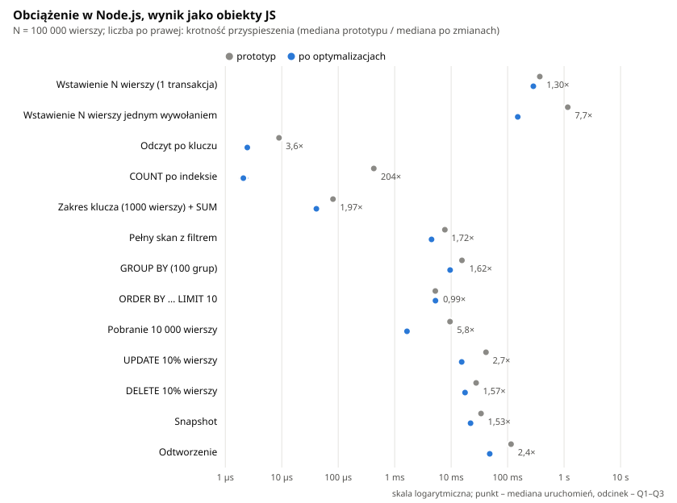
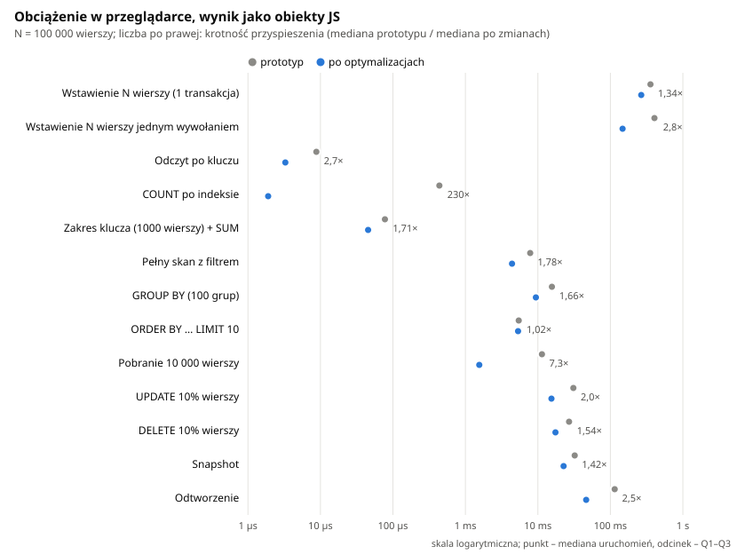
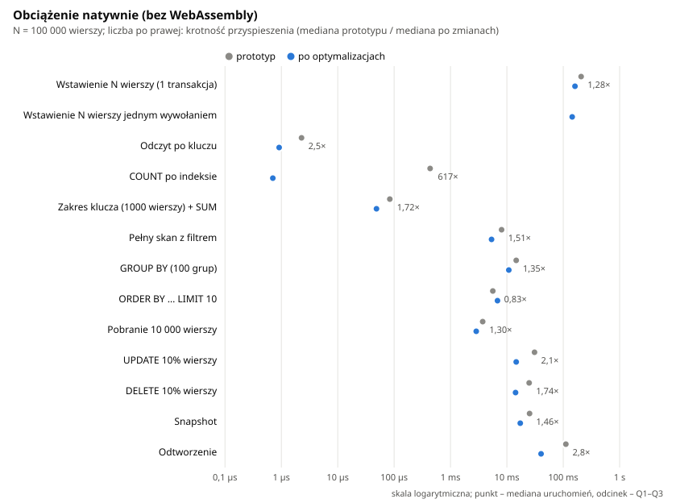
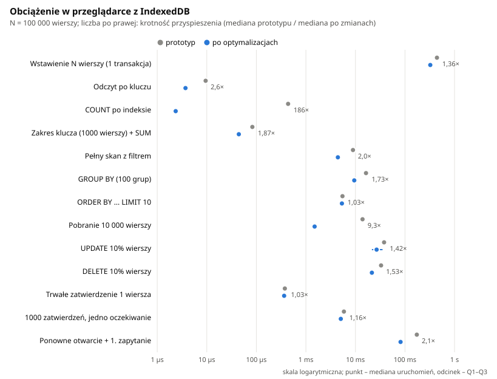
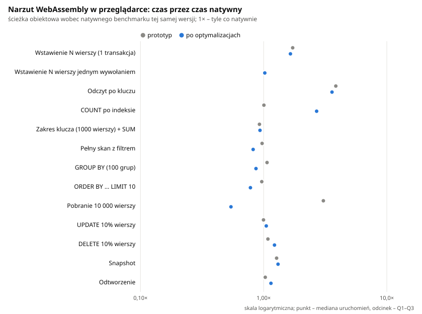
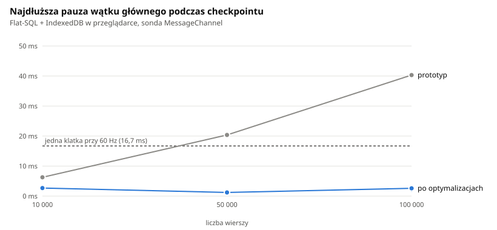

# Benchmark 2 – tabele

Wygenerowano skryptem `make-report.mjs` z surowych wyników w `before/raw` (prototyp, `prototyp`, 261d78fb44) i `after/raw` (wersja po optymalizacjach, `po-2.5`, 45f581d9ff). Obie wersje mierzone tym samym runnerem, uruchomienia naprzemienne, 10 na wersję. Wartość: mediana z uruchomień procesu, w nawiasie pierwszy i trzeci kwartyl. „Zmiana” to zmiana mediany, „krotność” – mediana prototypu przez medianę wersji końcowej, „rozłączne” – czy 95% przedziały ufności średnich są rozłączne.

## Środowisko

| Element | Wartość |
|---|---|
| Data pomiaru | 2026-10-28 – 2026-10-28 |
| Obciążenie procesora przed pomiarem | 6,2% |
| Node.js | v24.21.0 |
| Przeglądarka | Mozilla/5.0 (Windows NT 10.0; Win64; x64) AppleWebKit/537.36 (KHTML, like Gecko) HeadlessChrome/156.0.0.0 Safari/537.36 Edg/156.0.0.0 |
| Moduł WebAssembly (gzip -9) | 219575 B → 274098 B |
| Linux (pliki) | WSL 2 (jądro 6.6.87.2-microsoft-standard-WSL2, Ubuntu 24.04) na tym samym laptopie, katalog tymczasowy /tmp na ext4 (wirtualny dysk WSL na tym samym SSD); CLI obu wersji zbudowane na x86_64-unknown-linux-musl z rust-lld, pakiety WebAssembly skopiowane z kompilacji w Windows (bench/versions); Node.js 24.21.0 jak w Benchmarku 1; skrypt linux.sh |

Wyniki zgodne w obu wersjach: 2100 porównań sum kontrolnych zapytań i stanu tabeli.

## Obciążenie: Flat-SQL (obiekty), Node.js

| Pomiar | Prototyp | Wersja końcowa | Zmiana | Krotność | Rozłączne |
|---|---:|---:|---:|---:|---:|
| Wstawienie N wierszy (1 transakcja) | 371 (369–376) ms | 286 (285–287) ms | −23,1% | 1,30× | tak, mniej |
| Wstawienie N wierszy jednym wywołaniem | 1,16 (1,09–1,19) s | 151 (150–152) ms | −87,0% | 7,7× | tak, mniej |
| Odczyt po kluczu | 8,94 (8,83–9,04) µs | 2,45 (2,44–2,47) µs | −72,6% | 3,6× | tak, mniej |
| COUNT po indeksie | 427 (422–437) µs | 2,09 (1,79–2,46) µs | −99,5% | 204× | tak, mniej |
| Zakres klucza (1000 wierszy) + SUM | 80,8 (79,8–82,6) µs | 41,0 (40,7–41,5) µs | −49,2% | 1,97× | tak, mniej |
| Pełny skan z filtrem | 7,74 (7,71–7,77) ms | 4,49 (4,47–4,52) ms | −41,9% | 1,72× | tak, mniej |
| GROUP BY (100 grup) | 15,5 (15,4–16,1) ms | 9,58 (9,52–9,87) ms | −38,3% | 1,62× | tak, mniej |
| ORDER BY … LIMIT 10 | 5,24 (5,22–5,35) ms | 5,27 (5,23–5,52) ms | +0,6% | 0,99× | nie |
| Pobranie 10 000 wierszy | 9,54 (9,49–9,73) ms | 1,65 (1,64–1,75) ms | −82,7% | 5,8× | tak, mniej |
| UPDATE 10% wierszy | 41,4 (40,6–41,8) ms | 15,4 (15,3–15,5) ms | −62,9% | 2,7× | tak, mniej |
| DELETE 10% wierszy | 27,7 (27,4–28,1) ms | 17,6 (17,5–18,0) ms | −36,3% | 1,57× | tak, mniej |
| Snapshot | 33,8 (33,6–34,3) ms | 22,1 (22,0–22,7) ms | −34,8% | 1,53× | tak, mniej |
| Odtworzenie | 115 (114–116) ms | 48,2 (48,0–48,5) ms | −58,1% | 2,4× | tak, mniej |

## Obciążenie: Flat-SQL (JSON), Node.js

| Pomiar | Prototyp | Wersja końcowa | Zmiana | Krotność | Rozłączne |
|---|---:|---:|---:|---:|---:|
| Wstawienie N wierszy (1 transakcja) | 369 (368–374) ms | 285 (284–287) ms | −22,7% | 1,29× | tak, mniej |
| Wstawienie N wierszy jednym wywołaniem | 990 (945–1007) ms | 151 (150–152) ms | −84,7% | 6,6× | tak, mniej |
| Odczyt po kluczu | 5,36 (5,33–5,41) µs | 4,11 (4,07–4,13) µs | −23,2% | 1,30× | tak, mniej |
| COUNT po indeksie | 416 (413–424) µs | 3,40 (3,06–4,15) µs | −99,2% | 123× | tak, mniej |
| Zakres klucza (1000 wierszy) + SUM | 82,2 (81,2–83,2) µs | 44,1 (43,5–44,8) µs | −46,4% | 1,86× | tak, mniej |
| Pełny skan z filtrem | 7,79 (7,74–7,83) ms | 4,51 (4,48–4,54) ms | −42,2% | 1,73× | tak, mniej |
| GROUP BY (100 grup) | 16,4 (16,3–16,8) ms | 10,0 (9,88–10,1) ms | −39,1% | 1,64× | tak, mniej |
| ORDER BY … LIMIT 10 | 5,27 (5,23–5,37) ms | 5,34 (5,29–5,66) ms | +1,4% | 0,99× | nie |
| Pobranie 10 000 wierszy | 9,48 (9,45–9,55) ms | 8,76 (8,71–8,86) ms | −7,6% | 1,08× | tak, mniej |
| UPDATE 10% wierszy | 31,9 (31,8–32,2) ms | 15,2 (15,2–15,5) ms | −52,3% | 2,1× | tak, mniej |
| DELETE 10% wierszy | 28,9 (27,6–29,1) ms | 17,7 (17,5–17,7) ms | −38,8% | 1,64× | tak, mniej |
| Snapshot | 33,6 (33,2–33,9) ms | 21,5 (21,5–22,4) ms | −35,9% | 1,56× | tak, mniej |
| Odtworzenie | 114 (113–114) ms | 48,2 (47,9–49,0) ms | −57,7% | 2,4× | tak, mniej |

## Obciążenie: Flat-SQL natywnie, natywnie

| Pomiar | Prototyp | Wersja końcowa | Zmiana | Krotność | Rozłączne |
|---|---:|---:|---:|---:|---:|
| Wstawienie N wierszy (1 transakcja) | 208 (207–208) ms | 162 (161–163) ms | −22,2% | 1,28× | tak, mniej |
| Wstawienie N wierszy jednym wywołaniem | – | 144 (143–145) ms | – | – | – |
| Odczyt po kluczu | 2,28 (2,27–2,31) µs | 0,91 (0,90–0,93) µs | −59,9% | 2,5× | tak, mniej |
| COUNT po indeksie | 435 (431–459) µs | 0,71 (0,70–0,71) µs | −99,8% | 617× | tak, mniej |
| Zakres klucza (1000 wierszy) + SUM | 83,9 (81,7–86,5) µs | 48,7 (48,0–49,5) µs | −42,0% | 1,72× | tak, mniej |
| Pełny skan z filtrem | 8,06 (8,03–8,12) ms | 5,35 (5,32–5,40) ms | −33,6% | 1,51× | tak, mniej |
| GROUP BY (100 grup) | 14,6 (14,5–14,8) ms | 10,8 (10,8–10,9) ms | −26,1% | 1,35× | tak, mniej |
| ORDER BY … LIMIT 10 | 5,63 (5,61–5,72) ms | 6,82 (6,79–6,85) ms | +21,0% | 0,83× | tak, więcej |
| Pobranie 10 000 wierszy | 3,72 (3,70–3,76) ms | 2,86 (2,84–2,88) ms | −23,2% | 1,30× | tak, mniej |
| UPDATE 10% wierszy | 30,9 (30,8–31,1) ms | 14,6 (14,5–14,8) ms | −52,7% | 2,1× | tak, mniej |
| DELETE 10% wierszy | 24,8 (24,8–25,4) ms | 14,3 (14,2–14,5) ms | −42,6% | 1,74× | tak, mniej |
| Snapshot | 25,3 (25,2–25,4) ms | 17,3 (17,1–17,4) ms | −31,6% | 1,46× | tak, mniej |
| Odtworzenie | 111 (111–112) ms | 40,4 (40,0–40,9) ms | −63,7% | 2,8× | tak, mniej |

## Obciążenie: Flat-SQL (obiekty), przeglądarka

| Pomiar | Prototyp | Wersja końcowa | Zmiana | Krotność | Rozłączne |
|---|---:|---:|---:|---:|---:|
| Wstawienie N wierszy (1 transakcja) | 357 (355–361) ms | 267 (266–269) ms | −25,4% | 1,34× | tak, mniej |
| Wstawienie N wierszy jednym wywołaniem | 405 (403–426) ms | 147 (146–148) ms | −63,7% | 2,8× | tak, mniej |
| Odczyt po kluczu | 8,78 (8,72–8,90) µs | 3,28 (3,15–3,30) µs | −62,7% | 2,7× | tak, mniej |
| COUNT po indeksie | 437 (428–449) µs | 1,90 (1,84–1,93) µs | −99,6% | 230× | tak, mniej |
| Zakres klucza (1000 wierszy) + SUM | 77,6 (77,4–79,5) µs | 45,5 (43,7–47,1) µs | −41,4% | 1,71× | tak, mniej |
| Pełny skan z filtrem | 7,83 (7,78–7,90) ms | 4,40 (4,39–4,42) ms | −43,9% | 1,78× | tak, mniej |
| GROUP BY (100 grup) | 15,6 (15,4–15,7) ms | 9,38 (9,28–9,53) ms | −39,9% | 1,66× | tak, mniej |
| ORDER BY … LIMIT 10 | 5,44 (5,38–5,56) ms | 5,33 (5,29–5,39) ms | −2,1% | 1,02× | nie |
| Pobranie 10 000 wierszy | 11,4 (11,3–11,4) ms | 1,55 (1,49–1,60) ms | −86,3% | 7,3× | tak, mniej |
| UPDATE 10% wierszy | 30,9 (30,7–31,1) ms | 15,4 (15,1–15,8) ms | −50,1% | 2,0× | tak, mniej |
| DELETE 10% wierszy | 26,9 (26,6–27,5) ms | 17,5 (17,0–18,2) ms | −35,1% | 1,54× | tak, mniej |
| Snapshot | 32,2 (31,8–32,3) ms | 22,6 (22,2–23,0) ms | −29,8% | 1,42× | tak, mniej |
| Odtworzenie | 115 (114–116) ms | 46,4 (46,1–46,9) ms | −59,6% | 2,5× | tak, mniej |

## Obciążenie: Flat-SQL (JSON), przeglądarka

| Pomiar | Prototyp | Wersja końcowa | Zmiana | Krotność | Rozłączne |
|---|---:|---:|---:|---:|---:|
| Wstawienie N wierszy (1 transakcja) | 334 (332–336) ms | 269 (266–271) ms | −19,5% | 1,24× | tak, mniej |
| Wstawienie N wierszy jednym wywołaniem | 401 (397–404) ms | 146 (145–146) ms | −63,7% | 2,8× | tak, mniej |
| Odczyt po kluczu | 5,50 (5,47–5,54) µs | 4,16 (4,13–4,25) µs | −24,4% | 1,32× | tak, mniej |
| COUNT po indeksie | 427 (423–440) µs | 2,88 (2,87–2,90) µs | −99,3% | 148× | tak, mniej |
| Zakres klucza (1000 wierszy) + SUM | 77,3 (76,6–77,6) µs | 47,4 (45,9–49,0) µs | −38,6% | 1,63× | tak, mniej |
| Pełny skan z filtrem | 7,79 (7,75–7,81) ms | 4,45 (4,43–4,54) ms | −42,9% | 1,75× | tak, mniej |
| GROUP BY (100 grup) | 15,4 (15,3–15,5) ms | 9,77 (9,71–9,80) ms | −36,6% | 1,58× | tak, mniej |
| ORDER BY … LIMIT 10 | 5,42 (5,35–5,50) ms | 5,35 (5,33–5,36) ms | −1,3% | 1,01× | tak, mniej |
| Pobranie 10 000 wierszy | 7,80 (7,76–7,84) ms | 7,06 (7,01–7,11) ms | −9,5% | 1,10× | tak, mniej |
| UPDATE 10% wierszy | 30,7 (30,5–30,9) ms | 15,0 (14,8–15,4) ms | −51,1% | 2,0× | tak, mniej |
| DELETE 10% wierszy | 26,8 (26,6–27,1) ms | 17,6 (17,0–17,6) ms | −34,5% | 1,53× | tak, mniej |
| Snapshot | 32,5 (32,3–33,1) ms | 21,6 (21,2–21,9) ms | −33,5% | 1,50× | tak, mniej |
| Odtworzenie | 115 (114–116) ms | 46,7 (46,4–47,1) ms | −59,5% | 2,5× | tak, mniej |

## Obciążenie: Flat-SQL + IndexedDB, przeglądarka

| Pomiar | Prototyp | Wersja końcowa | Zmiana | Krotność | Rozłączne |
|---|---:|---:|---:|---:|---:|
| Wstawienie N wierszy (1 transakcja) | 442 (436–452) ms | 324 (323–366) ms | −26,6% | 1,36× | tak, mniej |
| Odczyt po kluczu | 9,47 (9,44–9,54) µs | 3,71 (3,62–3,88) µs | −60,8% | 2,6× | tak, mniej |
| COUNT po indeksie | 437 (433–451) µs | 2,36 (2,31–2,38) µs | −99,5% | 186× | tak, mniej |
| Zakres klucza (1000 wierszy) + SUM | 83,0 (82,0–85,5) µs | 44,3 (43,9–44,5) µs | −46,7% | 1,87× | tak, mniej |
| Pełny skan z filtrem | 8,92 (8,87–8,97) ms | 4,42 (4,40–4,45) ms | −50,4% | 2,0× | tak, mniej |
| GROUP BY (100 grup) | 16,3 (16,2–16,9) ms | 9,47 (9,40–9,49) ms | −42,0% | 1,73× | tak, mniej |
| ORDER BY … LIMIT 10 | 5,47 (5,41–5,53) ms | 5,33 (5,32–5,34) ms | −2,6% | 1,03× | tak, mniej |
| Pobranie 10 000 wierszy | 13,9 (13,8–14,1) ms | 1,50 (1,39–1,69) ms | −89,2% | 9,3× | tak, mniej |
| UPDATE 10% wierszy | 37,9 (37,0–39,4) ms | 26,8 (22,0–34,5) ms | −29,3% | 1,42× | nie |
| DELETE 10% wierszy | 32,9 (32,5–33,2) ms | 21,5 (21,3–22,3) ms | −34,8% | 1,53× | tak, mniej |
| Trwałe zatwierdzenie 1 wiersza | 376 (364–399) µs | 364 (354–375) µs | −3,3% | 1,03× | nie |
| 1000 zatwierdzeń, jedno oczekiwanie | 5,86 (5,78–6,02) ms | 5,07 (5,02–5,13) ms | −13,5% | 1,16× | tak, mniej |
| Ponowne otwarcie + 1. zapytanie | 173 (172–174) ms | 81,4 (81,3–81,6) ms | −53,0% | 2,1× | tak, mniej |

## Obciążenie: Flat-SQL + IndexedDB (strict), przeglądarka

| Pomiar | Prototyp | Wersja końcowa | Zmiana | Krotność | Rozłączne |
|---|---:|---:|---:|---:|---:|
| Wstawienie N wierszy (1 transakcja) | 453 (445–454) ms | 334 (331–336) ms | −26,3% | 1,36× | tak, mniej |
| Odczyt po kluczu | 9,59 (9,45–9,70) µs | 3,63 (3,57–3,72) µs | −62,1% | 2,6× | tak, mniej |
| COUNT po indeksie | 442 (437–453) µs | 2,31 (2,28–2,33) µs | −99,5% | 192× | tak, mniej |
| Zakres klucza (1000 wierszy) + SUM | 82,5 (80,5–83,4) µs | 44,0 (43,6–46,0) µs | −46,6% | 1,87× | tak, mniej |
| Pełny skan z filtrem | 8,94 (8,89–9,05) ms | 4,43 (4,40–4,43) ms | −50,5% | 2,0× | tak, mniej |
| GROUP BY (100 grup) | 16,2 (16,0–16,4) ms | 9,48 (9,41–9,52) ms | −41,3% | 1,70× | tak, mniej |
| ORDER BY … LIMIT 10 | 5,46 (5,43–5,48) ms | 5,29 (5,26–5,30) ms | −3,1% | 1,03× | tak, mniej |
| Pobranie 10 000 wierszy | 13,9 (13,9–14,0) ms | 1,40 (1,38–1,56) ms | −90,0% | 10,0× | tak, mniej |
| UPDATE 10% wierszy | 40,1 (38,8–44,7) ms | 31,8 (27,1–36,7) ms | −20,7% | 1,26× | nie |
| DELETE 10% wierszy | 34,3 (34,0–34,7) ms | 23,4 (22,9–23,5) ms | −31,8% | 1,47× | tak, mniej |
| Trwałe zatwierdzenie 1 wiersza | 975 (956–1048) µs | 979 (957–1032) µs | +0,5% | 1,00× | nie |
| 1000 zatwierdzeń, jedno oczekiwanie | 6,62 (6,35–6,81) ms | 5,89 (5,69–5,94) ms | −11,0% | 1,12× | tak, mniej |
| Ponowne otwarcie + 1. zapytanie | 173 (172–175) ms | 81,4 (81,1–81,6) ms | −53,0% | 2,1× | tak, mniej |

## Obciążenie: Flat-SQL w Workerze (pamięć), przeglądarka

| Pomiar | Prototyp | Wersja końcowa | Zmiana | Krotność | Rozłączne |
|---|---:|---:|---:|---:|---:|
| Wstawienie N wierszy (1 transakcja) | 350 (348–353) ms | 271 (269–274) ms | −22,4% | 1,29× | tak, mniej |
| Odczyt po kluczu | 59,2 (57,3–60,1) µs | 48,1 (46,1–48,6) µs | −18,7% | 1,23× | tak, mniej |
| COUNT po indeksie | 566 (558–569) µs | 45,8 (43,2–48,5) µs | −91,9% | 12× | tak, mniej |
| Zakres klucza (1000 wierszy) + SUM | 142 (135–147) µs | 96,7 (93,0–100) µs | −31,7% | 1,46× | tak, mniej |
| Pełny skan z filtrem | 8,52 (8,45–8,57) ms | 5,21 (5,09–5,30) ms | −38,8% | 1,63× | tak, mniej |
| GROUP BY (100 grup) | 18,1 (18,0–18,4) ms | 10,6 (10,5–10,8) ms | −41,0% | 1,70× | tak, mniej |
| ORDER BY … LIMIT 10 | 6,05 (5,95–6,11) ms | 6,13 (5,99–6,21) ms | +1,3% | 0,99× | nie |
| Pobranie 10 000 wierszy | 23,2 (23,1–23,4) ms | 13,5 (13,4–13,6) ms | −41,6% | 1,71× | tak, mniej |
| UPDATE 10% wierszy | 34,0 (33,8–34,8) ms | 15,8 (15,6–15,9) ms | −53,7% | 2,2× | tak, mniej |
| DELETE 10% wierszy | 27,1 (26,6–27,9) ms | 17,7 (17,4–18,1) ms | −34,8% | 1,53× | tak, mniej |

## Obciążenie: Flat-SQL w Workerze + IndexedDB, przeglądarka

| Pomiar | Prototyp | Wersja końcowa | Zmiana | Krotność | Rozłączne |
|---|---:|---:|---:|---:|---:|
| Wstawienie N wierszy (1 transakcja) | 449 (448–454) ms | 332 (327–337) ms | −26,1% | 1,35× | tak, mniej |
| Odczyt po kluczu | 59,4 (58,2–61,2) µs | 49,2 (47,6–50,5) µs | −17,1% | 1,21× | tak, mniej |
| COUNT po indeksie | 561 (545–571) µs | 46,8 (43,6–48,4) µs | −91,7% | 12× | tak, mniej |
| Zakres klucza (1000 wierszy) + SUM | 139 (136–155) µs | 95,9 (89,8–97,6) µs | −31,2% | 1,45× | tak, mniej |
| Pełny skan z filtrem | 9,50 (9,46–9,54) ms | 5,47 (5,31–5,52) ms | −42,5% | 1,74× | tak, mniej |
| GROUP BY (100 grup) | 17,3 (16,8–18,5) ms | 10,7 (10,6–10,7) ms | −38,2% | 1,62× | tak, mniej |
| ORDER BY … LIMIT 10 | 6,02 (5,94–6,13) ms | 6,39 (6,20–6,56) ms | +6,2% | 0,94× | nie |
| Pobranie 10 000 wierszy | 25,7 (25,6–26,1) ms | 13,8 (13,5–13,9) ms | −46,1% | 1,86× | tak, mniej |
| UPDATE 10% wierszy | 43,9 (41,9–53,6) ms | 25,7 (20,9–32,4) ms | −41,5% | 1,71× | nie |
| DELETE 10% wierszy | 32,6 (32,4–33,4) ms | 21,6 (21,1–22,1) ms | −33,9% | 1,51× | tak, mniej |
| Trwałe zatwierdzenie 1 wiersza | 419 (397–427) µs | 448 (424–465) µs | +7,0% | 0,93× | nie |
| 1000 zatwierdzeń, jedno oczekiwanie | 6,15 (6,03–6,27) ms | 5,21 (5,15–5,27) ms | −15,3% | 1,18× | tak, mniej |
| Ponowne otwarcie + 1. zapytanie | 179 (177–180) ms | 88,7 (86,9–89,5) ms | −50,3% | 2,0× | tak, mniej |

## Narzut WebAssembly: krotność czasu natywnego

| Operacja | Node.js obiekty: prototyp | po | Node.js JSON: prototyp | po | przeglądarka obiekty: prototyp | po | przeglądarka JSON: prototyp | po |
|---|---:|---:|---:|---:|---:|---:|---:|---:|
| Wstawienie N wierszy (1 transakcja) | 1,79× | 1,77× | 1,78× | 1,77× | 1,72× | 1,65× | 1,61× | 1,66× |
| Wstawienie N wierszy jednym wywołaniem | – | 1,05× | – | 1,05× | – | 1,02× | – | 1,01× |
| Odczyt po kluczu | 3,9× | 2,7× | 2,4× | 4,5× | 3,9× | 3,6× | 2,4× | 4,6× |
| COUNT po indeksie | 0,98× | 3,0× | 0,96× | 4,8× | 1,01× | 2,7× | 0,98× | 4,1× |
| Zakres klucza (1000 wierszy) + SUM | 0,96× | 0,84× | 0,98× | 0,91× | 0,92× | 0,93× | 0,92× | 0,97× |
| Pełny skan z filtrem | 0,96× | 0,84× | 0,97× | 0,84× | 0,97× | 0,82× | 0,97× | 0,83× |
| GROUP BY (100 grup) | 1,06× | 0,89× | 1,12× | 0,92× | 1,07× | 0,87× | 1,05× | 0,90× |
| ORDER BY … LIMIT 10 | 0,93× | 0,77× | 0,94× | 0,78× | 0,97× | 0,78× | 0,96× | 0,78× |
| Pobranie 10 000 wierszy | 2,6× | 0,58× | 2,5× | 3,1× | 3,1× | 0,54× | 2,1× | 2,5× |
| UPDATE 10% wierszy | 1,34× | 1,05× | 1,03× | 1,04× | 1,00× | 1,05× | 0,99× | 1,02× |
| DELETE 10% wierszy | 1,11× | 1,24× | 1,16× | 1,24× | 1,08× | 1,23× | 1,08× | 1,23× |
| Snapshot | 1,34× | 1,28× | 1,33× | 1,25× | 1,27× | 1,31× | 1,29× | 1,25× |
| Odtworzenie | 1,03× | 1,19× | 1,02× | 1,19× | 1,03× | 1,15× | 1,04× | 1,16× |

## Zimny start

### Flat-SQL (obiekty), Node.js

| Pomiar | Prototyp | Wersja końcowa | Zmiana | Krotność | Rozłączne |
|---|---:|---:|---:|---:|---:|
| Import i inicjalizacja modułu | 43,4 (42,9–44,0) ms | 46,5 (45,5–47,4) ms | +7,3% | 0,93× | tak, więcej |
| Otwarcie bazy | 6,32 (6,24–6,59) ms | 5,60 (5,52–5,80) ms | −11,4% | 1,13× | tak, mniej |
| Pierwsze zapytanie | 3,93 (3,88–4,10) ms | 6,25 (6,22–6,30) ms | +59,0% | 0,63× | tak, więcej |
| Razem | 53,9 (53,1–54,8) ms | 58,3 (57,4–59,3) ms | +8,3% | 0,92× | tak, więcej |

### Flat-SQL (JSON), Node.js

| Pomiar | Prototyp | Wersja końcowa | Zmiana | Krotność | Rozłączne |
|---|---:|---:|---:|---:|---:|
| Import i inicjalizacja modułu | 43,1 (42,4–43,7) ms | 45,8 (44,9–46,2) ms | +6,3% | 0,94× | tak, więcej |
| Otwarcie bazy | 6,34 (6,26–6,46) ms | 5,51 (5,48–5,60) ms | −13,1% | 1,15× | tak, mniej |
| Pierwsze zapytanie | 4,30 (4,24–4,42) ms | 6,67 (6,61–6,81) ms | +55,0% | 0,65× | tak, więcej |
| Razem | 53,9 (53,7–54,2) ms | 57,9 (57,1–58,5) ms | +7,4% | 0,93× | tak, więcej |

### Flat-SQL (obiekty), przeglądarka

| Pomiar | Prototyp | Wersja końcowa | Zmiana | Krotność | Rozłączne |
|---|---:|---:|---:|---:|---:|
| Import i inicjalizacja modułu | 32,9 (29,4–36,2) ms | 38,0 (33,7–40,9) ms | +15,4% | 0,87× | nie |
| Otwarcie bazy | 5,79 (5,71–6,64) ms | 4,44 (4,37–4,82) ms | −23,4% | 1,31× | tak, mniej |
| Pierwsze zapytanie | 3,78 (3,56–3,92) ms | 5,55 (5,39–5,80) ms | +46,7% | 0,68× | tak, więcej |
| Razem | 42,5 (39,6–45,9) ms | 49,0 (43,4–51,1) ms | +15,3% | 0,87× | nie |
| Pobrane pliki (gzip) | 230 KiB | 287 KiB | +24,7% | 0,80× | tak, więcej |

### Flat-SQL + IndexedDB, przeglądarka

| Pomiar | Prototyp | Wersja końcowa | Zmiana | Krotność | Rozłączne |
|---|---:|---:|---:|---:|---:|
| Import i inicjalizacja modułu | 35,4 (33,4–36,3) ms | 45,3 (38,0–50,4) ms | +28,1% | 0,78× | nie |
| Otwarcie bazy | 40,1 (38,2–41,7) ms | 40,7 (37,4–41,7) ms | +1,7% | 0,98× | nie |
| Pierwsze zapytanie | 4,01 (3,86–4,11) ms | 6,07 (5,86–6,40) ms | +51,2% | 0,66× | tak, więcej |
| Razem | 80,8 (77,4–81,1) ms | 90,5 (84,7–96,2) ms | +12,0% | 0,89× | nie |
| Pobrane pliki (gzip) | 230 KiB | 287 KiB | +24,7% | 0,80× | tak, więcej |

### Flat-SQL w Workerze (pamięć), przeglądarka

| Pomiar | Prototyp | Wersja końcowa | Zmiana | Krotność | Rozłączne |
|---|---:|---:|---:|---:|---:|
| Import i inicjalizacja modułu | 55,8 (49,2–63,7) ms | 63,5 (49,3–66,6) ms | +13,7% | 0,88× | nie |
| Otwarcie bazy | 6,33 (5,66–6,88) ms | 4,99 (4,69–5,24) ms | −21,2% | 1,27× | tak, mniej |
| Pierwsze zapytanie | 4,78 (4,34–5,29) ms | 6,86 (6,22–7,07) ms | +43,4% | 0,70× | tak, więcej |
| Razem | 68,4 (59,6–75,5) ms | 76,2 (60,7–78,7) ms | +11,3% | 0,90× | nie |
| Pobrane pliki (gzip) | 230 KiB | 287 KiB | +24,7% | 0,80× | tak, więcej |

## Pamięć liniowa WebAssembly po wczytaniu N wierszy

| Pomiar | Prototyp | Wersja końcowa | Zmiana |
|---|---:|---:|---:|
| Flat-SQL (obiekty), Node.js | 73,3 MiB | 51,8 MiB | −29,3% |
| Flat-SQL (JSON), Node.js | 73,3 MiB | 51,8 MiB | −29,3% |
| Flat-SQL (obiekty), przeglądarka | 73,3 MiB | 51,8 MiB | −29,3% |
| Flat-SQL (JSON), przeglądarka | 73,3 MiB | 51,8 MiB | −29,3% |

## Pauza checkpointu (przeglądarka)

### Flat-SQL + IndexedDB

| Pomiar | Prototyp | Wersja końcowa | Zmiana | Krotność | Rozłączne |
|---|---:|---:|---:|---:|---:|
| najdłuższa przerwa w bezczynności | 2,09 (1,92–2,31) ms | 2,11 (2,01–2,22) ms | +0,8% | 0,99× | nie |
| najdłuższa pauza, 10 000 wierszy | 6,27 (6,11–6,80) ms | 2,69 (2,46–2,92) ms | −57,2% | 2,3× | tak, mniej |
| cały checkpoint, 10 000 wierszy | 10,8 (10,4–12,1) ms | 10,4 (9,77–11,1) ms | −3,8% | 1,04× | nie |
| najdłuższa pauza, 50 000 wierszy | 20,4 (20,1–20,5) ms | 1,22 (1,12–1,39) ms | −94,0% | 17× | tak, mniej |
| cały checkpoint, 50 000 wierszy | 25,7 (25,5–26,3) ms | 19,2 (18,8–19,5) ms | −25,3% | 1,34× | tak, mniej |
| najdłuższa pauza, 100 000 wierszy | 40,3 (39,9–40,9) ms | 2,60 (1,50–3,29) ms | −93,6% | 16× | tak, mniej |
| cały checkpoint, 100 000 wierszy | 47,9 (47,2–48,2) ms | 35,6 (35,0–36,9) ms | −25,5% | 1,34× | nie |

### Flat-SQL + IndexedDB (strict)

| Pomiar | Prototyp | Wersja końcowa | Zmiana | Krotność | Rozłączne |
|---|---:|---:|---:|---:|---:|
| najdłuższa przerwa w bezczynności | 2,14 (2,10–2,66) ms | 2,19 (2,10–2,57) ms | +2,7% | 0,97× | nie |
| najdłuższa pauza, 10 000 wierszy | 6,23 (6,09–6,58) ms | 2,56 (2,30–2,70) ms | −58,9% | 2,4× | tak, mniej |
| cały checkpoint, 10 000 wierszy | 12,2 (12,2–13,1) ms | 11,8 (11,3–12,3) ms | −3,7% | 1,04× | nie |
| najdłuższa pauza, 50 000 wierszy | 20,6 (20,4–20,8) ms | 1,68 (1,46–1,87) ms | −91,8% | 12× | tak, mniej |
| cały checkpoint, 50 000 wierszy | 28,4 (28,1–29,1) ms | 22,7 (22,3–23,4) ms | −20,2% | 1,25× | tak, mniej |
| najdłuższa pauza, 100 000 wierszy | 40,0 (39,6–40,3) ms | 1,56 (1,49–2,57) ms | −96,1% | 26× | tak, mniej |
| cały checkpoint, 100 000 wierszy | 51,9 (51,5–53,3) ms | 40,1 (38,9–41,6) ms | −22,8% | 1,30× | tak, mniej |

## Local-First a Cloud-First

### Node.js

| Pomiar | Prototyp | Wersja końcowa | Zmiana | Krotność | Rozłączne |
|---|---:|---:|---:|---:|---:|
| local (WASM, in-process) | 14,5 (14,4–14,9) µs | 10,1 (9,60–10,4) µs | −30,7% | 1,44× | tak, mniej |
| cloud API (localhost HTTP) | 599 (580–608) µs | 666 (641–716) µs | +11,2% | 0,90× | tak, więcej |
| cloud API (+20 ms RTT) | 20,8 (20,8–20,8) ms | 20,8 (20,8–20,8) ms | +0,1% | 1,00× | nie |
| cloud API (+50 ms RTT) | 50,8 (50,7–50,8) ms | 50,8 (50,7–50,8) ms | −0,0% | 1,00× | nie |
| cloud API (+100 ms RTT) | 101 (101–101) ms | 101 (101–101) ms | +0,0% | 1,00× | nie |

### przeglądarka

| Pomiar | Prototyp | Wersja końcowa | Zmiana | Krotność | Rozłączne |
|---|---:|---:|---:|---:|---:|
| local (WASM, in-process) | 14,2 (12,7–14,8) µs | 14,2 (12,6–15,5) µs | −0,3% | 1,00× | nie |
| cloud API (localhost HTTP) | 2,53 (2,41–2,58) ms | 2,55 (2,45–2,60) ms | +0,9% | 0,99× | nie |
| cloud API (+20 ms RTT) | 22,9 (22,8–23,0) ms | 22,9 (22,8–22,9) ms | −0,3% | 1,00× | nie |
| cloud API (+50 ms RTT) | 53,0 (52,9–53,0) ms | 52,9 (52,9–53,0) ms | −0,1% | 1,00× | nie |
| cloud API (+100 ms RTT) | 103 (103–103) ms | 103 (103–103) ms | +0,1% | 1,00× | nie |

## Zapis plików (fsync)

### Node.js

| Pomiar | Prototyp | Wersja końcowa | Zmiana | Krotność | Rozłączne |
|---|---:|---:|---:|---:|---:|
| FsStore fsync checkpoint | 47,1 (46,4–47,8) ms | 37,3 (36,6–44,1) ms | −20,8% | 1,26× | tak, mniej |
| FsStore fsync commit_group | 6,86 (6,69–6,95) ms | 5,79 (5,62–5,87) ms | −15,6% | 1,18× | tak, mniej |
| FsStore fsync commit_single | 1,36 (1,29–1,39) ms | 677 (668–710) µs | −50,0% | 2,0× | tak, mniej |
| FsStore fsync insert | 579 (578–586) ms | 388 (386–394) ms | −33,0% | 1,49× | tak, mniej |
| FsStore fsync reopen | 111 (110–111) ms | 52,2 (51,9–52,5) ms | −52,9% | 2,1× | tak, mniej |
| FsStore nofsync checkpoint | 47,1 (46,0–47,6) ms | 34,0 (33,1–34,7) ms | −28,0% | 1,39× | tak, mniej |
| FsStore nofsync commit_group | 5,28 (5,16–5,52) ms | 3,84 (3,81–3,91) ms | −27,3% | 1,38× | tak, mniej |
| FsStore nofsync commit_single | 585 (562–600) µs | 77,7 (75,5–84,1) µs | −86,7% | 7,5× | tak, mniej |
| FsStore nofsync insert | 388 (384–390) ms | 337 (335–337) ms | −13,2% | 1,15× | tak, mniej |
| FsStore nofsync reopen | 98,8 (98,5–100) ms | 41,4 (40,9–41,8) ms | −58,1% | 2,4× | tak, mniej |
| sync round durableServer | 632 (621–668) µs | 640 (621–652) µs | +1,4% | 0,99× | nie |
| sync round memoryServer | 528 (522–530) µs | 527 (515–547) µs | −0,2% | 1,00× | nie |

### natywnie

| Pomiar | Prototyp | Wersja końcowa | Zmiana | Krotność | Rozłączne |
|---|---:|---:|---:|---:|---:|
| FileStorage fsync checkpoint | 38,7 (38,2–39,2) ms | 29,8 (29,4–33,6) ms | −22,9% | 1,30× | tak, mniej |
| FileStorage fsync commit_group | 3,43 (3,37–3,45) ms | 2,78 (2,76–2,92) ms | −18,8% | 1,23× | tak, mniej |
| FileStorage fsync commit_single | 485 (481–491) µs | 491 (488–496) µs | +1,2% | 0,99× | nie |
| FileStorage fsync insert | 255 (254–257) ms | 202 (201–202) ms | −20,9% | 1,26× | tak, mniej |
| FileStorage fsync reopen | 118 (118–119) ms | 45,9 (45,7–46,2) ms | −61,1% | 2,6× | tak, mniej |
| FileStorage nofsync checkpoint | 38,0 (37,5–46,6) ms | 29,0 (28,3–32,2) ms | −23,6% | 1,31× | tak, mniej |
| FileStorage nofsync commit_group | 2,82 (2,72–2,86) ms | 2,20 (2,09–2,21) ms | −22,1% | 1,28× | tak, mniej |
| FileStorage nofsync commit_single | 9,98 (9,52–10,1) µs | 9,23 (9,08–10,3) µs | −7,6% | 1,08× | nie |
| FileStorage nofsync insert | 254 (251–256) ms | 193 (192–194) ms | −23,9% | 1,31× | tak, mniej |
| FileStorage nofsync reopen | 118 (117–119) ms | 45,7 (45,2–45,8) ms | −61,3% | 2,6× | tak, mniej |

### Node.js, Linux

| Pomiar | Prototyp | Wersja końcowa | Zmiana | Krotność | Rozłączne |
|---|---:|---:|---:|---:|---:|
| FsStore fsync checkpoint | 72,9 (72,5–77,1) ms | 56,3 (54,3–57,4) ms | −22,7% | 1,29× | tak, mniej |
| FsStore fsync commit_group | 9,75 (9,56–10,00) ms | 8,93 (8,63–9,20) ms | −8,4% | 1,09× | nie |
| FsStore fsync commit_single | 2,68 (2,63–2,71) ms | 2,47 (2,39–2,52) ms | −7,9% | 1,09× | nie |
| FsStore fsync insert | 590 (586–602) ms | 463 (448–466) ms | −21,5% | 1,27× | tak, mniej |
| FsStore fsync reopen | 123 (122–124) ms | 58,8 (58,3–59,4) ms | −52,1% | 2,1× | tak, mniej |
| FsStore nofsync checkpoint | 71,6 (67,7–73,5) ms | 53,5 (48,4–56,9) ms | −25,2% | 1,34× | tak, mniej |
| FsStore nofsync commit_group | 4,80 (4,72–5,02) ms | 3,83 (3,71–3,90) ms | −20,2% | 1,25× | nie |
| FsStore nofsync commit_single | 368 (356–388) µs | 161 (146–169) µs | −56,2% | 2,3× | tak, mniej |
| FsStore nofsync insert | 427 (419–430) ms | 368 (366–379) ms | −13,7% | 1,16× | tak, mniej |
| FsStore nofsync reopen | 113 (110–115) ms | 48,9 (47,1–49,6) ms | −56,6% | 2,3× | tak, mniej |
| sync round durableServer | 694 (681–700) µs | 682 (664–694) µs | −1,7% | 1,02× | nie |
| sync round memoryServer | 578 (543–626) µs | 558 (544–590) µs | −3,4% | 1,04× | nie |

### natywnie, Linux

| Pomiar | Prototyp | Wersja końcowa | Zmiana | Krotność | Rozłączne |
|---|---:|---:|---:|---:|---:|
| FileStorage fsync checkpoint | 52,6 (51,9–53,2) ms | 42,8 (41,8–44,8) ms | −18,7% | 1,23× | tak, mniej |
| FileStorage fsync commit_group | 7,39 (7,10–7,82) ms | 6,07 (5,46–6,21) ms | −18,0% | 1,22× | tak, mniej |
| FileStorage fsync commit_single | 1,97 (1,93–2,00) ms | 2,05 (1,91–2,09) ms | +4,0% | 0,96× | nie |
| FileStorage fsync insert | 324 (321–329) ms | 246 (244–251) ms | −24,1% | 1,32× | tak, mniej |
| FileStorage fsync reopen | 152 (150–154) ms | 72,2 (71,6–72,5) ms | −52,4% | 2,1× | tak, mniej |
| FileStorage nofsync checkpoint | 50,5 (49,5–50,8) ms | 41,7 (40,1–42,2) ms | −17,4% | 1,21× | tak, mniej |
| FileStorage nofsync commit_group | 3,60 (3,55–3,69) ms | 2,39 (2,36–2,42) ms | −33,7% | 1,51× | tak, mniej |
| FileStorage nofsync commit_single | 8,25 (8,09–8,57) µs | 6,28 (6,18–6,34) µs | −23,9% | 1,31× | tak, mniej |
| FileStorage nofsync insert | 317 (312–322) ms | 247 (243–249) ms | −21,9% | 1,28× | tak, mniej |
| FileStorage nofsync reopen | 150 (150–152) ms | 70,4 (69,7–70,8) ms | −53,2% | 2,1× | tak, mniej |

## Wykresy

